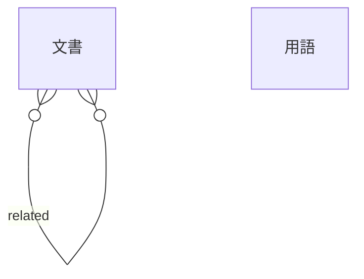

<!-- source-hash: sha256:21f4398fa6a6a9847649031366a430b3e824a38c4f12d84e0b1e5b56e77a485d -->
# ER 図: 索引

使う側が文書のメタデータと用語を書く YAML の索引。場所は設定の `index` で決め、使う側が読んだオブジェクトを `mount`・`render`・`collectReferences`・`checkIndex` に渡す。形は `schemas/mdmark.index.schema.json`（JSON Schema draft 2020-12）で縛る。

## 概要

データストアは YAML の 1 ファイル。最上位は `schema`（索引の版。整数で今は `1`、必須）・`docs`（文書の並び、必須）・`terms`（用語の並び、任意）の 3 つのキーを持ち、ほかのキーは拒む。索引の版を上げる移行は #10 が持つ

## ER 図

下の表から生成

| 名前 |
| --- |
| 文書 |
| 用語 |

| 元 | 先 | 多重度 | ラベル |
| --- | --- | --- | --- |
| 文書 | 文書 | }o--o{ | related |

## テーブル

### docs

docs

文書

YAML

索引に載せた文書 1 つのメタデータ

id

~1000

全件

#### カラム

| 物理名 | 論理名 | 型 | NOT NULL | 主キー | 一意 | 検査制約 | 既定 | 説明 | 例 | 補足 |
| --- | --- | --- | --- | --- | --- | --- | --- | --- | --- | --- |
| id | ID | string | ✅ | ✅ | ✅ | 空でない | - | 文書の ID。索引の `docs` の中で一意 | arch | - |
| path | パス | string | ✅ | - | ✅ | 空でない。区切りは `/` | - | 文書のパス。索引のファイルからの相対パス | 設計/arch.md | - |
| title | 題 | string | ✅ | - | - | 空でない | - | 文書の題。関連文書のリンクの文字に出す | アーキテクチャ | - |
| description | 概要 | string | - | - | - | - | - | 1 文の概要。ツールチップの関連文書と MCP の `find_docs`（#11）に出す | 全体の構成と依存の向き | - |
| aliases | 別名 | array | - | - | - | - | `[]` | 本文での呼び名。本文に出たら、その語のツールチップの関連文書にこの文書を出し、被参照にも数える | [構成図] | 要素は空でない文字列 |
| tags | タグ | array | - | - | - | - | `[]` | タグ。MCP の `find_docs`（#11）が絞り込みに使う | [設計] | 要素は空でない文字列 |
| related | 関連する文書 | array | - | - | - | - | `[]` | 関連する文書の `id`。この文書からその文書への参照として数える | [api] | 索引に無い `id` は `checkIndex` が `broken_ref` で知らせる |

### terms

terms

用語

YAML

索引に載せた用語 1 つ。本文に出たら意味のツールチップを付ける

id

~1000

全件

#### カラム

| 物理名 | 論理名 | 型 | NOT NULL | 主キー | 一意 | 検査制約 | 既定 | 説明 | 例 | 補足 |
| --- | --- | --- | --- | --- | --- | --- | --- | --- | --- | --- |
| id | ID | string | ✅ | ✅ | ✅ | 空でない | - | 用語の ID。索引の `terms` の中で一意。節ごとに最初の 1 回を数える単位 | workspace | - |
| term | 用語 | string | ✅ | - | - | 空でない | - | 用語の語 | ワークスペース | - |
| aliases | 別名 | array | - | - | - | - | `[]` | 別名。本文に出たら用語と同じツールチップを出す | [WS] | 要素は空でない文字列 |
| meaning | 意味 | string | ✅ | - | - | 空でない | - | 意味。ツールチップの「用語」に出す | 話し合いの記録を置くフォルダ | - |

- dev/設計書/インターフェース定義/ライブラリ本体/索引を点検する.ts#
