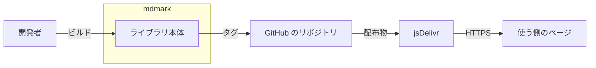

<!-- source-hash: sha256:4aaa61e376ccc80e1b17eba331517bf87e332a9864b67b68589d275d42378b6d -->
# アーキテクチャ図

mdmark の配布物が、開発者のビルドから使う側のページへ届くまでの全体構成。

## システム全体図

下の表から生成

> 向き: LR 

| ID | 表示 | 要素の種類 |
| --- | --- | --- |
| dev | 開発者 | actor |
| lib | ライブラリ本体 | system |
| repo | GitHub のリポジトリ | external |
| cdn | jsDelivr | external |
| page | 使う側のページ | actor |

| 元 | 先 | ラベル |
| --- | --- | --- |
| dev | lib | ビルド |
| lib | repo | タグ |
| repo | cdn | 配布物 |
| cdn | page | HTTPS |

| ID | 表示 | 中のノード |
| --- | --- | --- |
| mdmark | mdmark | lib |

## リポジトリ構成

モノレポ

| リポジトリ |
| --- |
| shuhei1101/mdmark |

| 場所 | 役割 | 使う側への届き方 | 作る Issue |
| --- | --- | --- | --- |
| `src/` | TypeScript と CSS の本体 | ビルドして `dist/` | この土台 |
| `dist/` | 配布物の JavaScript と CSS、CLI の `cli.js`（release と hotfix でだけ commit する） | jsDelivr から版のタグを固定した URL で読む。CLI は `npx github:shuhei1101/mdmark#v{版}` で入れる | この土台・#9 |
| `scripts/` | 開発のスクリプト（ビルド） | 届けない | この土台 |
| `tests/` | 単体・結合・E2E のテスト | 届けない | この土台 |
| `templates/` | 使う側へ置く雛形（設定・`theme.css`・索引・拡張の雛形。差分のアダプターのサンプルは #7） | CLI の `init` が置く | #9 |
| `schemas/` | 設定・索引・部品の JSON Schema | CDN と CLI | #3・#5・#6 |
| `migrations/` | 版ごとの移行の手順とスクリプト（`v{版}/`）、出していない版の手順（`next/`）、移行の手順が要らないスキーマの変更の一覧（`no-steps.yaml`） | CLI の `upgrade` が `v{版}/` を読む（`next/` と `no-steps.yaml` は配布物のビルドだけが読む） | #10 |
| `guide/` | 使い方集 | プラグインと MCP | #11 |
| `plugin/` | Claude Code のプラグイン（SessionStart・MCP） | プラグインのマーケットプレイス | #11 |

この土台で実体を作るのは `src/`・`dist/`・`scripts/`・`tests/` だけで、他は中身を持つ Issue が作る。

## サブシステム一覧

| サブシステム | scope | 役割 | 言語・ランタイム | どこで動くか | 状態 |
| --- | --- | --- | --- | --- | --- |
| ライブラリ本体 | lib | Markdown の表示に使う JavaScript と CSS をビルドして配り、同じ版の CLI で文書を 1 枚の HTML に書き出す | TypeScript 7 | 使う側のページを開いたブラウザ（`mount`・`render`）と、使う側の Node の処理（`render`）と、文書を書く人の手元の Node 24（CLI の `dist/cli.js`。`npx github:shuhei1101/mdmark#v{版}` で入れ、実行時の依存の yaml と esbuild を `dependencies` から読む） | planned |

## 外部システム連携

| 外部システム | 用途 | 方向 | 技術 | 詳細 | 料金・副作用 | 関連 | 状態 |
| --- | --- | --- | --- | --- | --- | --- | --- |
| jsDelivr | GitHub のリポジトリの版のタグが指す配布物を、使う側のページへ配る | 受信のみ | HTTPS | dev/設計書/外部API/jsDelivr# | 無料。1 ファイル 20MB まで | - | planned |
| 外部ライブラリのモジュール | 文書に印があるときだけ、対応表（既定と設定の `libraries`）の URL から ES モジュールを読み、印の場所に描かせる | 受信のみ | ブラウザの動的 `import()`（HTTPS。URL はページの `document.baseURI` を基準に解決する） | - | 無料。印の無い文書では要求が 0 件 | dev/設計書/インターフェース定義/ライブラリ本体/文書を描く.ts#constraints[外部ライブラリの読み込み] | planned |
