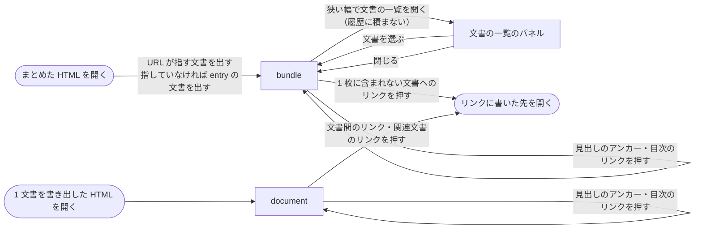

# ライブラリ本体

## 現状

<!-- table: data -->

| 分類 | ページ / ファイル | 概要 | 補足 |
| --- | --- | --- | --- |
| ドキュメント | [dev/設計書/アーキテクチャ図/アーキテクチャ図.yaml](https://github.com/shuhei1101/mdmark/blob/develop/dev/%E8%A8%AD%E8%A8%88%E6%9B%B8/%E3%82%A2%E3%83%BC%E3%82%AD%E3%83%86%E3%82%AF%E3%83%81%E3%83%A3%E5%9B%B3/%E3%82%A2%E3%83%BC%E3%82%AD%E3%83%86%E3%82%AF%E3%83%81%E3%83%A3%E5%9B%B3.yaml) | サブシステムはライブラリ本体だけで、動く場所はブラウザと使う側の Node の処理。リポジトリの構成の `templates/` の行が CLI の init が置く雛形として #9 を指す | 更新対象。CLI の置き場所・`templates/` の実体・CLI が読む外部ライブラリの読み込み先を書く |
| ドキュメント | [dev/設計書/設定/ライブラリ本体.yaml](https://github.com/shuhei1101/mdmark/blob/develop/dev/%E8%A8%AD%E8%A8%88%E6%9B%B8/%E8%A8%AD%E5%AE%9A/%E3%83%A9%E3%82%A4%E3%83%96%E3%83%A9%E3%83%AA%E6%9C%AC%E4%BD%93.yaml) / [schemas/mdmark.config.schema.json](https://github.com/shuhei1101/mdmark/blob/develop/schemas/mdmark.config.schema.json) | `features`・`libraries`・`index` を持つ。Schema の最上位は知らないキーを拒まない | 更新対象。`build` と使う側の CSS のキーを足す |
| ドキュメント | [dev/設計書/インターフェース定義/ライブラリ本体/索引を点検する.ts.yaml](https://github.com/shuhei1101/mdmark/blob/develop/dev/%E8%A8%AD%E8%A8%88%E6%9B%B8/%E3%82%A4%E3%83%B3%E3%82%BF%E3%83%BC%E3%83%95%E3%82%A7%E3%83%BC%E3%82%B9%E5%AE%9A%E7%BE%A9/%E3%83%A9%E3%82%A4%E3%83%96%E3%83%A9%E3%83%AA%E6%9C%AC%E4%BD%93/%E7%B4%A2%E5%BC%95%E3%82%92%E7%82%B9%E6%A4%9C%E3%81%99%E3%82%8B.ts.yaml) / [参照の表を作る.ts.yaml](https://github.com/shuhei1101/mdmark/blob/develop/dev/%E8%A8%AD%E8%A8%88%E6%9B%B8/%E3%82%A4%E3%83%B3%E3%82%BF%E3%83%BC%E3%83%95%E3%82%A7%E3%83%BC%E3%82%B9%E5%AE%9A%E7%BE%A9/%E3%83%A9%E3%82%A4%E3%83%96%E3%83%A9%E3%83%AA%E6%9C%AC%E4%BD%93/%E5%8F%82%E7%85%A7%E3%81%AE%E8%A1%A8%E3%82%92%E4%BD%9C%E3%82%8B.ts.yaml) | `checkIndex`・`collectReferences` は、ファイルを読むのは呼ぶ側として、索引と文書の本文を受け取る | 読むだけ。CLI がファイルを読んで渡す |
| ドキュメント | [dev/設計書/インターフェース定義/ライブラリ本体/文書をHTML文字列にする.ts.yaml](https://github.com/shuhei1101/mdmark/blob/develop/dev/%E8%A8%AD%E8%A8%88%E6%9B%B8/%E3%82%A4%E3%83%B3%E3%82%BF%E3%83%BC%E3%83%95%E3%82%A7%E3%83%BC%E3%82%B9%E5%AE%9A%E7%BE%A9/%E3%83%A9%E3%82%A4%E3%83%96%E3%83%A9%E3%83%AA%E6%9C%AC%E4%BD%93/%E6%96%87%E6%9B%B8%E3%82%92HTML%E6%96%87%E5%AD%97%E5%88%97%E3%81%AB%E3%81%99%E3%82%8B.ts.yaml) / [文書を描く.ts.yaml](https://github.com/shuhei1101/mdmark/blob/develop/dev/%E8%A8%AD%E8%A8%88%E6%9B%B8/%E3%82%A4%E3%83%B3%E3%82%BF%E3%83%BC%E3%83%95%E3%82%A7%E3%83%BC%E3%82%B9%E5%AE%9A%E7%BE%A9/%E3%83%A9%E3%82%A4%E3%83%96%E3%83%A9%E3%83%AA%E6%9C%AC%E4%BD%93/%E6%96%87%E6%9B%B8%E3%82%92%E6%8F%8F%E3%81%8F.ts.yaml) | `render` は文書間のリンクと画像の `src` を書いたまま出す。`mount` は対応表の URL を `document.baseURI` を基準に動的 `import()` で読む | 更新対象になりうる。まとめた HTML の文書間のリンクと、埋めたモジュールを読む口 |
| ドキュメント | [dev/設計書/インターフェース定義/ライブラリ本体/配布物をビルドする.ts.yaml](https://github.com/shuhei1101/mdmark/blob/develop/dev/%E8%A8%AD%E8%A8%88%E6%9B%B8/%E3%82%A4%E3%83%B3%E3%82%BF%E3%83%BC%E3%83%95%E3%82%A7%E3%83%BC%E3%82%B9%E5%AE%9A%E7%BE%A9/%E3%83%A9%E3%82%A4%E3%83%96%E3%83%A9%E3%83%AA%E6%9C%AC%E4%BD%93/%E9%85%8D%E5%B8%83%E7%89%A9%E3%82%92%E3%83%93%E3%83%AB%E3%83%89%E3%81%99%E3%82%8B.ts.yaml) / [dev/設計書/モジュール構成/ライブラリ本体/ビルド.ts.yaml](https://github.com/shuhei1101/mdmark/blob/develop/dev/%E8%A8%AD%E8%A8%88%E6%9B%B8/%E3%83%A2%E3%82%B8%E3%83%A5%E3%83%BC%E3%83%AB%E6%A7%8B%E6%88%90/%E3%83%A9%E3%82%A4%E3%83%96%E3%83%A9%E3%83%AA%E6%9C%AC%E4%BD%93/%E3%83%93%E3%83%AB%E3%83%89.ts.yaml) | `dist/index.js`・`dist/index.css` を束ねてサイズを検査する | 更新対象。CLI の配布物を足す |
| ドキュメント | [dev/設計書/画面設計/文書.ts.yaml](https://github.com/shuhei1101/mdmark/blob/develop/dev/%E8%A8%AD%E8%A8%88%E6%9B%B8/%E7%94%BB%E9%9D%A2%E8%A8%AD%E8%A8%88/%E6%96%87%E6%9B%B8.ts.yaml) / [dev/設計書/部品設計/index.yaml](https://github.com/shuhei1101/mdmark/blob/develop/dev/%E8%A8%AD%E8%A8%88%E6%9B%B8/%E9%83%A8%E5%93%81%E8%A8%AD%E8%A8%88/index.yaml) | 画面は描く先の要素の中の文書だけ。文書の一覧や文書の切り替えの部品は無い | 更新対象。まとめた HTML の画面と、文書の一覧の部品を足す |
| ドキュメント | [dev/設計書/非機能要件/非機能要件.yaml](https://github.com/shuhei1101/mdmark/blob/develop/dev/%E8%A8%AD%E8%A8%88%E6%9B%B8/%E9%9D%9E%E6%A9%9F%E8%83%BD%E8%A6%81%E4%BB%B6/%E9%9D%9E%E6%A9%9F%E8%83%BD%E8%A6%81%E4%BB%B6.yaml) | 配布ファイル 1 つのサイズ（256KB 以下）・対応ブラウザ（Chrome 99・Firefox 97・Safari 16.4 以降）・通信 | 更新対象。書き出した HTML の外部への要求 0 件と、CLI が動く Node の版を足す |
| ドキュメント | [dev/設計書/テスト/テスト実行方法.yaml](https://github.com/shuhei1101/mdmark/blob/develop/dev/%E8%A8%AD%E8%A8%88%E6%9B%B8/%E3%83%86%E3%82%B9%E3%83%88/%E3%83%86%E3%82%B9%E3%83%88%E5%AE%9F%E8%A1%8C%E6%96%B9%E6%B3%95.yaml) / [dev/設計書/開発コマンド/開発コマンド.yaml](https://github.com/shuhei1101/mdmark/blob/develop/dev/%E8%A8%AD%E8%A8%88%E6%9B%B8/%E9%96%8B%E7%99%BA%E3%82%B3%E3%83%9E%E3%83%B3%E3%83%89/%E9%96%8B%E7%99%BA%E3%82%B3%E3%83%9E%E3%83%B3%E3%83%89.yaml) | E2E は配布物を読むページを開発サーバーから開く | 更新対象。CLI の結合テストと、file:// で開く E2E の前提を足す |
| ドキュメント | [dev/設計書/外部ライブラリ/index.yaml](https://github.com/shuhei1101/mdmark/blob/develop/dev/%E8%A8%AD%E8%A8%88%E6%9B%B8/%E5%A4%96%E9%83%A8%E3%83%A9%E3%82%A4%E3%83%96%E3%83%A9%E3%83%AA/index.yaml) | YAML を読むライブラリを持たない（ブラウザで YAML を読まないため） | CLI が設定と索引の YAML を読むライブラリを選定して足す |
| 実装 | [src/index.ts](https://github.com/shuhei1101/mdmark/blob/develop/src/index.ts) / [src/libraries.ts](https://github.com/shuhei1101/mdmark/blob/develop/src/libraries.ts) | 公開関数と、対応表の URL を動的 `import()` で読む処理 | 埋めたモジュールを読む口を足す |
| 実装 | [scripts/build.ts](https://github.com/shuhei1101/mdmark/blob/develop/scripts/build.ts) / [package.json](https://github.com/shuhei1101/mdmark/blob/develop/package.json) | 配布物のビルド。`package.json` は `private` で `bin` を持たない | CLI の配布物と呼び出し口を足す |

<!-- /table -->

## 変更方針

<!-- table: data -->

| 対象 | 方針 | 補足 |
| --- | --- | --- |
| CLI の置き場所 | ライブラリ本体のサブシステムの中に CLI の入口を置き、`render`・`collectReferences`・`checkIndex` を同じソースから呼ぶ。ファイル・YAML・glob を読むのは CLI の側だけにし、ブラウザの配布物 `dist/index.js` へ Node の API を持ち込まない | `未確定`（決める段: インターフェース定義設計） |
| 雛形 | `templates/` に設定・`theme.css`・索引・拡張のビルドの雛形（TypeScript と JavaScript）を置き、`init` が写す | - |
| 設定 | `build`（`include`・`exclude`・`glossary`・`entry`・`out`）と使う側の CSS のパスを、設定の設計書と JSON Schema に足す | パスは設定ファイルのあるフォルダからの相対パス |
| 書き出しの組み立て | 文書ごとに `render` の本文を作り、配布物の JavaScript と CSS・使う側の CSS・設定・索引・参照の表を 1 枚の HTML に埋め、開いたときに `mount` で描く | 書き出した HTML のスクリプトは配布物と埋めたモジュールだけで、文書の中身はサニタイズした HTML として扱う |
| まとめた HTML の文書の行き来 | 文書を `path` で引ける形で埋め、URL の `#` で開く文書と見出しを指す。文書間のリンクは 1 枚の中の文書へ移るリンクに直す | 見出しのアンカーと同じ `#` を使うため、文書と見出しを分ける書き方を画面設計で決める |
| 外部ライブラリと画像の埋め込み | 対応表のモジュールと、文書が相対パスで指す画像を埋め、開いてからの外部への要求を 0 件にする | 埋め方は要件の「外部ライブラリの埋め方」（PoC 結果で決まった） |
| 点検 | 設定の Schema の検査と `checkIndex` の結果と `build` の対象の数を 1 つの一覧にまとめ、ずれがあれば終了コードを 0 以外にする | - |
| 非機能要件 | 書き出した HTML の外部への要求の数（0 件）と、CLI が動く Node の版を足す。書き出した HTML 1 つのサイズは、埋めるものの実測から決める | 配布ファイル 1 つのサイズ（256KB）は jsDelivr の配る `dist/` のファイルが対象で、書き出した HTML には当てない |

<!-- /table -->

`未確定`: CLI をどのサブシステムに置くか（決める段: インターフェース定義設計）

| 案 | 内容 | メリット | デメリット |
| --- | --- | --- | --- |
| A | ライブラリ本体に CLI の入口を足し、同じ版のタグで配る | `render` などと同じソースと同じ版で動き、版のずれが起きない | ライブラリ本体の動く場所に使う側の Node の CLI が加わる |
| B | サブシステム `CLI` を新設し、ライブラリ本体の配布物を読んで呼ぶ | 責務の境界がはっきりする | 同じ版のタグで一緒に配るため独立してデプロイできず、サブシステムの増減としてエスカレーションが要る |

推奨: A

CLI は同じリポジトリの同じ版のタグで配り、独立してテスト・デプロイする単位にならない。

### 画面一覧

| 種別 | 画面 | 概要 | アクション | 判定の根拠 | 補足 |
| --- | --- | --- | --- | --- | --- |
| 新規 | `bundle` | `mdmark build` が書き出す 1 枚の HTML。文書の一覧と、開いている文書（`document` の中身）を並べる | 文書の一覧で文書を選ぶ<br>文書間のリンク・関連文書のリンクを押す<br>ブラウザの戻る・進むで文書を行き来する<br>見出しのアンカー・目次のリンクで節へ移る<br>狭い幅で文書の一覧を開く・閉じる<br>開いている文書を印刷する | 一覧から 1 件を選んで中身を見る関係のため、一覧と詳細を並べる。文書の数は 5 つを超えうるため、文書の一覧は横のメニューにする。狭くなるときは見ていた文書の側を残す | 開いたときは URL が指す文書、指していなければ `entry` の文書を出す。文書を移ると履歴に積み、一覧のパネルの開閉は積まない。印刷では文書の一覧を出さず、開いている文書だけを出す。狭い幅の一覧の出し方は `未確定`（決める段: モック作成） |
| 変更 | `document` | 書き出した HTML の中の文書。`mdmark export` の HTML はこの画面だけを持つ | 見出しのアンカー・目次のリンクで節へ移る<br>文書間のリンク・関連文書のリンクを押す | 文書の中身は今の画面のままで、要素を足さない | まとめた HTML の中では、文書間のリンクと関連文書のリンクが 1 枚の中の文書へ移る。1 文書を書き出した HTML の文書間のリンクは全て 1 枚に含まれない文書へのリンクになる。1 枚に含まれない文書へのリンクの扱いは `未確定`（決める段: 単一ユースケース設計） |
| 新規 | `components/doc-list` | `bundle` の文書の一覧の部品 | 文書を選ぶ | `bundle` だけが使う新しい部品のため、状態ごとの案を 1 ページに並べる。目次は 1 文書の中の見出しへのリンク、ファイルツリーは操作を持たない表示で、どちらも開いている文書を示す状態と、選ぶと開いている文書を替える振る舞いを持たない | 開いている文書の示し方・フォルダでのまとめ方・題が長い文書・文書が多いときを並べる。フォルダのまとめ方は `未確定`（決める段: モック作成） |

`未確定`: 狭い幅での文書の一覧の出し方（決める段: モック作成）

| 案 | 内容 | メリット | デメリット |
| --- | --- | --- | --- |
| A | 文書の上にボタンを置き、押すと文書の一覧のパネルを重ねて開く。文書を選ぶか閉じると閉じる | 開いたときに文書がすぐ読め、幅が変わっても開いている文書を保つ。パネルの開閉は履歴に積まない | 一覧を見るのにひと手間かかる |
| B | 一覧と文書を別の表示に分け、文書から戻る操作で一覧へ戻す | 外部規約『画面の分け方』の狭い幅の既定のとおり | 開くと `entry` の文書を出す要件と、戻るで見てきた文書へ戻る要件と食い違う |

推奨: A

要件は、開くと文書を出すことと、戻る・進むで移った文書を行き来することを求めており、一覧を履歴に積む B はこの 2 つとぶつかる。

`未確定`: 文書の一覧でのフォルダのまとめ方（決める段: モック作成）

| 案 | 内容 | メリット | デメリット |
| --- | --- | --- | --- |
| A | フォルダごとに 1 段の見出しでまとめ、見出しにフォルダのパス（`使い方/導入` など）を書く | 深いフォルダも横のメニューの 2 段に収まる | フォルダの入れ子は見出しのパスでしか分からない |
| B | フォルダの入れ子どおりのツリーにする | フォルダの構成がそのまま見える | 3 段を超えるフォルダで横のメニューが 2 段に収まらない |

推奨: A

外部規約『画面の分け方』は横のメニューを 2 段までにしており、`include` の glob はフォルダの深さを限らない。

### 画面遷移



`未確定`: 1 枚に含まれない文書へのリンクの扱い（決める段: 単一ユースケース設計）

対象は、まとめた HTML に含まれない文書へのリンクと、1 文書を書き出した HTML の文書間のリンク（全てが当たる）。

| 案 | 内容 | メリット | デメリット |
| --- | --- | --- | --- |
| A | 書いたままの `href` で残し、押すとリンクに書いた先を開く | 本文の他の相対リンクと同じ振る舞いで、HTML の隣にその文書を置けば開ける | HTML だけを受け取った読む人には開けないリンクになる。1 文書を書き出した HTML では文書間のリンクが全て開けない |
| B | リンクを外して文字だけにする | 開けないリンクを押させない | 書いた人のリンクが黙って消え、1 文書を書き出した HTML では文書間のリンクが全て文字になる |
| C | リンクは残し、押すとその文書が 1 枚に含まれていないことを知らせる | 開けない理由が分かり、1 文書を書き出した HTML でも `mdmark build` でまとめれば移れると伝えられる | 知らせの UI が増え、1 文書を書き出した HTML では文書間のリンクを押すたびに出る |

推奨: A

`render` は今も相対リンクを書いたまま出しており、`mdmark export` の HTML の本文の相対リンクと振る舞いが揃う。
文書を行き来させたいときは `mdmark build` でまとめる。

## PoC 結果

<!-- table: data -->

| 検証構成 | 成功条件 | 結果 | PoC PR | 補足 |
| --- | --- | --- | --- | --- |
| 埋めたモジュールを `blob:` URL で読む（Chromium） | 外への要求 0 件・`canvas` が描かれる・知らせの枠 0・表のボタンが付く | ✅ 要求 0 件 | [#35](https://github.com/shuhei1101/mdmark/pull/35)（closed） | 採用 |
| 埋めたモジュールを `blob:` URL で読む（Firefox） | 同上 | ✅ 要求 0 件 | [#35](https://github.com/shuhei1101/mdmark/pull/35)（closed） | 採用 |
| 埋めたモジュールを `data:` URL で読む（Chromium） | 同上 | ✅ 要求 0 件 | [#35](https://github.com/shuhei1101/mdmark/pull/35)（closed） | 不採用（両方通ったときの基準で `blob:` を採る） |
| 埋めたモジュールを `data:` URL で読む（Firefox） | 同上 | ✅ 要求 0 件 | [#35](https://github.com/shuhei1101/mdmark/pull/35)（closed） | 不採用（同上） |
| jsDelivr の `+esm` を esbuild で束ねる | 束ねたモジュールに `http:`・`https:`・`/npm/` の import が残らない | ✅ 0 件 | [#35](https://github.com/shuhei1101/mdmark/pull/35)（closed） | 採用 |
| 書き出した HTML 1 つのサイズ | 記録のみ | 548,910 バイト | [#35](https://github.com/shuhei1101/mdmark/pull/35)（closed） | 配布物 243,704・CSS 31,213・束ねたモジュール 253,535 |

<!-- /table -->

結論: 成立。
書き出した HTML だけを空のフォルダへ写して file:// で開き、Playwright 1.64.0 同梱の Chromium・Firefox の両方で、描き終えるまでの要求がページ自身と `blob:`・`data:` のほかに 0 件、`mount` が表に並べ替え・ピン止めのボタンを付け、Chart.js の印の場所に `canvas` が描かれ、知らせの枠もエラーも出なかった（[result.log](https://github.com/shuhei1101/mdmark/blob/a3b1a77/poc/single-html/result.log)）。
`blob:` と `data:` はどちらも通ったため、モジュールの文字列を URL に符号化しない `blob:` を採る（`data:` は 250KB のモジュールを `encodeURIComponent` した URL になる）。
Safari 16.4 は手元で確かめられず、確かめていない。

要件の `未確定`「外部ライブラリのモジュールの埋め方」は、この結果で案 A に決まった。

束ねたモジュールに入ったパッケージと版（[metafile.json](https://github.com/shuhei1101/mdmark/blob/a3b1a77/poc/single-html/out/metafile.json)）:

| パッケージ | 版 | バイト |
| --- | --- | --- |
| chart.js | 4.5.1 | 200,205 |
| chart.js/helpers | 4.4.6 | 33,098 |
| @kurkle/color | 0.3.4 | 8,211 |
| @kurkle/color | 0.3.2 | 8,211 |
| hammerjs | 2.0.8 | 20,821 |
| chartjs-plugin-zoom | 2.2.0 | 15,142 |

`chartjs-plugin-zoom` 2.2.0 の `+esm` は `chart.js@4.4.6/helpers` を import するため、4.5.1 と並べると Chart.js の 2 つの版が入る。
jsDelivr の `+esm` は依存の版を固定して import するため、書き出しは URL ごとに別のモジュールとして束ね、版の重なりを解かない。
既定の対応表で版を揃えるかは、対応表を持つ #6 が決める。

最小再現コードの要点（[export.ts](https://github.com/shuhei1101/mdmark/blob/a3b1a77/poc/single-html/export.ts)）:

```ts
// 取得したモジュールの中の import は、そのモジュールの URL を基準に解決する
build.onResolve({ filter: /^https?:\/\// }, (args) => ({ path: args.path, namespace: "http-url" }));
build.onResolve({ filter: /.*/, namespace: "http-url" }, (args) => ({
  path: new URL(args.path, args.importer).href,
  namespace: "http-url",
}));
build.onLoad({ filter: /.*/, namespace: "http-url" }, async (args) => {
  const response = await fetch(args.path);
  return { contents: await response.text(), loader: "js" };
});

// 起動のスクリプト: 埋めた文字列を blob: URL に替え、配布物を読んで mount する
const payload = JSON.parse(document.getElementById("mdmark-payload").textContent);
const toUrl = (code) => URL.createObjectURL(new Blob([code], { type: "text/javascript" }));
const { mount } = await import(toUrl(payload.mdmark));
const libraries = Object.fromEntries(Object.entries(payload.modules).map(([name, code]) => [name, toUrl(code)]));
mount(document.getElementById("doc"), { markdown: payload.markdown, config: { libraries } });
```

diff の見どころ: 埋めたものは `<script type="application/json">` に置き、`<` を `<` に逃がして `</script>` で閉じないようにしている。
`mount` と `loadLibraries` は変えておらず、対応表に `blob:` の絶対 URL を渡すだけで今の動的 `import()` が読む。

## テスト結果

テスト作成・実装で記入する。