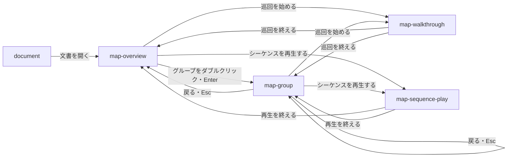

# ライブラリ本体

## 現状

| 分類 | ページ / ファイル | 概要 | 補足 |
| --- | --- | --- | --- |
| ドキュメント | [dev/設計書/シナリオ/単一ユースケース/図を描く.yaml](https://github.com/shuhei1101/mdmark/blob/e7db75806e37c88d70a7e19779a56076be1f3e36/dev/%E8%A8%AD%E8%A8%88%E6%9B%B8/%E3%82%B7%E3%83%8A%E3%83%AA%E3%82%AA/%E5%8D%98%E4%B8%80%E3%83%A6%E3%83%BC%E3%82%B9%E3%82%B1%E3%83%BC%E3%82%B9/%E5%9B%B3%E3%82%92%E6%8F%8F%E3%81%8F.yaml) | 座標の JSON のフロー図・シーケンス図・グラフを描くシナリオ | 変更しない。`map` は新しいシナリオで扱う |
| ドキュメント | [dev/設計書/シナリオ/単一ユースケース/mermaidの図を描く.yaml](https://github.com/shuhei1101/mdmark/blob/e7db75806e37c88d70a7e19779a56076be1f3e36/dev/%E8%A8%AD%E8%A8%88%E6%9B%B8/%E3%82%B7%E3%83%8A%E3%83%AA%E3%82%AA/%E5%8D%98%E4%B8%80%E3%83%A6%E3%83%BC%E3%82%B9%E3%82%B1%E3%83%BC%E3%82%B9/mermaid%E3%81%AE%E5%9B%B3%E3%82%92%E6%8F%8F%E3%81%8F.yaml) | `mermaid` のコードブロックを mermaid のライブラリで図の枠に描くシナリオ | `map` の範囲の中のブロックを対象から外す |
| ドキュメント | [dev/設計書/インターフェース定義/ライブラリ本体/文書を描く.ts.yaml](https://github.com/shuhei1101/mdmark/blob/e7db75806e37c88d70a7e19779a56076be1f3e36/dev/%E8%A8%AD%E8%A8%88%E6%9B%B8/%E3%82%A4%E3%83%B3%E3%82%BF%E3%83%BC%E3%83%95%E3%82%A7%E3%83%BC%E3%82%B9%E5%AE%9A%E7%BE%A9/%E3%83%A9%E3%82%A4%E3%83%96%E3%83%A9%E3%83%AA%E6%9C%AC%E4%BD%93/%E6%96%87%E6%9B%B8%E3%82%92%E6%8F%8F%E3%81%8F.ts.yaml) | `mount` の入出力と、マーカーごとの描き方 | `map` のマーカーを追加する |
| ドキュメント | [dev/設計書/インターフェース定義/ライブラリ本体/設定と索引を点検する.ts.yaml](https://github.com/shuhei1101/mdmark/blob/e7db75806e37c88d70a7e19779a56076be1f3e36/dev/%E8%A8%AD%E8%A8%88%E6%9B%B8/%E3%82%A4%E3%83%B3%E3%82%BF%E3%83%BC%E3%83%95%E3%82%A7%E3%83%BC%E3%82%B9%E5%AE%9A%E7%BE%A9/%E3%83%A9%E3%82%A4%E3%83%96%E3%83%A9%E3%83%AA%E6%9C%AC%E4%BD%93/%E8%A8%AD%E5%AE%9A%E3%81%A8%E7%B4%A2%E5%BC%95%E3%82%92%E7%82%B9%E6%A4%9C%E3%81%99%E3%82%8B.ts.yaml) | `mdmark check` の点検 | 補足の検査を追加する |
| ドキュメント | [dev/設計書/モジュール構成/ライブラリ本体/図.ts.yaml](https://github.com/shuhei1101/mdmark/blob/e7db75806e37c88d70a7e19779a56076be1f3e36/dev/%E8%A8%AD%E8%A8%88%E6%9B%B8/%E3%83%A2%E3%82%B8%E3%83%A5%E3%83%BC%E3%83%AB%E6%A7%8B%E6%88%90/%E3%83%A9%E3%82%A4%E3%83%96%E3%83%A9%E3%83%AA%E6%9C%AC%E4%BD%93/%E5%9B%B3.ts.yaml) | 図の部品の定義の型・線の形・部品の HTML・記法のコアルール・拡大と縮小・ツールチップ | 共通の図の枠・ツールチップを `map` から使う |
| ドキュメント | [dev/設計書/モジュール構成/ライブラリ本体/mermaid.ts.yaml](https://github.com/shuhei1101/mdmark/blob/e7db75806e37c88d70a7e19779a56076be1f3e36/dev/%E8%A8%AD%E8%A8%88%E6%9B%B8/%E3%83%A2%E3%82%B8%E3%83%A5%E3%83%BC%E3%83%AB%E6%A7%8B%E6%88%90/%E3%83%A9%E3%82%A4%E3%83%96%E3%83%A9%E3%83%AA%E6%9C%AC%E4%BD%93/mermaid.ts.yaml) | mermaid のコードブロックを図の枠に置き換える処理 | `map` の範囲を除外する |
| ドキュメント | [dev/設計書/モジュール構成/ライブラリ本体/記法.ts.yaml](https://github.com/shuhei1101/mdmark/blob/e7db75806e37c88d70a7e19779a56076be1f3e36/dev/%E8%A8%AD%E8%A8%88%E6%9B%B8/%E3%83%A2%E3%82%B8%E3%83%A5%E3%83%BC%E3%83%AB%E6%A7%8B%E6%88%90/%E3%83%A9%E3%82%A4%E3%83%96%E3%83%A9%E3%83%AA%E6%9C%AC%E4%BD%93/%E8%A8%98%E6%B3%95.ts.yaml) | マーカーと記法を HTML にする markdown-it のコアルール | `map` のマーカーの読み取りを追加する |
| ドキュメント | [dev/設計書/部品設計/図の枠.ts.yaml](https://github.com/shuhei1101/mdmark/blob/e7db75806e37c88d70a7e19779a56076be1f3e36/dev/%E8%A8%AD%E8%A8%88%E6%9B%B8/%E9%83%A8%E5%93%81%E8%A8%AD%E8%A8%88/%E5%9B%B3%E3%81%AE%E6%9E%A0.ts.yaml)・[dev/設計書/部品設計/フロー図.ts.yaml](https://github.com/shuhei1101/mdmark/blob/e7db75806e37c88d70a7e19779a56076be1f3e36/dev/%E8%A8%AD%E8%A8%88%E6%9B%B8/%E9%83%A8%E5%93%81%E8%A8%AD%E8%A8%88/%E3%83%95%E3%83%AD%E3%83%BC%E5%9B%B3.ts.yaml)・[dev/設計書/部品設計/図のツールチップ.ts.yaml](https://github.com/shuhei1101/mdmark/blob/e7db75806e37c88d70a7e19779a56076be1f3e36/dev/%E8%A8%AD%E8%A8%88%E6%9B%B8/%E9%83%A8%E5%93%81%E8%A8%AD%E8%A8%88/%E5%9B%B3%E3%81%AE%E3%83%84%E3%83%BC%E3%83%AB%E3%83%81%E3%83%83%E3%83%97.ts.yaml) | 図の枠・フロー図・図のツールチップの部品 | 図の枠とツールチップを `map` でも使う。フロー図は変更しない |
| ドキュメント | [dev/設計書/画面設計/文書.ts.yaml](https://github.com/shuhei1101/mdmark/blob/e7db75806e37c88d70a7e19779a56076be1f3e36/dev/%E8%A8%AD%E8%A8%88%E6%9B%B8/%E7%94%BB%E9%9D%A2%E8%A8%AD%E8%A8%88/%E6%96%87%E6%9B%B8.ts.yaml) | 文書に mdmark が追加する UI の項目 | `map` の操作（グループの開閉・戻る・巡回・再生）を追加する |
| ドキュメント | [dev/設計書/設定/ライブラリ本体.yaml](https://github.com/shuhei1101/mdmark/blob/e7db75806e37c88d70a7e19779a56076be1f3e36/dev/%E8%A8%AD%E8%A8%88%E6%9B%B8/%E8%A8%AD%E5%AE%9A/%E3%83%A9%E3%82%A4%E3%83%96%E3%83%A9%E3%83%AA%E6%9C%AC%E4%BD%93.yaml) | `features`・`libraries` | `map` の機能のオン・オフを追加する |
| ドキュメント | [docs/リファレンス/構成図の決まり.md](https://github.com/shuhei1101/mdmark/blob/e7db75806e37c88d70a7e19779a56076be1f3e36/docs/%E3%83%AA%E3%83%95%E3%82%A1%E3%83%AC%E3%83%B3%E3%82%B9/%E6%A7%8B%E6%88%90%E5%9B%B3%E3%81%AE%E6%B1%BA%E3%81%BE%E3%82%8A.md) | 構成図の見た目の決まり | 入れ子と層の決まりを追加する（#309） |
| 実装 | [src/diagram/layout.ts](https://github.com/shuhei1101/mdmark/blob/e7db75806e37c88d70a7e19779a56076be1f3e36/src/diagram/layout.ts) | 座標を省いた判定フローチャートの自動の配置（入れ子を持たない） | `map` の自動配置は入れ子を扱う別の処理にする |
| 実装 | [src/diagram/definition.ts](https://github.com/shuhei1101/mdmark/blob/e7db75806e37c88d70a7e19779a56076be1f3e36/src/diagram/definition.ts)・[src/diagram/check.ts](https://github.com/shuhei1101/mdmark/blob/e7db75806e37c88d70a7e19779a56076be1f3e36/src/diagram/check.ts) | フロー図の定義の型と配置の点検 | 変更しない |
| 実装 | [src/interact/diagrams.ts](https://github.com/shuhei1101/mdmark/blob/e7db75806e37c88d70a7e19779a56076be1f3e36/src/interact/diagrams.ts)・[src/interact/zoom.ts](https://github.com/shuhei1101/mdmark/blob/e7db75806e37c88d70a7e19779a56076be1f3e36/src/interact/zoom.ts)・[src/interact/diagram-tips.ts](https://github.com/shuhei1101/mdmark/blob/e7db75806e37c88d70a7e19779a56076be1f3e36/src/interact/diagram-tips.ts) | 図の拡大・縮小・移動・全画面・ツールチップ | `map` からも使う |
| 実装 | [src/mermaid.ts](https://github.com/shuhei1101/mdmark/blob/e7db75806e37c88d70a7e19779a56076be1f3e36/src/mermaid.ts) | mermaid を読み込んで図にする `attachMermaid` | `map` の範囲を除外する |
| 実装 | [schemas/mdmark.config.schema.json](https://github.com/shuhei1101/mdmark/blob/e7db75806e37c88d70a7e19779a56076be1f3e36/schemas/mdmark.config.schema.json) | 設定の JSON Schema | `features` に `map` を追加するなら、移行の手順か `migrations/no-steps.yaml` の行を置く |

## 変更方針

| 対象 | 方針 | 補足 |
| --- | --- | --- |
| シナリオ | 複合 UC『Mermaidと補足で書いた図を辿って読む』と、単一 UC『Mermaidと補足で図を描く』『図のグループの中へ入る・開閉する』『図を巡回する』『シーケンスを構成図の上で再生する』を新しく作る | 影響するユースケースへ `new` で追加済み |
| マーカー | `<!-- map: … -->`〜`<!-- /map -->` を記法のコアルールで読み、範囲の中の `mermaid` のブロックと `<!-- map-data: format=yaml` の HTML コメントを 1 つの図の定義にする | 範囲の中に `mermaid` のブロックが無い・2 つ以上ある・補足が 2 つ以上あるときは書き方の警告 |
| Mermaid の読み取り | `flowchart`（ノードの形・`subgraph`・`direction`・矢印の種類・ラベル・`:::クラス`・線の ID）と `sequenceDiagram`（`participant`・`actor`・メッセージ・`loop`）を読む処理を独自に作る | 読めない行は描画を止めずに、その行を指す書き方の警告にする |
| 補足 | YAML を読み、`version` と機能ごとのキーをスキーマで検査する。ノード・線は Mermaid の ID か `from`・`to` で指す | スキーマは `schemas/` に置き、`check` と描画で同じものを使う |
| 自動配置 | 入れ子の箱を内側から配置し、箱の大きさを決めてから外側を配置する。ラベルは箱の幅の上限で折り返す。線は縦横の折れ線で、端点とその祖先以外の矩形を避け、祖先の箱の枠の出入りを最少にする経路を探す | PoC の方式（ライブラリ本体.md の `## PoC 結果`） |
| 配置の上書き | `layout` の指定を自動配置の制約として渡し、配置し直すたびに当てる | - |
| 中へ入る・開閉 | 表示する箱と線の集合を決めてから自動配置をやり直す。外の箱は薄く残し、閉じた箱への線をまとめて件数を出す。開閉と中へ入った状態は sessionStorage に保ち、描き直しても図の倍率と表示する位置を保つ | - |
| 巡回・再生 | 図の枠の下の帯に、番号・文とアイコンのボタンを出す。再生は今のメッセージの線の上の印を繰り返し動かし、自動で進める間隔を選べる。`prefers-reduced-motion` では印を動かさない | - |
| 図の枠・操作 | 自動配置の結果を今のフロー図・シーケンス図の部品の定義にして描き、図の枠（タイトル・凡例・拡大・縮小・移動・全画面・リサイズハンドル）・線の交差の飛び越え・ツールチップをそのまま使う。箱は部品の上に重ね、`layout` の色で箱・ノード・線の色を変える | 凡例は `map` のクラスと線の種類から作る |
| 用語の下線 | ラベルと `notes` の文に、今の図と同じく用語の下線を付ける | - |
| mermaid のコードブロック | `map` の範囲の中のブロックを `attachMermaid` の対象から外す | - |
| 点検 | `check` に、補足のスキーマ・ID の参照・`--` を含む値・知らないキーの検査を追加する | - |
| 書き出し | `mdmark export`・`build` の 1 枚の HTML でも `map` を描く | 外へ要求しない |
| 設定 | `features` に `map` を追加する | 文書の印でオン・オフできる |
| アクセシビリティ | 箱の中へ入る・開閉・巡回と再生の操作をキーボードで操作でき、アイコンのボタンに名前を付ける | - |
| 既存機能への影響 | `flow`・`sequence`・`chart`・`param` は変更しない | - |
| 性能 | 入れ子 2 レイヤー・ノード 30 個の図の配置し直しの時間を PoC で測り、決定値を非機能要件に置く | 時間の決定値は PoC の結果から決める |
| 配布物の大きさ | 自動配置と Mermaid の読み取りを配布物の本体に入れるか、ビューとコメントと同じく使うときだけ読む別の配布ファイルにするかを、モジュール構成設計で決める | 非機能要件のサイズの上限に当てる |

### 画面一覧

map の図は文書の中の図の枠に描き、図の枠の中で表示を切り替える。下の画面は図の枠の中の表示の単位。

| 種別 | 画面 | 概要 | アクション | 判定の根拠 | 補足 |
| --- | --- | --- | --- | --- | --- |
| 変更 | `document` | 文書の map の範囲の場所に、map の図の枠を置く | 図の枠を拡大・縮小・移動・全画面にする | 今の図の枠と同じ操作で、画面は増やさない | - |
| 新規 | `map-overview` | 入れ子のグループを自動配置した全体の図。巡回の入口を図の右上のツールに、再生の入口をシーケンス図の右上のツールに置く | グループの中へ入る<br>グループを開閉する<br>巡回を始める<br>シーケンスを再生する | グループの開閉は同じ図の見せ方の切り替えのため、同じ画面の中で切り替える | - |
| 新規 | `map-group` | 入ったグループの中だけを配置し直した図。外は薄く残し、図の右上に戻るボタンを出す | 外へ戻る<br>さらに中のグループへ入る<br>グループを開閉する<br>巡回を始める<br>シーケンスを再生する | 階層が 3 段（全体・グループ・中のグループ）になるため、戻る操作で 1 段ずつ外へ戻る | - |
| 新規 | `map-walkthrough` | 図の枠の下の帯に、手順の番号・説明と前へ・次へを出し、手順の強調するノードを図に当てる | 前へ<br>次へ<br>巡回を終える | 決まった順番で進める手続きのため、ステップで進む。手順が開く段（全体・グループ）へ図を切り替え、巡回を終えると始めた段へ戻る | - |
| 新規 | `map-sequence-play` | 構成図の上で今のメッセージの線に印を繰り返し動かし、帯に今のメッセージの文と操作を出す | 自動で進める<br>一時停止する<br>前へ<br>次へ<br>間隔を選ぶ<br>再生を終える | 決まった順番で進める手続きのため、ステップで進む。再生を終えると始めた段へ戻る | - |

### 画面遷移

戻る操作は 1 段ずつ外へ戻る。巡回と再生を終えると、始めた段（全体か、入っていたグループ）へ戻る。



## 設計書の確定コミット

| 工程 | 範囲 | 補足 |
| --- | --- | --- |
| 複合ユースケース設計 | `e7db7580..8d175ce6` | - |
| 複合ユースケース設計 | `67caf6f5..137e4b3a` | レビューの指摘の修正 |
| 単一ユースケース設計 | `f6ac7fa0..2ccd7630` | - |
| 単一ユースケース設計 | `a051d7e8..97c2ee3d` | レビューの指摘の修正 |

## PoC 結果

| 検証構成 | 成功条件 | 結果 | PoC PR | 補足 |
| --- | --- | --- | --- | --- |
| 記法の読み取り（独自） | No 1: 見本のノード・箱・線・メッセージの数と親子が一致し、読めない行は警告 1 件 | ✅ 30・6・40・6 | [#446](https://github.com/shuhei1101/mdmark/pull/446)（closed） | 単体テスト 13 件 pass（[unit.log](https://github.com/shuhei1101/mdmark/blob/3e4d731e84e99f920a58f53908aaddcdc54af8fc/poc/map/unit.log)） |
| 入れ子の自動配置と線の経路（独自） | No 2: 重なり・はみ出し・端点と祖先以外の横切りが 0 件、祖先の枠の出入りが 1 回 | ✅ 0 件 | [#446](https://github.com/shuhei1101/mdmark/pull/446)（closed） | 5 つの操作の描画の全てで 0 件（[run.log](https://github.com/shuhei1101/mdmark/blob/3e4d731e84e99f920a58f53908aaddcdc54af8fc/poc/map/run.log)・[result.json](https://github.com/shuhei1101/mdmark/blob/3e4d731e84e99f920a58f53908aaddcdc54af8fc/poc/map/result.json)） |
| ラベルの折り返し | No 3: 30 文字のラベルが 220px で折り返し、描いた文字が箱に収まる | ✅ はみ出し 0 件 | [#446](https://github.com/shuhei1101/mdmark/pull/446)（closed） | 見積もりと描いた幅の差は最大 1.0px |
| 上書き | No 4: align・order・座標の固定を当てても No 2 を満たし、指定どおり | ✅ | [#446](https://github.com/shuhei1101/mdmark/pull/446)（closed） | 上書きが無いと 3 つとも指定と違う位置になることも確認 |
| 配置し直しの時間 | No 5: 配置し直しと SVG の描き直しが 10 回の最大値 100ms 以内 | ✅ 最大 58.9ms | [#446](https://github.com/shuhei1101/mdmark/pull/446)（closed） | 全体 58.9・上書き 18.1・中へ入る 8.8・閉じる 20.4・視点 6.2（ms） |
| 配布物の増分 | No 6: 記録だけ | 13,576 バイト | [#446](https://github.com/shuhei1101/mdmark/pull/446)（closed） | 配置と読み取りを minify した大きさ（gzip 前） |

結論: 成立。自動配置と記法の読み取りは、外のライブラリを使わずに独自に作る（PoC の方針の案 A）。

- 配置は、箱の中身を内側から決め、子孫の線を直下の子どうしの線に持ち上げて段（閉路の戻りを外した最長路）と段の中の並び（重心の 4 回の掃引）を決める。階層をまたぐ線は、配置の後に格子の上で経路を探して引く
- 線の経路は、矩形の辺から 12px 離した座標と中心の座標で作った格子の A*。端点とその祖先以外の矩形の内側の点を通れない点にし、片方だけの祖先の枠の出入りに大きな重みを付けて出入りを 1 回にする。残りの出入りの数を見積もりに加えると、時間が 1/4 になった（85ms → 18ms、Node）
- 点検は、葉どうしは今の `checkFlowLayout` をそのまま使い、箱の重なり・はみ出し・横切り・祖先の枠の出入りは `checkFlowLayout` が箱を持たないため別の関数で数えた。`src/diagram/check.ts` の `overlaps`・`inside`・`crosses` を export して使った
- 測った環境の日本語の字体は IPA ゴシックで、見積もりと描いた幅の差は最大 1.0px。本番との違いの表の 4px の元は、ラベルの左右の余白 10px（`LABEL_METRICS.padX`）で、差がその半分の 5px を下回れば文字が枠に届かない。差が 4px 以内のため、Firefox の確認は実装の結合テストの範囲で足りる
- 成功条件の外で、[スクリーンショット](https://github.com/shuhei1101/mdmark/blob/3e4d731e84e99f920a58f53908aaddcdc54af8fc/poc/map/screenshot.png) から次が分かった。同じ通り道を通る線が重なって見分けにくい。矢じりを描いていない。図が横に広がる。線を通り道ごとにずらす処理と矢じりは、モジュール構成設計と実装で扱う

核心部（線の経路の見積もり。`poc/map/layout.ts`）:

```ts
const heuristic = (point: number): number => {
  let diff = (maskAt[point] as number) ^ goalMask; // まだ出入りしていない祖先の枠
  let count = 0;
  while (diff) { count += diff & 1; diff >>= 1; }
  const distance = Math.abs(xs[point % nx] - tx) + Math.abs(ys[Math.floor(point / nx)] - ty) - target.w / 2 - target.h / 2;
  return Math.max(0, distance) + count * MAP_LAYOUT.borderCost;
};
```

closed PR の diff の見どころは `poc/map/layout.ts` の `layoutBox`（内側からの配置と線の持ち上げ）と `routeEdges`（格子と A*）、`poc/map/check-map.ts`（箱の点検）。

