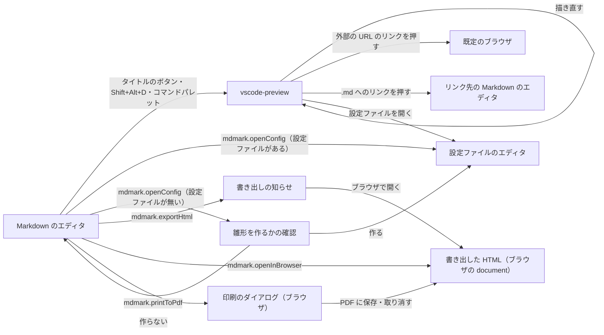

# VS Code 拡張機能

## 現状

なし（新規。アーキテクチャ図のサブシステム一覧に「VS Code 拡張機能」を足す）

## 変更方針

| 対象 | 方針 | 補足 |
| --- | --- | --- |
| 置き場所 | `vscode/` に独自の `package.json`・TypeScript のソース・テストを置き、ルートの `package.json` とは依存を分ける | npm workspaces は vsce が扱えないため使わない |
| プレビューの出し方 | 独自の Webview パネルを開き、その中で jsDelivr から読んだ mdmark の `mount` を呼ぶ。本文の差し替えは `update` で行う | 1 つの Markdown に 1 つのパネル |
| 読む版 | `mdmark.version` が `latest` のときは、プレビューを開くときに GitHub のタグ一覧の API から `vX.Y.Z` の最新を選ぶ。取れたら版を拡張機能の状態に残し、取れないときは残した前回の版を使う | 前回の版も無いときは描けない理由を出す。タグ一覧を取る待ちの上限は非機能要件で決める。テストのときだけ配布物の配信元とタグ一覧の取得先を手元の代役へ差し替える方法（設定に出さない）と、そのときの CSP の `script-src` の配信元は、インターフェース定義設計で決める |
| 描けないとき | 配布物の読み込みに失敗したら、プレビューに理由（オフライン・版が無い）と `mdmark.refreshPreview` を出す | - |
| ライブ更新 | エディタの変更を受けて `mdmark.preview.updateDelayMs` 待ち、最後の全文を Webview へ送る。表に戻ったときは全文を送り直す | 背面のパネルへの送信は届く前提にしない。送り直しは Webview の `ready` の報告を受けて行う（`## PoC 結果`） |
| スクロールの同期 | ブロックの元の行番号の属性から、エディタの見えている先頭行とプレビューの位置を相互に引く | 片方を動かした直後の逆向きの同期は止め、往復で揺れないようにする |
| テーマ | `mdmark.preview.theme` が `auto` のときは Webview の `body` に VS Code が付ける class をそのまま使い、`light` / `dark` のときは拡張機能が class を付け替える | mdmark が親の class で配色を切り替える変更（ライブラリ本体.md）が要る |
| リンクと画像 | Webview からのリンクの押下を拡張機能が受け、外部 URL は `openExternal`、`.md` は VS Code で開き、`#` はプレビューの中で移る。相対パスの画像は `asWebviewUri` で直す | `localResourceRoots` はワークスペースのフォルダに限る |
| 設定ファイル | `mdmark.configPath` の YAML を拡張機能が読み、`features`・`libraries` だけを取り出して渡す。ファイルの保存を見て描き直す | 読めない YAML は描くのを止めず、プレビューに知らせる |
| CSP | Webview の CSP は jsDelivr と `libraries` の配信元・ワークスペースの画像だけを許し、スクリプトは nonce で許す | `style-src` には `'unsafe-inline'` が要る（`## PoC 結果`） |
| 印刷と書き出し | 要件.md の推奨案 A で、jsDelivr の配布物を読んで `mount` で描く HTML を書き出し、`openInBrowser` で開く。`printToPdf` は書き出した HTML を開いた後に印刷のダイアログを出す | Webview の中では `print()` が効かない。含めるかと HTML の形は `未確定`（要件.md） |
| 版とタグ | 拡張機能の版は `vscode/package.json` の `version` で持ち、タグ `vscode-v{版}` を打つ | jsDelivr が mdmark の版として拾う `v{版}` と混ぜない |
| .vsix の配布 | `.github/workflows/` に、`vscode-v*` のタグで .vsix を作って GitHub Release に添えるワークフローを置く | Marketplace・Open VSX への登録は手で行う（反映作業） |
| テスト | 拡張機能の処理（版の選び方・設定の取り出し・URL の直し方・行番号の引き方）は単体テスト、Webview とコマンドは VS Code を起動する結合テストにする | テストのランナーは設計で決める |

### 画面一覧

| 種別 | 画面 | 概要 | アクション | 判定の根拠 | 補足 |
| --- | --- | --- | --- | --- | --- |
| 新規 | `vscode-preview` | Markdown 1 つを mdmark で描くプレビューのパネル（VS Code の Webview）。中身の文書は mdmark の既定の見た目のまま描き、拡張機能はパネルの中の状態の表示だけを足す | 文書を読む（スクロールでエディタと位置を合わせる）<br>外部の URL のリンクを押す<br>`.md` へのリンクを押す<br>`#` で始まるリンクを押す<br>描き直す（描けないときの表示から）<br>設定ファイルを開く（設定ファイルを読めない知らせから） | 書きながら Markdown と描いた見た目を同時に見比べるため、エディタと同じ画面（VS Code の横の列）に並べる。`mdmark.openPreview` は同じ列に開き、エディタとタブで切り替える。読み込み中・描いた文書・描けないときは同じパネルの中で表示を切り替える | 状態は 4 つ。読み込み中（文言を出す）・描いた文書・描けない（文書の代わりに理由と「描き直す」のボタン。理由はオフライン・指定した版が無い・版を決められない（タグ一覧を取れず前回の版も無い））・設定ファイルを読めない（文書は描いたまま、パネルの上部に知らせの帯と「設定ファイルを開く」のボタン）。描けない理由と知らせの帯は配布物を読む前にも出すため mdmark の知らせの枠を使えず、拡張機能が描く。見た目は知らせの枠の状態色（`--mdmark-color-notice-*`）と同じ値に揃える |
| 変更 | Markdown のエディタ（VS Code） | エディタのタイトルに、横の列にプレビューを開くボタンを足す | プレビューを横に開く（タイトルのボタン・`Shift+Alt+D`・コマンドパレット）<br>同じ列にプレビューを開く（コマンドパレット）<br>HTML に書き出す・ブラウザで開く・PDF に印刷する・設定ファイルを開く・描き直す（コマンドパレット） | VS Code の画面のため置き方は変えず、入口のボタンだけを足す | ボタンとショートカットは Markdown を開いているときだけ効く。プレビューにフォーカスがあるときのコマンドは、そのプレビューの Markdown を対象にする。モックは作らない |
| 新規 | 雛形を作るかの確認（VS Code のダイアログ） | 設定ファイルが無いときに `mdmark.openConfig` が尋ねる | 作る<br>作らない | 続けるのに必須の入力のため、モーダルにする | VS Code のダイアログ（`showInformationMessage` の `modal`）で出す。モックは作らない |
| 新規 | 書き出しの知らせ（VS Code の通知） | `mdmark.exportHtml` の結果（書き出したパス・書き出せない理由） | ブラウザで開く（書き出せたとき） | 裏で動く処理の結果の知らせのため、モーダルにせず通知で出す | VS Code の通知で出す。モックは作らない |

書き出した HTML をブラウザで開いた画面は、既存の `document` の画面（mdmark の既定の見た目）のまま変えない。
PDF は、その画面からブラウザの印刷のダイアログで作る。

### 画面遷移



プレビューのパネルとエディタは別の列か同じ列のタブに並ぶため、パネルを閉じるかタブを切り替えるとエディタへ戻る。
ブラウザ・リンク先のエディタ・設定ファイルのエディタは VS Code の別のタブか別のウィンドウで開き、元のエディタとプレビューは残る。

`未確定`: `mdmark.openInBrowser`・`mdmark.printToPdf` で開く HTML（決める段: 単一ユースケース設計）

| 案 | 内容 | メリット | デメリット |
| --- | --- | --- | --- |
| A | 毎回、開いている Markdown を書き出し直してから開く | 書いた内容と食い違う古い HTML を開かない。書き出していなくても 1 回のコマンドで開ける | 書き出し先の HTML を毎回上書きする |
| B | 書き出した HTML があればそれを開き、無ければ書き出しを促す知らせを出す | 書き出し先の HTML を書き換えない | 書き出した後に書き換えた内容が HTML に出ない。知らせから書き出しのコマンドへ戻る往復が増える |

推奨: A

複合ユースケースの流れは書き終えた文書をそのまま PDF にするもので、開いた HTML がエディタの内容と違うと印刷し直しになる。

## PoC 結果

| 検証構成 | 成功条件 | 結果 | PoC PR | 補足 |
| --- | --- | --- | --- | --- |
| 配布物の読み込み（Linux 版 VS Code 1.143.1 + `xvfb-run`） | `version()` が `v0.6.0` で、見本の要素が見本どおりの数だけ描かれる | ✅ 全て一致 | [#70](https://github.com/shuhei1101/mdmark/pull/70)（closed） | 見出し 2 が 6・表 1・注意書き 1・図 2（箱 5）・ヒント 2・自作の図 1。初回の報告まで 641〜845 ms（jsDelivr のキャッシュが冷えた最初の実行は 5,045 ms） |
| 配布物の読み込み（Windows の VS Code 1.141.0 で WSL を開く Remote） | 同上 | ✅ 全て一致 | 同上 | 初回の報告まで 1,400 ms |
| CSP の `style-src`（`'unsafe-inline'` なし） | 違反の件数と出元を記録する | ✅ 記録した（20 件） | 同上 | 全て `style-src-attr` で出元は `dist/index.js`。図の箱の `style` 属性が止まり、箱の `left` が `12px` でなく `0px` になって位置が崩れる（Linux 版・Remote とも同じ） |
| CSP の `style-src`（`'unsafe-inline'` あり） | 違反が 0 件 | ✅ 0 件 | 同上 | 箱の `left` が `12px`・`top` が `100px` で `style` 属性どおり（Linux 版・Remote とも） |
| 本文の差し替え | `update` に送った見出しが報告に出る | ✅ 出た | 同上 | 自作の図も描き直された |
| 背面からの復帰（`retainContextWhenHidden: false`） | 背面で 3 回送った後に表に戻すと最後の本文が出る | ✅ 出た | 同上 | 背面の間の `postMessage` は `false` を返す。表に戻すと Webview が作り直され `ready` が 1 回増え、`ready` を受けて送った最後の本文が 148〜174 ms（Remote は 433 ms）で描かれた |
| 背面からの復帰（`retainContextWhenHidden: true`） | 同上 | ✅ 出た | 同上 | 背面の間の `postMessage` は `true` を返し、作り直しは無い（`ready` は 1 回のまま）。表に戻すと最後の本文が 38〜94 ms（Remote は 177 ms）で描かれ、背面の間に送った 1・2 回目の本文は描かれなかった |
| 自作の図のモジュール（`asWebviewUri` の URL を `libraries` に渡す） | `draw` が付けた属性が報告に出る | ✅ 出た | 同上 | Linux 版・Remote とも |
| 配色の手がかり | `body` の class を記録する | ✅ 記録した | 同上 | ライトのテーマで `vscode-light`、ダークのテーマで `vscode-dark`（Linux 版。Remote は利用者の設定を書き換えないよう流していない） |

結論: 成立。
Webview の CSP の下で jsDelivr の版付きの URL から mdmark を読み、図とヒント・自作の図のモジュールまで描ける。
ただし v0.6.0 の図とヒントの部品は HTML に `style` 属性を書くため、`style-src` に `'unsafe-inline'` が要る。
スクリプトは nonce で絞ったままにでき、`'unsafe-inline'` は `style-src` だけに足す。
背面からの復帰は `retainContextWhenHidden` の値によらず、Webview の `ready` を受けて最後の全文を送れば最後の本文が出る。
`true` でも背面の間に送った本文は描かれないため、背面の間の送信に頼らない。

最小再現コードの要点（[vscode/extension.js](https://github.com/shuhei1101/mdmark/blob/5661abbfa5ecdfc9504ac5760b0739a6ed2719bc/vscode/extension.js)）:

```js
const csp = [
  "default-src 'none'",
  `script-src 'nonce-${nonce}' https://cdn.jsdelivr.net ${src}`,
  `style-src https://cdn.jsdelivr.net ${src} 'unsafe-inline'`,
  `img-src ${src} https: data:`,
  `font-src ${src} https://cdn.jsdelivr.net`,
  "connect-src https://cdn.jsdelivr.net",
].join("; ");
// Webview の中: 読み終えたら ready を返し、届いた本文を mount / update で描く
const mdmark = await import(`${DIST}/index.js`);
window.addEventListener("message", (ev) => {
  if (handle === null) handle = mdmark.mount(el, { markdown: ev.data.markdown, config: ev.data.config });
  else handle.update(ev.data.markdown);
});
vscodeApi.postMessage({ type: "ready" });
// 拡張機能の側: ready を受けたら最後の全文を送る
panel.webview.onDidReceiveMessage((m) => { if (m.type === "ready" && latest !== null) post(latest); });
```

diff の見どころは、`vscode/scenario.js` の観点ごとの流し方と、`vscode/results/` の Linux 版・Remote の報告。

## テスト結果

なし
