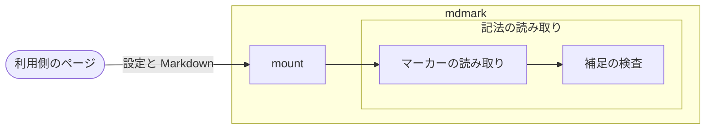
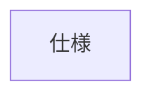
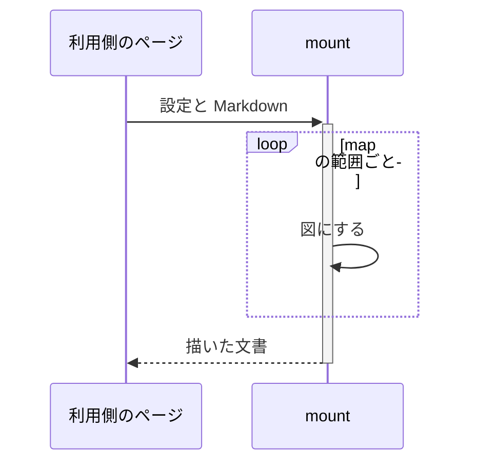
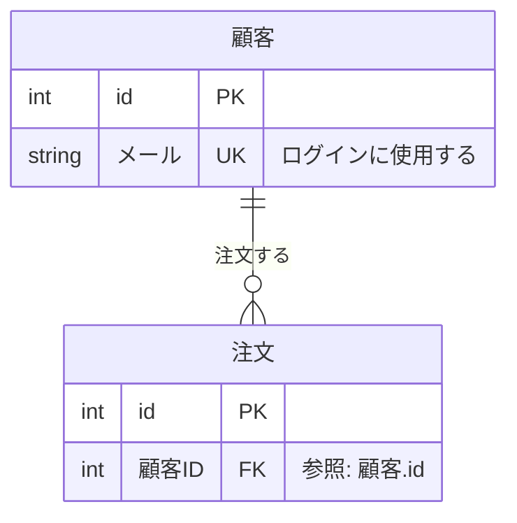
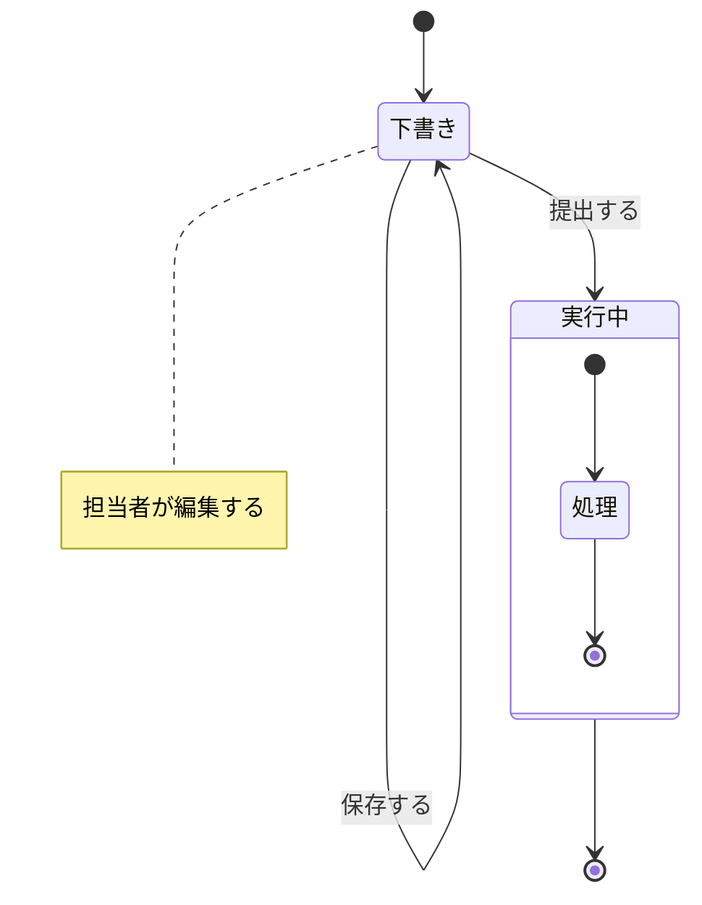
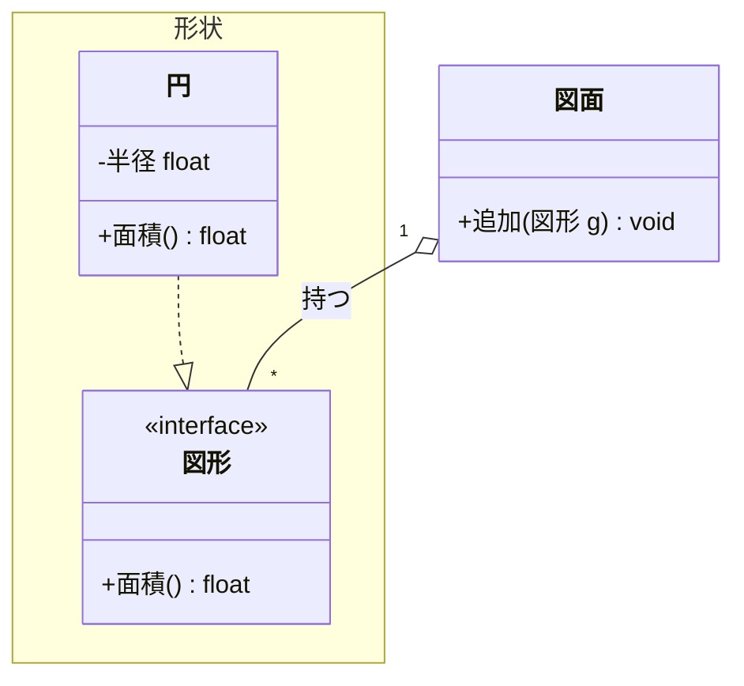
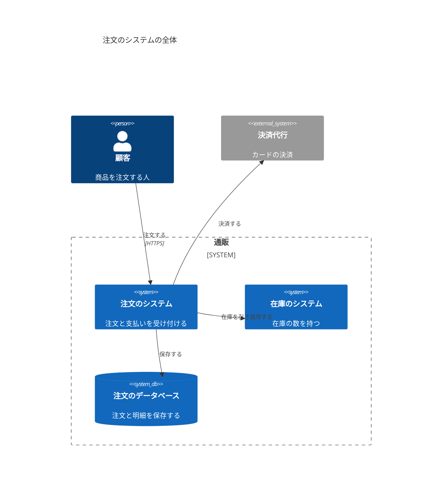
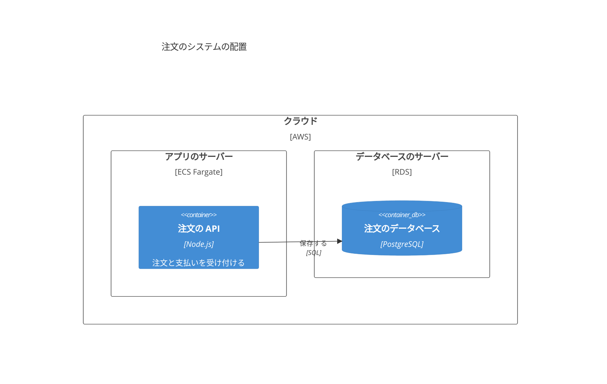
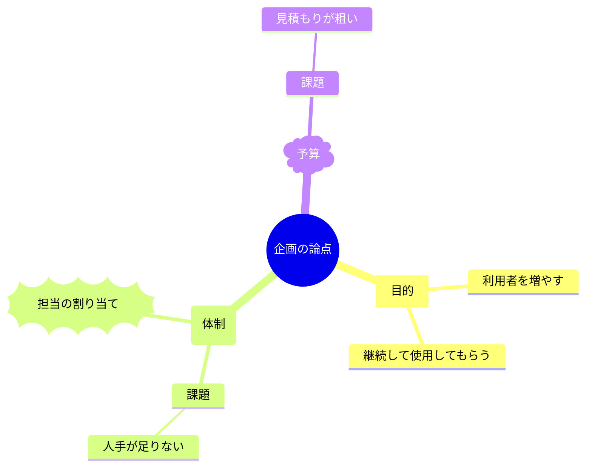
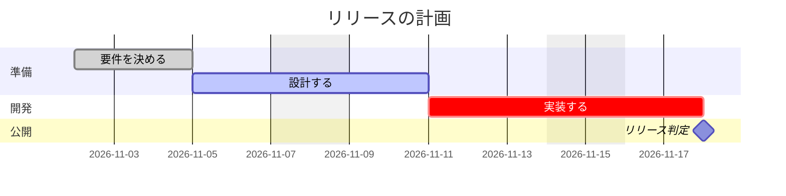

# Mermaidと補足で図を描く

map のマーカー・Mermaid のブロック・補足の記載方法と、注記の参照・配置と色の上書き・案内・再生の書き方の手順

座標を記載せずに構成図とシーケンス図を描き、読者にグループの中へ入る・開閉・案内・再生で辿らせるときに実行する。

## 前提

- [文書を描く](./導入-文書を描く.md)
- 設定の `features.map` がオン（既定）。
  オフにする手順は [機能をオン・オフする](./カスタマイズ-機能をオン・オフする.md)

## 手順

### map の範囲に Mermaid を記載する

<!-- code: {"raw": true} -->

````markdown
<!-- map: {"title": "全体の構成"} -->



<!-- /map -->
````

`<!-- map -->` 〜 `<!-- /map -->` の範囲の `mermaid` のブロックが、座標を記載しなくても自動で配置した図になる。
`subgraph` はグループになり、入れ子の内側から配置する。
描くのは Mermaid の 1 行目が `flowchart`・`sequenceDiagram`・`erDiagram`・`stateDiagram-v2`（`stateDiagram`）・`classDiagram`・`architecture-beta`・`C4Context`・`C4Container`・`C4Component`・`C4Dynamic`・`C4Deployment`・`mindmap`・`gantt`・`timeline`・`gitGraph`・`journey`・`block-beta` の図。
範囲に入れない同じ種類の `mermaid` のコードブロックも、補足の無い map の図で描く（[mermaidの図を描く](./図を描く-mermaidの図を描く.md)）。
範囲で囲むと、補足とマーカーの引数を前提にする操作が増える。

| 操作 | 範囲の外 | 範囲の中 |
| --- | --- | --- |
| 拡大・縮小・移動・全画面・リサイズハンドル・文字の選択とコピー | ✓ | ✓ |
| 選択と強調・移動と並べ替え・グループの開閉と中へ入る・シーケンス図の再生のバー・参加者の行の固定 | ✓ | ✓ |
| `click`・`link` の行のリンク | ✓ | ✓ |
| 図の SVG・PNG への書き出し・一覧の表示 | ✓ | ✓ |
| 説明と注記のツールチップ（補足の `notes`） |  | ✓ |
| 案内（補足の `tour`）・構成図の上の再生（補足の `plays_over`） |  | ✓ |
| 配置と色の上書き（補足の `layout`）・マーカーの引数の `focus`・`collapse` |  | ✓ |
| 計画した変更（補足の `changes`） |  | ✓ |

グループの分け方は [構成図の決まり](./構成図の決まり.mark.md#グループにするかの判定) の判定フローチャートで決める。
マーカーの引数（`title`・`focus`・`collapse`）は [map の引数](./記法.mark.md#map)。

### ノードと線の種類を設定で作る

```yaml
map:
  kinds:
    step: { label: 処理, icon: cog, shape: rounded }
    store: { label: 保存先, icon: database, shape: rect, color: purple }
    outside: { label: 外部, icon: globe, shape: pill, color: green }
  lines:
    "-.->": { dash: dashed, head: open }
    back: { dash: dotted, head: open }
```

mdmark はノードの種類と線の種類を持たない。
`map.kinds` に Mermaid のクラス名（`:::step`）ごとの種類の名前・アイコン・形状・色を、`map.lines` に矢印ごとと名前ごとの模様・太さ・矢じり・色を記載する。
クラスを付けないノードは種類の行を空にし、設定の無い矢印は実線で描く。
キーの一覧は [map の設定](./設定.mark.md#map-の設定)。

### 補足で説明・案内・上書きを付ける

<!-- code: {"raw": true} -->

```markdown
<!-- map-data: {
  "version": 1,
  "notes": {"data": {"text": "version と機能ごとのキーをスキーマで検査する"}},
  "walkthroughs": [
    {"title": "mount に渡す", "text": "設定と Markdown を mount に渡す", "nodes": ["user", "mount"]},
    {"title": "補足を検査する", "text": "記法の読み取りの中で補足を検査する", "nodes": ["marker", "data"], "enter": "read"}
  ],
  "layout": {
    "read": {"color": "blue"},
    "mount->marker": {"packet": {"color": "source", "shape": "diamond"}},
    "data": {"justify": "start"}
  }
} -->
```

補足は範囲の中に `<!-- map-data: {JSON のオブジェクト} -->` で 1 つ記載する。

| キー | 付くもの |
| --- | --- |
| `notes` | ノード・線・グループのタイトルのマーカーにポインターを適用したときのツールチップと、再生の帯の説明。`annotations` に注記の ID を並べると、ツールチップの説明の下に注記を出す |
| `walkthroughs` | 図の下の手順のバーで手順を選んで繰り返す案内。手順ごとにノードを強調し、強調するノードどうしの線にデータの印を流す |
| `layout` | ノード・グループ・線の ID ごとの色・並び・寄せ方・座標・幅・最初に閉じるか・線の種類・データの印・線の端の辺・経由点 |
| `changes` | ノード・グループ・線の ID ごとの計画した変更（追加・変更・削除）の色とバッジ |

上書きの無い部分は自動の配置のまま。
文字の値の中に `--` をそのまま記載しない（HTML コメントを閉じてしまう）。値に `--` を持つときは、2 つ目の `-` を JSON の Unicode エスケープで `-\u002d` と記載する。
キーの一覧は [補足のキー](./記法.mark.md#補足のキー)。

ノードや線に注意書きを付けるときは、本文の注記（[注記](./記法.mark.md#注記)）を定義し、`notes` の `annotations` で ID を参照する。
`text`（説明）を持たないノード・線にも付けられる。

<!-- code: {"raw": true} -->

```markdown
<!-- map-data: {"version": 1, "notes": {"judge": {"text": "入力の値を判定の条件と比べる", "annotations": ["cond"]}, "e1": {"annotations": ["cond"]}}} -->

※[cond]: 条件を満たさないときは次の工程へ進む。
```

`text` はノードや線の概要、注記は複数の場所から参照する注意書きに使い分ける。
注記は文書の末尾の注記の一覧にも並び、一覧の戻るリンクでノードや線のツールチップへ戻る。

### 計画した変更を示す

<!-- code: {"raw": true} -->

```markdown
<!-- map-data: {"version": 1, "changes": {"cache": {"type": "added"}, "mount": {"type": "changed"}, "legacy": {"type": "removed"}}} -->
```

補足の `changes` に、ノード・グループ・線の ID ごとの `{"type": …}` を記載すると、その要素に計画した変更を示す。

| `type` | 描き方 |
| --- | --- |
| `added` | 差分の追加の色の枠線・線と「追加」のバッジ |
| `changed` | 色の名前 `orange` の枠線と「変更」のバッジ |
| `removed` | 差分の削除の色の破線の枠線・線、取り消し線の名前と「削除」のバッジ。図から削除せずに配置したまま描く |

変更の色は、同じ要素の `layout` の `color` と種類の色より優先する（種類のアイコンと名前の行は種類の色のまま）。
使用できるのは `flowchart`・`erDiagram`・`stateDiagram-v2`・`classDiagram`・`architecture-beta`・C4 図で、ほかの図の種類と、ER 図の列・クラス図のメンバーを指すキーは記載の警告にする。

### ノードにリンク先を持たせる

`flowchart` に `click {ID} "{リンク先}"` の行を記載すると、そのノードの全体がリンクになる。
`classDiagram` の `click {クラス} href "{リンク先}"`・`link {クラス} "{リンク先}"` の行も、そのクラスの全体をリンクにする。



リンク先は `http`・`https`・`mailto` と相対パスだけ。
ほかのリンク先は図の前に記載の警告が出て、そのノードはリンクにならない。

設計書の参照 `click {ID} "id:{ID}#{項目のパス}"`（`href` を挟む書き方と、`classDiagram` の `link {クラス} "id:{ID}#{項目のパス}"` も同じ）は、利用側が `mount` の `resolveIdLink` に `id:` を URL に変える関数を指定したときだけリンクになる（[mount の引数](./API.mark.md)）。
関数は `id:` を含む値を受け取り、開く URL を返却する。
返却した URL も同じ許可で確認し、関数を指定しない・URL を返却しない・例外を投げたときは、ほかの許可しないリンク先と同じく記載の警告にする。
同じ関数は本文の `[名前](id:...)` のリンクにも適用する。
`mdmark check` は `id:` のリンク先をずれにしない。

### 座標で記載した図を map へ書き換える

廃止した `flow`・`sequence` の範囲は、`mdmark upgrade` が map の範囲へ書き換える（[バージョンを上げる](./導入-バージョンを上げる.md)）。
システムの枠と層は入れ子の `subgraph`、ノードの種類は Mermaid のクラス、`flow` 以外の線の種類は補足の `layout` の `line`、ノードの `sub`・`io`・`hint` と線の `tip` は補足の `notes` になり、使用していた種類は設定の `map.kinds`・`map.lines` に追記される。
範囲と更新日と `stickyTitles` は写さず、移行の報告に挙がる。

廃止した `er` の範囲も、`mdmark upgrade` が `erDiagram` の map の範囲へ書き換える。
テーブル・列（型・名前・PK・FK・説明）・関係（多重度・ラベル）をコピーし、関係はテーブルの物理名（`name`）で指す。
論理名（`label`）は補足の `notes` のテーブルの説明の先頭、題（`title`）は map のマーカーの引数 `title`、畳んだテーブル（`folded`）は補足の `layout` の `collapsed` になる。
テーブルの種類（`kind`）・色（`color`）・列の `nn`・範囲・更新日と座標は写さず、写さない値は移行の報告に挙がる。
Mermaid の記法で記載できない名前を持つ範囲と、物理名が重なる範囲は書き換えずに、移行の報告に挙がる。

### シーケンス図を構成図の上で再生する

<!-- code: {"raw": true} -->

````markdown
<!-- map: {"title": "描くまでの流れ"} -->



<!-- map-data: {"version": 1, "plays_over": 1, "notes": {"1": {"text": "map の範囲の Markdown と印の引数"}}} -->

<!-- /map -->
````

図の下の手順のバーでメッセージを 1 通ずつ選んで繰り返し再生し、`plays_over` で指した構成図（文書の中の map の番号）の、同じ ID のノードの上でも強調する。
`rect` の直前に `%% block: 名前` を記載すると、名前の無いブロックに名前を付けられる。

### ER 図を描く

<!-- code: {"raw": true} -->

````markdown
<!-- map: {"title": "記録の構造"} -->



<!-- map-data: {"version": 1, "notes": {"注文.顧客ID": {"text": "注文した顧客"}, "r1": {"text": "顧客 1 人が注文を 0 件以上持つ"}}, "groups": {"記録": {"title": "記録", "tables": ["注文"]}}} -->

<!-- /map -->
````

テーブルは列の行（キー・名前・型）を持つノードになり、関連の線は FK の列の行から引き、両端に多重度を出す。
関連の線のデータの印は、多重度の多い側（`}|`・`}o`・`|{`・`o{` の端）から少ない側へ流れる。両端が同じ側の関連は、記載の左のテーブルから右のテーブルへ流れる。
関連の端につなぐ列は、コメントが `参照: {テーブル}.{列}` の FK の列、相手のテーブル名で始まる名前の FK の列、PK の列の順に選ぶ。
補足の `groups` で、テーブルを分類のグループにまとめる。
補足の ID は、テーブル名・`{テーブル}.{列}`・関連の記載順の `r{番号}`。

### 状態遷移図を描く

<!-- code: {"raw": true} -->

````markdown
<!-- map: {"title": "作業の状態"} -->



<!-- map-data: {"version": 1, "notes": {"t3": {"text": "提出すると編集できない"}}} -->

<!-- /map -->
````

開始は黒丸、終了は二重丸、`<<choice>>` はひし形、入れ子の状態はグループ、`note` は破線でつないだノートのノードになる。
入れ子の状態そのものへの遷移は中の開始へつなぎ、中に `[*]` が無ければ開始・終了を補う。
補足に `walkthroughs` が無いときは、図の下の帯で遷移を記載順に 1 本ずつ再生する。
補足の ID は、状態の ID・遷移の記載順の `t{番号}`。

### クラス図を描く

<!-- code: {"raw": true} -->

````markdown
<!-- map: {"title": "型の構成"} -->



<!-- map-data: {"version": 1, "notes": {"図形.面積": {"text": "単位は平方ピクセル"}, "r2": {"text": "図面は図形を並べる"}}} -->

<!-- /map -->
````

クラスは、名前の行と、区切り線で分けた属性とメソッドの区画を持つノードになる。
`<<…>>` は名前の上の `«…»`、`~T~` は名前とメンバーの型の `<T>`（`dict~str, list~int~~` は `dict<str, list<int>>`）、静的（`$`）は下線、抽象（`*`）は斜体で描く。
関係の線は矢じりを持たず、記号の側の端に形（継承と実現は白抜きの三角、合成は黒のひし形、集約は白のひし形、関連と依存は開いた矢じり）を、端の近くに多重度を出す。
`namespace` はグループ、`note for` は破線でつないだノートのノードになる。
補足の ID は、クラス名・`{クラス名}.{メンバー名}`・`namespace` の ID・関係の記載順の `r{番号}`。

### アーキテクチャ図を描く

<!-- code: {"raw": true} -->

````markdown
<!-- map: {"title": "配置の構成"} -->


<!-- map-data: {"version": 1, "notes": {"r2": {"text": "時間の掛かる処理をジョブへ渡す"}}} -->

<!-- /map -->
````

service はアイコン（`cloud`・`database`・`disk`・`internet`・`server`）と名前のノード、group はアイコンと名前のタイトルを持つグループ、`junction` は小さい点になる。
左から右へ配置し、上下の辺（`T`・`B`）でつなぐ 2 つは同じ段に縦に並べる。
別の group にある 2 つは、同じ段に並ばない場合がある。
線は指定の辺の中ほどから出て、指定の辺の中ほどへ入る。
`{group}` を付けた端は、その service を含む group の枠の辺から出る。
補足の `layout` の `ends` は、Mermaid の辺の指定より優先する。
補足の ID は、service・group・junction の ID・線の記載順の `r{番号}`。

### C4 図を描く

<!-- code: {"raw": true} -->

````markdown
<!-- map -->



<!-- map-data: {"version": 1, "notes": {"store": {"text": "注文の受付から通知までを持つ"}}} -->

<!-- /map -->
````

要素（`Person`・`System`・`SystemDb`・`SystemQueue` とその `_Ext`）は、種類の行・名前・説明を持つノードになる。
`SystemDb` はデータベースのアイコン、`SystemQueue` は角の丸い横長の形、`_Ext` は灰色の面と種類の行の `External` で描き分ける。
境界（`Enterprise_Boundary`・`System_Boundary`・`Boundary`）は、名前と種類のタイトルを持つ破線のグループになる。
上から下へ配置し、`Rel_R`・`Rel_L` の相手は同じ段の右・左、`Rel_D`・`Rel_U` の相手は下・上の段に配置する。
別の境界にある 2 つは、同じ段に並ばない場合がある。
関係のラベルの後ろに `[{技術}]` を出す。
`title` の行は、マーカーに `title` が無いときの図の枠のタイトルになる。
補足の ID は、要素・境界・配置先のノードの別名（第 1 引数）・関係の記載順の `r{番号}`。

1 行目を `C4Container`・`C4Component`・`C4Dynamic`・`C4Deployment` にした図も、同じ記載方法と操作で描く。



| 種類 | 加わる記載 | 描き方 |
| --- | --- | --- |
| `C4Container` | `Container`・`ContainerDb`・`ContainerQueue` とその `_Ext`、`Container_Boundary` | 種類の行に技術の引数を `[Container: Node.js]` のように出す。`Container_Boundary` は「{名前}［Container］」の破線のグループ |
| `C4Component` | `Component`・`ComponentDb`・`ComponentQueue` とその `_Ext` | 種類の行を `[Component: {技術}]` にする |
| `C4Dynamic` | `RelIndex` | 関係のラベルの前に記載の順の番号を出す。`RelIndex` の第 1 引数は Mermaid と同じく番号にしない。補足に `walkthroughs` が無いときは、図の下の帯で関係を番号の順に 1 本ずつ再生し、帯のタイトルを「{番号}: {元の要素} → {先の要素}：{ラベル}」（`BiRel` は `↔`）、説明を補足の `r{番号}` の説明にする |
| `C4Deployment` | `Deployment_Node`・`Node`・`Node_L`・`Node_R` | 配置先のノードを「{名前}［{種類}］」の実線のグループにし、入れ子にできる。`Node_L`・`Node_R` は兄弟の左・右に配置する |

読み取れない行は描くのを止めずにスキップし、図の前の書き方の警告に行番号と行の文字を出す。

### マインドマップを描く

<!-- code: {"raw": true} -->

````markdown
<!-- map: {"title": "企画の論点"} -->



<!-- map-data: {"version": 1, "notes": {"a1": {"text": "利用者の数と、続けて使う割合の 2 つで測る"}, "人手が足りない": {"text": "開発 2 名・デザイン 0 名"}}, "layout": {"a1": {"color": "purple"}}} -->

<!-- /map -->
````

字下げの深さで親子を決め、根を図の中央に、根の子（枝）を記載順に左右へ振り分けて、深い項目ほど外へ並べる。
項目は記載した形状（`[ ]` は四角、`( )` は角の丸い四角、`(( ))` は丸、`)) ((` はバン、`) (` は雲、`{{ }}` は六角形）で描き、形状の指定の無い項目は枠線の無い文字に下線で描く。
親と子は曲線でつなぎ、枝ごとに線と縁の色（`blue`・`green`・`orange`・`purple`・`red`・`yellow` の順）を分ける。
`::icon()` の行と `:::` のクラスは描かない。
根より浅いか同じ字下げの行（2 つ目の根）は記載の警告にし、スキップする。

補足の ID は、項目の ID（`a1[目的]` の `a1`）か、ID を持たない項目の表示する文字。
ID を持たない同じ文字の項目が 2 つ以上あるとき、その文字を補足のキーにするとどの項目にも適用せず、記載の警告にする。項目に ID を記載して ID で指す。
補足の `layout` は `color` と `collapsed` だけを適用する。
項目はドラッグで動かさず、並び順は Mermaid の行の順で変える。

### ガントチャート・タイムライン・Git グラフ・ジャーニー・ブロック図を描く

<!-- code: {"raw": true} -->

````markdown
<!-- map -->



<!-- map-data: {"version": 1, "notes": {"imp": {"text": "5 種類の読み取りと配置を実装する"}}, "layout": {"rel": {"color": "purple"}, "公開": {"collapsed": true}}} -->

<!-- /map -->
````

| 図 | 配置 |
| --- | --- |
| `gantt` | 上の日付の軸に沿って、タスクを記載順に 1 行ずつ開始日から終了日までの棒で描く。`after` は前のタスクの終了日から始め、`excludes weekends` では土日を数えない。`done`・`active`・`crit`・`milestone` を描き分け、今日の日付に縦の線を描く（`todayMarker off` で描かない） |
| `timeline` | 期間を記載順に左から右へ並べ、出来事を期間の下に記載順に並べる |
| `gitGraph` | ブランチごとの横の線に、commit を記載順に左から右へ並べる。`HIGHLIGHT`・`REVERSE`・merge・cherry-pick を描き分け、`tag:` を札に出す |
| `journey` | タスクを記載順に左から右へ、点数が高いほど上に表情の顔で並べ、図の下に人の凡例を出す |
| `block-beta` | `columns` の列の数の格子に記載順に並べる。幅 `:{数}` は列数分を占め、`space` は空ける。入れ子の `block:{ID}` 〜 `end` は中の `columns` で格子を再作成する |

`section` と入れ子のブロックは、グループと同じく開閉と中へ入るができる。
閉じた section は「{名前}（{種類} {数} 件）」の 1 つの項目（ガントチャートは 1 本の棒、タイムラインは期間 1 つ分の幅、ジャーニーは点数の平均の高さ）になり、閉じた入れ子のブロックは記載した幅のまま 1 行の高さになる。
中へ入るとその中の項目だけを再配置し、ガントチャートは日付の軸をその section の期間に縮める。
ガントチャート・タイムライン・Git グラフ・ジャーニーは、補足に `walkthroughs` が無いときは、図の下の帯で記載順（ガントチャートは開始日の順）に 1 つずつ再生する。
`title` の行は、マーカーに `title` が無いときの図の枠のタイトルになる。

補足の ID は、ID を記載した項目（タスクの ID・commit の `id:`・ブロックの ID）は ID、記載しない項目は表示する文字（タスク名・期間と出来事の文・commit の `msg:`）。
`id:` も `msg:` も持たない commit は記載順の `c{番号}`、section は名前、Git グラフのブランチはブランチ名で指す。
同じ文字の項目・同じ名前の section を指すキーはどの項目にも適用せず、記載の警告にする。項目に ID を記載するか、section の名前を分ける。
補足の `layout` は `color` と `collapsed` だけを適用し、座標と並び順は記載の警告にする。
項目はドラッグで動かさず、並び順は Mermaid の行の順で変える。

### 読者ができること

| 操作 | 結果 |
| --- | --- |
| グループのタイトルを押す | そのグループの中だけを再配置し、外を薄く残す。右上の戻るボタンか Esc で外へ戻る |
| 開閉のボタンを押す | グループを閉じて 1 つのノードにし、中への線を 1 本にまとめる。Shift を押すと中のグループもまとめて開閉する |
| ノード・線を押す | そのノードと線のほかを薄くし、線にデータの印を流す |
| ノード・グループのタイトルの行と左・右・下の縁・線の区間をドラッグする | 位置を変える。右上の「配置と選択を元に戻す」で自動の配置に戻す |
| グループの右下の角をドラッグする | グループの大きさを変える。中のノードより小さくはならない。角にフォーカスして矢印キーを押すと 8px（Shift で 32px）ずつ変える |
| 帯の手順のバーの区切りか左右の矢印を押す | その手順へ移り、停止するまで繰り返す。倍率は変えず、強調するノードが見えていなければ（拡大しているときは常に）強調するノードが中央に来るように図がなめらかに移る。同じ区切りをもう一度押すと、その手順の最初から。状態遷移図は遷移、`C4Dynamic` は関係を 1 本ずつ選ぶ。閉じた境界の中の要素への関係は、その境界を強調する |
| 帯のバーの外・図の空いた場所を押すか、バーで Esc を押す | 案内・再生を止めて、始めた図と倍率に戻す。図の空いた場所で 4px 以上動かしたときは止めない |
| ER 図のテーブルの開閉のボタンを押す | 列を閉じて、テーブル名の 1 行にする |
| ER 図のテーブルを 2 つ押す | 2 つをつなぐ最短の経路を全て残し、1 の側から多の側へたどる関連に「×n」のマーカーを付ける。マーカーにフォーカスすると、行が増える理由を出す |
| 状態遷移図の状態を押す | その状態に入る遷移と出る遷移のほかを薄くする |
| クラス図のクラスの開閉のボタンを押す | メンバーを閉じて、クラス名の 1 行にする |
| シーケンス図の図の中を縦に動かす・文書をスクロールする | 参加者の行を、図の中では表示する枠の上端、文書のスクロールでは画面の上端に留める。図の下端が過ぎると一緒に画面の外へ出る |
| クラス図のクラス・アーキテクチャ図の service・C4 図の要素を押す | 1 つならつながる線と相手、2 つならつなぐ最短の経路のほかを薄くする |
| マインドマップの持ち手の開閉のボタンを押す | その項目の子孫を閉じ、ボタンに子孫の数を出す |
| マインドマップの持ち手の中へ入るボタンを押す | その項目を根にして子孫だけを再描画し、根からの道筋を図の上端に出す。右上の戻るボタンか Esc で 1 つ外へ戻る |
| マインドマップの項目の名前の周りか枠線（形状の指定の無い項目は下線）を押す | 根からその項目までの道筋と子孫のほかを薄くする |
| ガントチャート・タイムライン・ジャーニーの section、ブロック図の入れ子のブロックの開閉と中へ入るボタンを押す | 1 つの項目に閉じる・その中だけを再配置して図の上端に「全体 › {名前}」を出す |
| ガントチャートのタスクを押す | `after` でつながる前後のタスクのほかを薄くし、つながりの線を出す |
| タイムラインの期間・出来事を押す | その期間と出来事のほかを薄くする |
| Git グラフのブランチ名・commit を押す | そのブランチの commit と入った commit、その commit の祖先のほかを薄くする |
| ジャーニーの凡例の人・タスクを押す | その人のタスクを線でつなぎ、ほかを薄くする |
| ブロック図のブロックを押す | 構成図のノードと同じく、つながる線と相手のほかを薄くする |
| 右上のパネルの書き出すボタンを押して「SVG」「PNG」を選ぶ | 今の開閉のまま、倍率と表示する位置に依らず等倍の図の全体を `{図の枠のタイトル}.svg`・`.png`（PNG は 2 倍の画素数）で保存する。大きすぎて PNG にできない図は、SVG で書き出すよう知らせる |
| 右上のパネルの一覧の表示のボタンを押す | 構成図はグループとノードの入れ子、シーケンス図はメッセージの記載順の一覧に替える。↑・↓ で項目を移り、→・← でグループの項目を開閉する。もう一度押すと、倍率・位置・開閉を保った図に戻す。マインドマップと軸と格子の配置の図には無い |

中へ入った状態と開閉は同じタブの中で再描画しても保ち、動かした位置とグループの大きさも同じタブの中で保つ。全画面でも同じ操作ができ、開閉・位置・グループの大きさは元の図と共有する。中へ入ったグループは URL のクエリ文字列 `map-{図の番号}` にも保つ。
拡大・縮小・全画面・リサイズハンドルは [図を描く](./図を描く-図を描く.md#読者ができること) と同じ。

## 反映

即時。
`mount` と `update` で描くたびに、map の範囲から再配置する。
`render` が返却する HTML 文字列は図にせず、Mermaid のソースのコードブロックのまま返却する。

## 確認

#### 図が描かれている

```js
[...document.querySelectorAll(".mdmark figure.mdmark-diagram")].map((f) => f.dataset.diagram)
```

記載した順に `map` が出る。

#### 記載方法を誤ったとき

Mermaid の読み取れない行・補足の誤り・補足が指す無い ID・設定に無いクラスと線の名前は、図の上の `記載の警告` のブロックに修正方法つきで並び、読み取れた部分を図にする。
範囲の外のコードブロックも、読み取れない行を `記載の警告` にし、読み取れた部分を図にする（mermaid の図には戻さない。[mermaidの図を描く](./図を描く-mermaidの図を描く.md)）。
`mdmark check` は、同じ誤りとマーカーの知らないキーを `map_*` のずれで返却する（[点検する](./書き出す-点検する.mark.md)）。

外観と操作は [描いた図を確認する](./図を描く-描いた図を確認する.mark.md) の手順で確認する。

## 元に戻す

範囲のマーカーと補足を削除する。
`mermaid` のブロックは補足の無い map の図として描かれる。
map の図を描く機能ごと止めるときは、`features.map` をオフにする（範囲の外の `mermaid` のコードブロックも mermaid の図で描く）。
