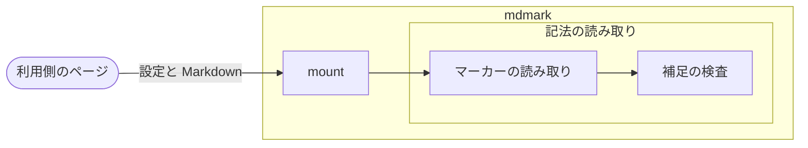
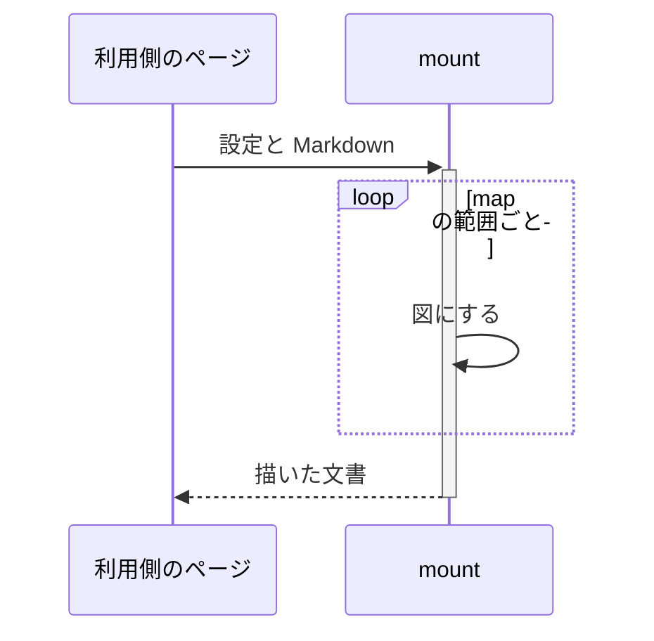

# Mermaidと補足で図を描く

map のマーカー・Mermaid のブロック・補足の記載方法と、配置と色の上書き・案内・再生の書き方の手順

座標を記載せずに構成図とシーケンス図を描き、読者にグループの中へ入る・開閉・案内・再生で辿らせるときに実行する。

## 前提

- [文書を描く](./導入-文書を描く.md)
- 設定の `features.map` がオン（既定）。オフにする手順は [機能をオン・オフする](./カスタマイズ-機能をオン・オフする.md)

## 手順

### map の範囲に Mermaid を記載する

````markdown
<!-- map: {"title": "全体の構成"} -->



<!-- /map -->
````

`<!-- map -->` 〜 `<!-- /map -->` の範囲の `mermaid` のブロックが、座標を記載しなくても自動で配置した図になる。
`subgraph` はグループになり、入れ子の内側から配置する。
描くのは Mermaid の 1 行目が `flowchart` と `sequenceDiagram` の図。
グループの分け方は [構成図の決まり](./構成図の決まり.md#グループにするかの判定) の判定フローチャートで決める。
マーカーの引数（`title`・`focus`・`play`・`interval`・`collapse`）は [map の引数](./記法.md#map)。

### ノードと線の種類を設定で作る

```yaml
map:
  kinds:
    step: { label: 処理, icon: cog, shape: rounded }
    store: { label: 保存先, icon: database, shape: rect, color: purple }
    outside: { label: 外部, icon: globe, shape: pill, color: green }
  lines:
    "-.->": { dash: dashed, head: open }
    back: { dash: dotted, head: open }
```

mdmark はノードの種類と線の種類を持たない。
`map.kinds` に Mermaid のクラス名（`:::step`）ごとの種類の名前・アイコン・形状・色を、`map.lines` に矢印ごとと名前ごとの模様・太さ・矢じり・色を記載する。
クラスを付けないノードは種類の行を空にし、設定の無い矢印は実線で描く。
キーの一覧は [map の設定](./設定.md#map-の設定)。

### 補足で説明・案内・上書きを付ける

```markdown
<!-- map-data: {
  "version": 1,
  "notes": {"data": {"text": "version と機能ごとのキーをスキーマで検査する"}},
  "walkthroughs": [
    {"title": "mount に渡す", "text": "設定と Markdown を mount に渡す", "nodes": ["user", "mount"]},
    {"title": "補足を検査する", "text": "記法の読み取りの中で補足を検査する", "nodes": ["marker", "data"], "enter": "read"}
  ],
  "layout": {
    "read": {"color": "blue"},
    "mount->marker": {"packet": {"color": "source", "shape": "diamond"}},
    "data": {"justify": "start"}
  }
} -->
```

補足は範囲の中に `<!-- map-data: {JSON のオブジェクト} -->` で 1 つ記載する。

| キー | 付くもの |
| --- | --- |
| `notes` | ノード・線・グループのタイトルのマーカーにポインターを当てたときのツールチップと、再生の帯の説明 |
| `walkthroughs` | 図の下の帯で前へ・次へ・自動で進める案内。手順ごとにノードを強調し、強調するノードどうしの線にデータの印を流す |
| `layout` | ノード・グループ・線の ID ごとの色・並び・寄せ方・座標・幅・最初に閉じるか・線の種類・データの印・線の端の辺・経由点 |

上書きの無い部分は自動の配置のまま。
文字の値に `--` を含めない（HTML コメントを閉じてしまう）。
キーの一覧は [補足のキー](./記法.md#補足のキー)。

### ノードにリンク先を持たせる

`flowchart` に `click {ID} "{リンク先}"` の行を記載すると、そのノードの全体がリンクになる。


リンク先は `http`・`https`・`mailto` と相対パスだけ。ほかのリンク先は図の前に記載の警告が出て、そのノードはリンクにならない。

### 座標で記載した図を map へ書き換える

廃止した `flow`・`sequence` の範囲は、`mdmark upgrade` が map の範囲へ書き換える（[バージョンを上げる](./導入-バージョンを上げる.md)）。
システムの枠と層は入れ子の `subgraph`、ノードの種類は Mermaid のクラス、`flow` 以外の線の種類は補足の `layout` の `line`、ノードの `sub`・`io`・`hint` と線の `tip` は補足の `notes` になり、使用していた種類は設定の `map.kinds`・`map.lines` に書き足される。
範囲と更新日と `stickyTitles` は写さず、移行の報告に挙がる。

### シーケンス図を構成図の上で再生する

````markdown
<!-- map: {"title": "描くまでの流れ", "interval": 3} -->



<!-- map-data: {"version": 1, "plays_over": 1, "notes": {"1": {"text": "map の範囲の Markdown と印の引数"}}} -->

<!-- /map -->
````

図の下の帯でメッセージを 1 通ずつ進め、`plays_over` で指した構成図（文書の中の map の番号）の、同じ ID のノードの上でも強調する。
`rect` の直前に `%% block: 名前` を記載すると、名前の無いブロックに名前を付けられる。

### 読者ができること

| 操作 | 結果 |
| --- | --- |
| グループのタイトルを押す | そのグループの中だけを配置し直し、外を薄く残す。右上の戻るボタンか Esc で外へ戻る |
| 開閉のボタンを押す | グループを閉じて 1 つのノードにし、中への線を 1 本にまとめる。Shift を押すと中のグループもまとめて開閉する |
| ノード・線を押す | そのノードと線のほかを薄くし、線にデータの印を流す |
| ノード・グループのタイトルの行・線の区間をドラッグする | 位置を変える。右上の「配置と選択を元に戻す」で自動の配置に戻す |
| 帯の前へ・自動で進める・次へを押す | 案内・再生を進める |

中へ入った状態と開閉は同じタブの中で描き直しても保ち、中へ入ったグループは URL のクエリ文字列 `map-{図の番号}` にも保つ。
拡大・縮小・全画面・リサイズハンドルは [図を描く](./図を描く-図を描く.md#読者ができること) と同じ。

## 反映

即時。`mount` と `update` で描くたびに、map の範囲から配置し直す。
`render` が返却する HTML 文字列は図にせず、Mermaid のソースのコードブロックのまま返却する。

## 確認

#### 図が描かれている

```js
[...document.querySelectorAll(".mdmark figure.mdmark-diagram")].map((f) => f.dataset.diagram)
```

記載した順に `map` が出る。

#### 記載方法を誤ったとき

Mermaid の読めない行・補足の誤り・補足が指す無い ID・設定に無いクラスと線の名前は、図の上の `記載の警告` のブロックに修正方法つきで並び、読めた部分を図にする。
`mdmark check` は、同じ誤りとマーカーの知らないキーを `map_*` のずれで返却する（[点検する](./書き出す-点検する.md)）。

外観と操作は [描いた図を確認する](./図を描く-描いた図を確認する.md) の手順で確認する。

## 元に戻す

範囲のマーカーと補足を削除する。`mermaid` のブロックは mermaid のコードブロックとして描かれる。
map の図を描く機能ごと止めるときは、`features.map` をオフにする。
