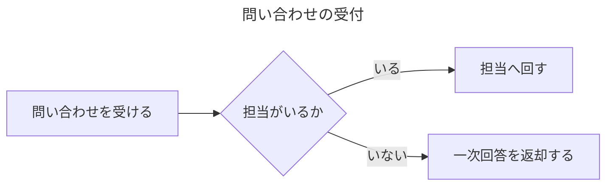
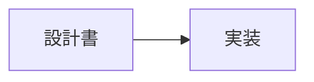

# mermaidの図を描く

mermaid のコードブロックを記載して mdmark の外観の図にし、テーマを変える手順

ほかのツールで記載した mermaid を、VS Code のプレビューと書き出した HTML で図にして読み込ませるときに実行する。

## 前提

- [文書を描く](./導入-文書を描く.md)
- 設定の `features.mermaid` がオン（既定）。
  オフにする手順は [機能をオン・オフする](./カスタマイズ-機能をオン・オフする.md)

## 手順

### mermaid のコードブロックを記載する

<!-- code: {"raw": true} -->

````markdown

````

言語を `mermaid` にしたコードブロックが、図の枠に入った図になる。
front matter の `title` が図の枠のタイトルになり、図の中には重ねて描かない。
`title` が無ければ `accTitle`、どちらも無ければ図の種類の名前（`フローチャート`・`シーケンス図` など）がタイトルになる。
`flowchart`・`sequenceDiagram`・`erDiagram`・`stateDiagram-v2`・`classDiagram`・`architecture-beta`・`C4Context`・`C4Container`・`C4Component`・`C4Dynamic`・`C4Deployment`・`mindmap`・`gantt`・`timeline`・`gitGraph`・`journey`・`block-beta` は、map の範囲に入れなくても map の図で描く（機能 `map` がオフのときは mermaid の図で描く）。
説明のツールチップ・案内・配置の上書きを付けるときは、[Mermaidと補足で図を描く](./図を描く-Mermaidと補足で図を描く.md) の map の範囲に入れて補足を記載する。
次のどれかを持つコードブロックは、map の図にせず、警告を出さずに mermaid の図で描く。

- map が読み取れない行（`A --o B` など）
- 外観を指定する行（`classDef`・`style`・`linkStyle`・`cssClass`・flowchart の `class`・mindmap の `::icon()`）とノードの `:::` のクラスの指定
- `%%{` で始まる設定の行と、front matter の `config`

`gantt`・`pie` など、ほかの種類は mermaid の図で描く。
シーケンス図の `actor` は、mdmark のほかの図と同じ人のアイコンで描く。
記載方法の一覧は [mermaid のコードブロック](./記法.mark.md#mermaid-のコードブロック)。

### ノードをリンクにする

<!-- code: {"raw": true} -->

````markdown

````

`flowchart` の `click {ノード} href "{URL}"`・`click {ノード} "{URL}"` と、`classDiagram` の `click {クラス} href "{URL}"`・`link {クラス} "{URL}"` の行を記載すると、そのノードが記載した URL のリンクになる。
リンクは本文のリンクと同じ色と下線で、押すか Tab でフォーカスして Enter を押すと同じタブで開く。
後ろに記載した `_blank` などの開く先とツールチップは使用しない。
URL は本文のリンクと同じく `http`・`https`・`mailto` と相対パスだけをリンクにし、`javascript:` などはリンクにしない。
`flowchart` と `classDiagram` の `id:` で始まる URL は、`mount` の `resolveIdLink` が返却した URL のリンクにする（[Mermaidと補足で図を描く](./図を描く-Mermaidと補足で図を描く.md#ノードにリンク先を持たせる)）。
`click {ノード} call {関数}()` などの関数を呼ぶ行は動かさない。

### テーマを変える

```yaml
mermaid:
  theme: neutral
  themeVariables:
    mainBkg: "#e0f2f1"
```

テーマは mermaid で描く図にだけ適用し、map の図は map の配色で描く。
既定のテーマ `mdmark` は、描いた文書の配色（`--mdmark-color-*` の CSS 変数）から図の色を作り、明暗を切り替えると図も再描画する。
`theme` に mermaid のテーマの名前（`default`・`neutral`・`dark`・`forest`・`base`）を記載すると、そのテーマで描く。
`themeVariables` は、選んだテーマの変数に重ねる。
どのテーマでも、グラデーションと影は付けない。
キーの一覧は [mermaid の設定](./設定.mark.md#mermaid-の設定)。

### 読み込み先を差し替える

```yaml
mermaid:
  url: /vendor/mermaid/mermaid.esm.min.mjs
```

既定では、バージョンを固定した jsDelivr の URL から、mermaid で描くコードブロックがある文書でだけ読み込む。
外へ要求できない環境では、mermaid の `dist/` をそのまま配置した場所を指す。
`mdmark export`・`mdmark build` は、mermaid で描くコードブロックがある文書のときだけ mermaid を 1 枚の HTML に埋めるため、開いたときに外へ要求しない（[1枚にまとめる仕組み](./コアコンセプト-1枚にまとめる仕組み.md)）。

### 読者ができること

図の枠の右上に重ねたパネルのボタンとキーの `+`・`-`・`0`・ピンチで拡大・縮小し、ドラッグと矢印キーで動かし、全画面で開き、右下のリサイズハンドルで高さを変える。
図の中の文字はドラッグで選んでコピーでき、文字の無い所のドラッグは図を動かす。
map の図では、ノード・参加者の選択と強調、ノード・グループ・線の移動と参加者の並べ替え、グループの開閉、シーケンス図の再生のバーも使用できる。
シーケンス図の参加者かライフラインにポインターを合わせている間は、その参加者を選んだときと同じく強調する。
シーケンス図の参加者の行は、図の中を縦に動かしたときも文書をスクロールしたときも上端に留まる。
操作は [図を描く](./図を描く-図を描く.md#読者ができること)。

## 反映

即時。
`mount` と `update` で描くたびに、mermaid のコードブロックから再描画する。
`render` が返却する HTML 文字列は図にせず、コードブロックのまま返却する。

## 確認

#### 図が描かれている

```js
[...document.querySelectorAll(".mdmark figure.mdmark-diagram")].map((f) => f.dataset.diagram)
```

記載した順に、map が描ける種類は `map`、ほかの種類と mermaid の図で描いたコードブロックは `mermaid` が出る。
図の枠のタイトルが front matter の `title` の文字になっている。

#### ノードがリンクになっている

```js
[...document.querySelectorAll(".mdmark a.mdmark-diagram-node-link")].map((a) => a.getAttribute("href"))
```

`click`・`link` の行に記載した URL が、記載した文字のまま出る。

#### 読み込めないとき・記載方法を誤ったとき

`mermaid.url` を無いファイルにすると、コードブロックの上にタイトル `この図を表示できません` の枠が出て、コードブロックのまま残る。
図の種類の行が無いソースを記載すると、コードブロックの上にタイトル `記載の警告` の枠が出て、`mermaid の図を描けません（` から始まる文が記載される。

外観と操作は [描いた図を確認する](./図を描く-描いた図を確認する.mark.md) の手順で経由する。

## 元に戻す

コードブロックの言語を `mermaid` 以外にするか、コードブロックを削除する。
map が描ける種類を mermaid の図で描くときは、`features.map` をオフにする。
mermaid の図を描く機能ごと止めるときは、`features.mermaid` をオフにする。
オフにすると mermaid を読み込まず、コードブロックのまま描く。
