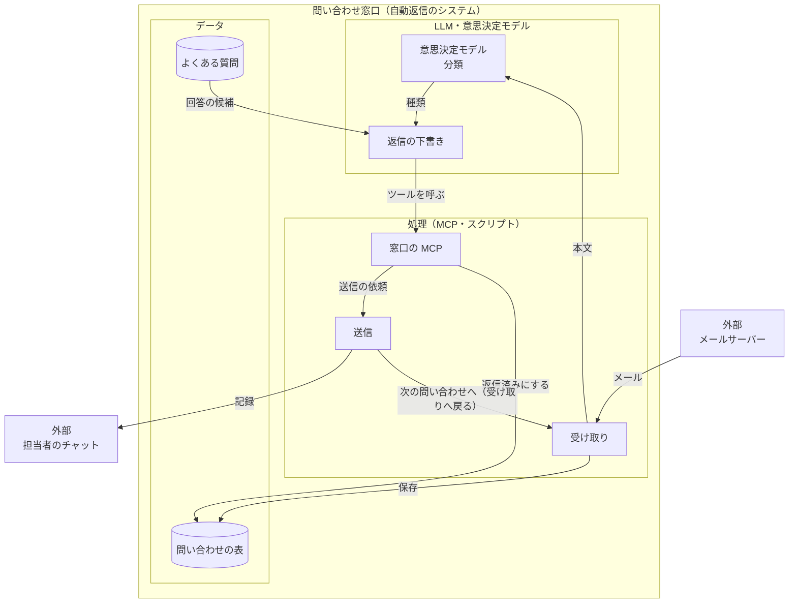
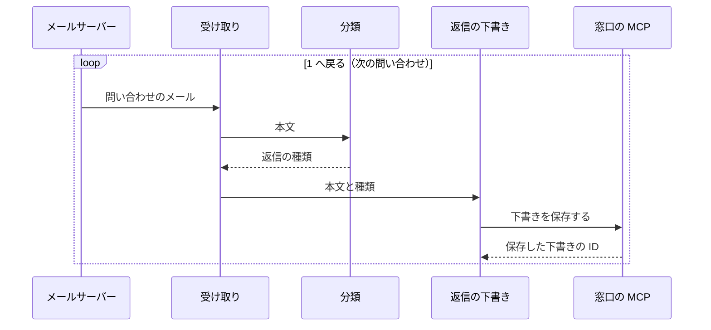

# 見本

map の図・グラフ・操作できる部品を組み合わせた見本の文書

部品の定義をコピーして始めるときに開く。

## 問い合わせ窓口の設計メモ

問い合わせのメールを受け取り、意思決定モデルが返信の種類を選び、LLM がよくある質問から下書きを作成して、担当者のチャットへ記録を送信する。

### 構成

<!-- map: {"title": "問い合わせへの自動返信の構成"} -->



<!-- map-data: {"version": 1, "notes": {"recv": {"text": "1 通ずつ読み込む\n入力: 問い合わせのメール\n処理: 件名・本文・送信者を取り出し、表に保存してから分類へ回す\n出力: 本文と、問い合わせの表の行"}, "classify": {"text": "返信の種類を選ぶ\n入力: 問い合わせの本文\n処理: 返信の種類（よくある質問で回答する・担当者へ回す）から 1 つ選ぶ\n出力: 返信の種類と、その確からしさ"}, "draft": {"text": "{{よくある質問}}から作成\n入力: 本文・返信の種類・回答の候補\n処理: 回答の候補から返信の下書きを作成し、保存のツールを呼ぶ\n出力: 下書きの本文とツールの呼び出し"}, "mcp": {"text": "保存・送信を頼む"}, "send": {"text": "宛先へ返信する\n入力: 送信の依頼（下書きの ID）\n処理: 下書きを宛先へ送信し、担当者のチャットへ記録を送信する\n出力: 送信したメールと記録"}, "table": {"text": "状態つき"}, "faq": {"text": "質問と回答"}, "mail->recv": {"text": "件名・本文・送信者のアドレス"}, "recv->classify": {"text": "件名を除いた本文。署名と引用は落とす"}, "draft->mcp": {"text": "下書きの本文・宛先・返信の種類"}, "faq->draft": {"text": "質問に近い回答 3 件と、その見出し"}, "send->chat": {"text": "返信の本文と宛先"}}} -->

<!-- /map -->

回答の候補が無い問い合わせは、分類が担当者へ回す種類を選び、下書きを作成せずに担当者のチャットへ送信する。

### 1 通の流れ

<!-- map: {"title": "問い合わせ 1 通の流れ"} -->



<!-- map-data: {"version": 1, "notes": {"1": {"text": "件名・本文・送信者のアドレス"}, "4": {"text": "本文・返信の種類・回答の候補 3 件"}}} -->

<!-- /map -->

### 返信までの時間

<!-- chart -->

```json
{
  "title": "返信までの時間",
  "scope": "10 月の第 2 週",
  "updated": "2026-10-17",
  "x": { "label": "曜日", "ticks": ["月", "火", "水", "木", "金"] },
  "y": { "label": "分", "min": 0, "max": 60, "step": 15 },
  "series": [
    { "name": "自動返信", "points": [12, 9, 14, 8, 10] },
    { "name": "担当者", "points": [42, 38, 51, 35, 44] }
  ]
}
```

<!-- /chart -->

### 返信の速さの見積もり

返信の進みの見積もりは、反応の強さで変わる。

<!-- param -->

```json
{
  "title": "返信の速さの見積もり",
  "knob": { "key": "strength", "label": "反応の強さ", "min": 0, "max": 10, "step": 1, "value": 5 },
  "chart": {
    "title": "反応の強さごとの返信の進み",
    "scope": "経過 0〜10 秒",
    "updated": "2026-10-17",
    "x": { "label": "経過（秒）", "ticks": ["0", "2", "4", "6", "8", "10"] },
    "y": { "label": "返信の進み（%）", "min": 0, "max": 100, "step": 25 }
  },
  "table": {
    "0": [0, 0, 0, 0, 0, 0],
    "1": [0, 10, 18, 26, 33, 39],
    "2": [0, 18, 33, 45, 55, 63],
    "3": [0, 26, 45, 59, 70, 78],
    "4": [0, 33, 55, 70, 80, 86],
    "5": [0, 39, 63, 78, 86, 92],
    "6": [0, 45, 70, 83, 91, 95],
    "7": [0, 50, 75, 88, 94, 97],
    "8": [0, 55, 80, 91, 96, 98],
    "9": [0, 59, 83, 93, 97, 99],
    "10": [0, 63, 86, 95, 98, 99]
  }
}
```

<!-- /param -->

### 用語

<!-- glossary: {"term": {"column": "用語"}, "meaning": {"column": "意味"}} -->

| 用語 | 意味 |
| --- | --- |
| 意思決定モデル | 選択肢から選ぶ・当てはまるかに回答するだけの、速く安い判断用の AI |
| よくある質問 | 問い合わせの多い質問と、その回答をまとめた表 |

<!-- /glossary -->

## 使用方法

- 構成図とシーケンス図の記載方法は [Mermaidと補足で図を描く](./図を描く-Mermaidと補足で図を描く.md)
- グラフと操作できる部品の定義の記載方法は [図を描く](./図を描く-図を描く.md) と [操作できる部品を作る](./図を描く-操作できる部品を作る.md)
- ノードと線の配置方法は [構成図の決まり](./構成図の決まり.md)
- 固有の部品を追加するときは [固有の部品とCSSを適用する](./図を描く-固有の部品とCSSを適用する.md)
