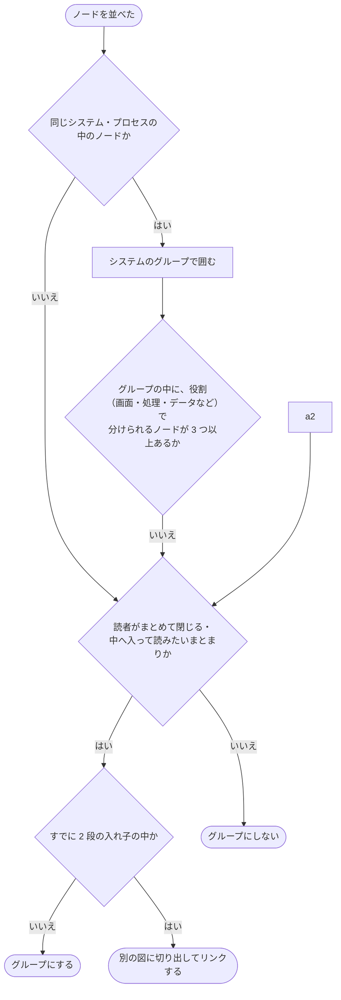
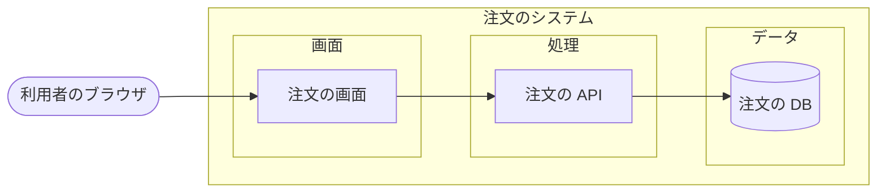

# 構成図の決まり

構成図の外観の決まり（入れ子と層・タイトル・ノード・線・交差・ツールチップ・操作）

システムの構成を描く map の構成図が守る決まり。
記載方法は [Mermaidと補足で図を描く](./図を描く-Mermaidと補足で図を描く.md)、処理の順番を描く図は [フローチャートの決まり](./フローチャートの決まり.md)。

## map の図の入れ子と層

[map](./記法.md#map) の図は、枠も層も `subgraph` の入れ子（グループ）で描き、座標を記載せずに自動で配置する。
層を表す専用の要素は無い。

| 項目 | 決まり |
| --- | --- |
| 入れ子の深さ | 2 レイヤーまでを推奨する。それより深い構成は、別の図に切り出してリンクする |
| 層 | 役割（画面・処理・データなど）ごとのグループで表す。層の名前はグループのタイトル、並びはグループの記載の順と親の `direction`、色は補足の `layout` の `color` で決める。mdmark は層の種類を持たない |
| 層の色の重なり | 色を指定したグループの面は、外のグループの面の上に重ねる。色を指定しないグループは面を持たず、枠線だけを描く |
| 枠のタイトル | グループの左上に、開閉のボタンとタイトルを置く。タイトルを押すとその中へ入る |
| 凡例 | 出さない。ノードの種類はノードの種類の行のアイコンと名前、線の種類は模様で見分ける |
| タイトル | 図のタイトルだけを出し、範囲と更新日は出さない |

### グループにするかの判定

ノードを並べたら、次の順に当てはめてグループを決める。
グループが無い図は、読者が閉じる・中へ入る単位を持たず、ノードが増えるほど読み取りにくくなる。



層をグループで描く例。

````markdown
<!-- map: {"title": "注文のシステム"} -->



<!-- map-data: {"version": 1, "layout": {"ui": {"color": "purple"}, "store": {"color": "orange"}}} -->

<!-- /map -->
````

## ノード

ノードの種類は、設定の `map.kinds` の色だけでなく、左上のアイコンと種類の名前でも示す。
判定フローチャートの種類の形は [フローチャートの決まり](./フローチャートの決まり.md#判定フローチャート)。

ノードと線のラベルの文字は選べ、スクリーンリーダーに出る。
長い名前と補足はノードの中で折り返す。

## 線

線の種類は、設定の `map.lines` の色と模様（破線の間隔・太さ・矢じり）の組で分け、色だけで分けない。
色を指定しない線の色は `--mdmark-color-diagram-line`。
線は縦と横だけの折れ線で、ノードの縁から縁へ参照する。
線のラベルには要約を記載し、詳細は補足の `notes` に持たせてツールチップに出す。

## 交差

- 交差は、ノードの並べ替えで減らす
- 残った交差は、横の線が縦の線を飛び越える形状（line jump）にそろえる。弧の半径は 6px
- 線どうしが同じ向きで重なるときは、4px ずつずらす

## タイトルと凡例

- 図ごとにタイトルを付ける。範囲と更新日は出さない
- 凡例は出さない（[map の図の入れ子と層](#map-の図の入れ子と層)）

## ツールチップ

| 付く先 | 出すもの |
| --- | --- |
| 線（補足の `notes` に説明を持つ線のラベルか、押せる帯） | 説明の文 |
| ノード（補足の `notes` に説明を持つノードのマーカー） | 説明の文。ツールチップのあるノードには右上にマーカーを付ける |
| グループのタイトル（補足の `notes` に説明を持つグループのマーカー） | 説明の文 |
| ノードの中の用語 | 用語集の意味。本文の用語と同じ破線の下線とツールチップ |

- 持ち主の下に出し、下に収まらないときだけ上に出す。設定の `tooltips.diagramPlacement` で上を先にできる（ノードの中の用語は本文の `tooltips.placement` に従う）
- ホバーとフォーカスの両方で出し、Esc で閉じる。上に乗っても閉じない
- タッチの端末ではタップで出し、ツールチップと持ち主の外のタップか、同じ持ち主のもう一度のタップで閉じる
- ノードのツールチップは右上のマーカーの上でだけ開き、ノードの上では開かない。ポインターの形状状は変えない
- 持ち主は `aria-describedby` でツールチップ（`role="tooltip"`）を指す
- 理解に必須の決まりは入れない。用語集は図の外にも配置する
- 同時に開くのは 1 つ。印刷では出さない

## 操作

<!-- table: {"kind": "data"} -->

| 操作 | 決まり |
| --- | --- |
| 開いたとき | 全体が表示する枠に収まる倍率（100% を超えない）で開く。どの幅でも同じ |
| 拡大・縮小 | 図の右上のボタンと、図にフォーカスしているときのキー `+`・`-`・`0`。1 回 1.25 倍で、下限は開いたときの倍率、上限は 300% |
| 戻す | `0` か倍率のボタンで、開いたときの倍率と位置に戻る。開いたときの倍率でも押せ、何も変わらない。倍率のボタンのスクリーンリーダー向けの名前は `倍率 {今の倍率}。全体が収まる倍率に戻す` |
| ホイール | 受け取らず、文書のスクロール（Shift を押しながらで横）に使用する |
| 文字の選択 | 文字の上はカーソルが I の形状で文字を選べ、それ以外の上はドラッグで図を動かす。ドラッグ中は文字を選ばせない |
| 移動 | 矢印キー（80px ずつ）と、右上の移動のボタン。移動のボタンは、図が表示する枠に収まらない間だけ出す |
| 表示する枠の高さ | 右下のリサイズハンドルのドラッグと、フォーカスしているときの `↑`・`↓`（32px ずつ）で縦にだけ変える。高さは 120px から、図の全体が今の倍率で収まる高さまで。変えた後の `0` と倍率のボタンは、変えた高さで全体が収まる倍率に戻す。ダブルクリックで元の高さに戻す。変えた高さは同じタブの中で再読み込みしても保つ。全画面と印刷では出さず、設定の `features.diagram-resize` で削除できる |
| 全画面 | 右上のボタンで図をモーダルに開く。閉じるボタンか Esc で閉じてフォーカスを戻す。ツールチップを開いている間の Esc はツールチップだけを閉じる |

<!-- /table -->

## 色の変数

ライトとダークで切り替わる。値は [テーマの CSS 変数](./API.md#テーマの-css-変数) の図の変数。
