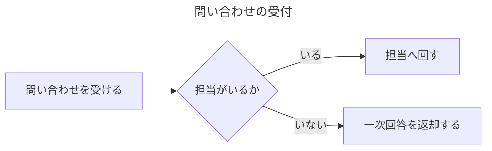
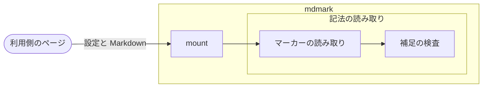

# 記法

マーカーと記法の一覧（記載方法・引数・マーカーに対応しない表示での見え方）

文書に記載して、表・注意書き・タブなどの表示を付ける記載方法の一覧。
どれも [文書を描く](./導入-文書を描く.md) で描いた文書に有効になる。

マーカーは HTML コメントで記載する。
1 か所に付けるマーカーは `<!-- 名前: 引数 -->`、範囲を持つマーカーは `<!-- 名前: 引数 -->` 〜 `<!-- /名前 -->` で囲む。
引数の無いマーカーはコロンを省いて `<!-- 名前 -->` と記載できる。
引数は `<!-- 名前: {JSON のオブジェクト} -->` のように、名前の後ろに JSON のオブジェクトを 1 つ記載する。複数の行にわたってよい。キーを省くと既定の値を使用する。
値に `-->` を記載するとコメントがそこで閉じるため、`>` を `\u003e` にした `--\u003e` で記載する。
名前の後ろが `{` で始まらない引数（`キー=値`・`+機能` などの前の書き方）は、このマイナーバージョンの間だけ読み込み、[mdmark check](./CLI.md) が `legacy_mark` で返す。[mdmark upgrade](./導入-バージョンを上げる.md) で JSON に書き換えられる。

## 一覧

<!-- table: {"kind": "data"} -->

| 名前 | 記載方法 | 説明 |
| --- | --- | --- |
| [表](#表) | `<!-- table: {"kind": "種類", "features": {…}, "columns": {…}, "collapse": {…}} -->` 〜 `<!-- /table -->` | 表に並べ替え・ピン止め・絞り込み・件数・テーブル設定・集計の行・コピー・行へのリンクと折り畳みを付け、列と行に色を付け、真偽値を ✓ で出し、多段の見出し・行見出し・セルの結合にする。キーの列を階層で出し、YAML の見本と結ぶ |
| [注意書き](#注意書き) | 引用の 1 行目の `[!NOTE] タイトル` | 引用を種類ごとのタイトル・色・アイコンを持つ枠にし、折り畳み・入れ子にする |
| [タブ](#タブ) | `<!-- tabs: {"group": "名前", "collapse": {"open": false, "title": "見出し"}} -->` 〜 `<!-- /tabs -->` | 見出しで区切った範囲をタブで切り替えて見せ、同じ組のタブの選択を統一して覚え、折り畳みに入れる。タブの中にタブを入れ子にできる |
| [ステップ](#ステップ) | `<!-- steps: {"collapse": {"open": false, "title": "見出し"}} -->` 〜 `<!-- /steps -->` | 番号付きリストを手順に見せ、折り畳みに入れる |
| [ファイルツリー](#ファイルツリー) | 言語 `tree` のコードブロックと、直前の `<!-- tree: {"depth": "all"} -->` | 罫線で記載したフォルダ構成を、注釈・アイコン・開閉・コピーボタンを持つ入れ子のツリーにする |
| [バッジ](#バッジ) | 行内のコードの頭の `badge\:` と `badge\:色:` | 行内のコードを札にし、色の名前の色を付ける |
| [文字の色](#文字の色) | `[文字]{color=色}` | 本文の文字に色の名前の色を付けて太字にする |
| [脚注](#脚注) | 本文の `[^ラベル]` と行頭の `[^ラベル]: 中身`、行内の `^[中身]` | 本文に上付きの番号とツールチップを配置し、文書の末尾に閉じた脚注の一覧を配置する |
| [コードブロックの飾り](#コードブロックの飾り) | コードブロックの直前の `<!-- code: {"title": "タイトル", "lines": {}, "highlight": […], "fold": […], "wrap": true} -->` と、コードの行末の `[!code ++]`・`[!code --]`・`[!code highlight]`・`[!code focus]`・`[!code error]`・`[!code warning]`。コードブロックの言語（`ts`・`yaml` など） | コードブロックにタイトル・行番号・行の強調・言語のラベル・コピーボタンを付け、行末のマーカーで行を追加した行・削除した行・強調・注目・エラー・警告に分け、インデントで行を畳み、言語に応じて色分けする |
| [目次](#目次) | `<!-- toc -->` | h2〜h3 の見出しの目次を配置する。文書の右側にも、マーカーなしで h1〜h3 の目次を出す |
| [見出しのアンカー](#見出しのアンカー) | なし（見出しに付く） | 見出しに ID と、その ID へのリンクを付ける |
| [セクションの開閉](#セクションの開閉) | 見出しの直後の `<!-- section: {"open": false} -->` | 見出しのセクションを見出しから開閉し、Shift と右側の目次のボタンでまとめて開閉する |
| [行の詳細](#行の詳細) | 表の直後の `<!-- row-detail: {"at": 行の位置} -->` 〜 `<!-- /row-detail -->` | 表の行の下に詳細を開閉して出す |
| [図と表の番号](#図と表の番号) | `<!-- fig: {"id": "ID"} -->` | 図と表に通し番号を付け、リンクの文字を番号にする |
| [画像](#画像) | 画像の後ろの `{width=幅 align=配置 nolightbox}`、URL のフラグメントの `#only-dark`・`#only-light` | 画像に幅と配置を当て、画像だけの段落を title のキャプションを持つ図にし、押すとライトボックスで拡大し、配色ごとに出し分ける |
| [ギャラリー](#ギャラリー) | `<!-- gallery: {"columns": 列の数} -->` 〜 `<!-- /gallery -->` | 範囲の画像を格子に並べる |
| [動画と音声](#動画と音声) | 拡張子が動画・音声の画像の記載方法と、後ろの `{autoplay muted loop poster=パス}` | 再生バー付きの動画・音声にする |
| [GIF](#gif) | 拡張子が `gif` の画像 | GIF に止める・再生するボタンを付ける |
| [リンクと添付のカード](#リンクと添付のカード) | リンク 1 つだけの段落 | URL をリンクのカードに、ファイルへのリンクを添付のカードにする |
| [用語集の表](#用語集の表) | `<!-- glossary: {"term": {"column": "列名"}, "meaning": {"column": "列名"}, "aliases": {"column": "列名"}} -->` 〜 `<!-- /glossary -->` | 表の用語・意味・別名の列から用語を入れ、本文の用語にツールチップを付ける |
| [ビュー](#ビュー) | `<!-- view: {"board": {"group": {"column": "列名"}, "values": {…}}, "initial": "board\|table", "columns": {…}} -->` 〜 `<!-- /view -->` | 範囲の最初の表を、ボード表示と表形式を切り替えるビューにし、表形式を列で絞り込む |
| [図の部品](#図の部品) | `<!-- flow -->`・`<!-- sequence -->`・`<!-- chart -->`・`<!-- param -->`・`<!-- er -->` 〜 閉じのマーカー | 範囲の `json` のコードブロックの定義から、フロー図・シーケンス図・グラフ・操作できる部品・ER 図を描く |
| [埋め込んだ HTML](#埋め込んだ-html) | `<!-- html -->` 〜 `<!-- /html -->` | 範囲の `html` のコードブロックを、コードではなくその場の HTML として描き、中の図の部品の custom element を図にする。範囲の `css`・`ts`・`js` で外観と動きを追加する |
| [ヒント](#ヒント) | 埋め込んだ HTML の要素の `data-hint` | 要素の文をツールチップで出す |
| [アイコン](#アイコン) | 行内のコードの頭の `icon\:名前` | 行内のコードを Lucide のアイコンにする |
| [キー](#キー) | 行内のコードの頭の `kbd\:` | 行内のコードを `+` で区切ったキーの外観にする |
| [蛍光ペン](#蛍光ペン) | `==文字==` と `==文字=={color=色}` | 文字に蛍光ペンの面を敷く |
| [ルビ](#ルビ) | 文書の HTML の `<ruby>` | 文字の上にルビを出す |
| [段組み](#段組み) | `<!-- columns -->` 〜 `<!-- /columns -->` と区切りの `<!-- column -->` | 本文を 2〜3 列に横に並べる |
| [カードの格子](#カードの格子) | `<!-- cards -->` 〜 `<!-- /cards -->` で囲んだリスト | リストの項目を、アイコン・タイトル・説明のカードにして格子に並べる |
| [details の範囲](#details-の範囲) | `<!-- details: {"title": "タイトル", "open": true} -->` 〜 `<!-- /details -->` | 範囲をタイトルから開閉する |
| [改ページ](#改ページ) | `<!-- pagebreak -->` | 印刷のときにその場所で改ページする |
| [取り込み](#取り込み) | `<!-- include: {"path": "パス", "heading": "見出しの ID"} -->`・`<!-- include: {"path": "パス", "lines": {"from": 開始, "to": 終了}} -->` | ほかの文書の全体・見出しの中・コードの行の範囲を取り込む |
| [wide の範囲](#wide-の範囲) | `<!-- wide: {"open": false} -->` 〜 `<!-- /wide -->` | 図・表・画像を本文の幅より広げ、ボタンで本文の幅と切り替える |
| [CSV の表](#csv-の表) | 言語 `csv` のコードブロック | CSV を表にし、ボタンで元の CSV と切り替える |
| [mermaid のコードブロック](#mermaid-のコードブロック) | 言語 `mermaid` のコードブロック | mermaid の記法を、mdmark の外観のテーマで図にして図の枠に入れる |
| [map](#map) | `<!-- map: {JSON のオブジェクト} -->` 〜 `<!-- /map -->` の範囲の `mermaid` のブロックと `<!-- map-data: {JSON のオブジェクト} -->` | Mermaid の `flowchart` と `sequenceDiagram` を、入れ子のグループを自動で配置した図にし、中へ入る・開閉・案内・再生・選択・移動で読ませる |
| [ページの設定](#ページの設定) | 文書の先頭の `<!-- page: {"scheme": "明暗", "theme": "テーマ", "toc": {"mode": "出し方"}} -->` | 文書ごとに配色の明暗・テーマ・右側の目次の出し方を指定する |
| [フロントマター](#フロントマター) | 文書の 1 行目の `---` 〜 `---` か `...` | 文書の先頭の YAML を本文に出さず、機能がオンのときだけ折りたたみに出す |
| [拡張のマーカー](#拡張のマーカー) | `<!-- 名前: 引数 -->` | 利用側が追加したマーカーを描く |
| [記載の警告](#記載の警告) | なし（読み込めない指定の箇所に出る） | 読み込めない指定とその修正の仕方を通知する |

<!-- /table -->

## 表

表に、種類ごとの並べ替え・ピン止め・絞り込みと折り畳みを付ける。
機能の名前は `table`（[設定](./設定.md#記法の機能)）。
手順は [表に機能を付ける](./記載する-表に機能を付ける.md)。

### 記載方法

```markdown
<!-- table: {"kind": "data", "columns": {"名前": {"filter": {}}, "更新日": {"filter": {"type": "date"}}}, "collapse": {"open": false}} -->

| 名前 | 値 | 更新日 |
| --- | --- | --- |
| りんご | 10 | 2026-10-01 |
| みかん | 2 | 2026-10-02 |

<!-- /table -->
```

マーカーで囲んだ範囲の表すべてに該当する。
囲まない表は既定の種類で描く。

### 引数

<!-- table: {"kind": "data"} -->

| 引数 | 説明 |
| --- | --- |
| `kind` | `"data"` か `"plain"`。省くと既定の種類 |
| `features.{機能}` | 種類の機能に追加する。`{}` で追加し、`{"enabled": false}` で削除する。機能は `sort`（並べ替え）・`pin`（ピン止め）・`filter`（絞り込み）・`resize`（列の幅の変更）・`count`（件数の表示）・`columns`（列の表示・非表示）・`reorder`（列の並べ替え）・`total`（集計の行）・`copy`（表のコピー）・`rowlink`（行へのリンク）。下の列の設定を記載した機能は、記載しなくても付く |
| `columns.{列名}` | 列ごとの設定。列名は表の見出しの文字（多段の見出しは最下段の文字） |
| `columns.{列名}.filter` | 絞り込みを付ける。`type` は `"select"`・`"text"`・`"date"` で、省くと長文の列は `"text"`、ほかの列は `"select"`（`{}`・`{"type": "date"}`）。`filter` の機能が付く |
| `columns.{列名}.hidden` | `true` で最初から隠す。`columns` の機能が付く。Markdown に記載した先頭の列は隠せない |
| `columns.{列名}.total` | 集計の行で集計する計算の配列（`[{"calc": "sum"}]`）。計算は `sum`（合計）・`avg`（平均）・`count`（空でないセルの数）。計算ごとに 1 行ずつ出る。`total` の機能が付く |
| `columns.{列名}.sort` | `true` で長文の列にも並べ替えを付け、`false` でその列の並べ替えを外す。長文の列には、記載しないと並べ替えが付かない（表の種類と `features.sort` の記載によらない）。`true` を記載すると `sort` の機能が付く |
| `columns.{列名}.pinned` | `true` で描いた直後にピン止めする。`pin` の機能が付く。どの列にも記載しないと、行見出しの列（行見出しが無ければ先頭の列）を留める。`false` は、その既定の列を留めない。設定の `table.pin` が `through` の表は、`true` の列のうち最も右の列までを留める |
| `columns.{列名}.width.mode` | `"nowrap"` で折り返さず、値の長さの幅を取る。読者が列の幅を変えた後に元の幅に戻すと、この幅に戻る。省くと `"auto"`（列の中身から折り返すかを決める） |
| `columns.{列名}.width.min`・`width.max` | 列の幅の下限と上限（em の数）。記載した列は文字数によらず折り返し、この範囲の幅で描く。`min` が `max` より大きいときは `max` を優先する |
| `columns.{列名}.format.type` | `"check"` で、`true` のセルを ✓、`false` のセルを空欄で出す |
| `columns.{列名}.highlight` | 列を面の薄い色で強調し、見出しのセルの下端に線を描く。`color` は [色の名前](#色の名前) で、省くと `"blue"`（`{}`・`{"color": "red"}`） |
| `collapse` | 表を折り畳みに入れる。`open` が `true` なら開いて、省くと閉じて始める。`title` は折り畳みの見出しで、省くと `表（{本文の行の数} 行）` |
| `rows.colors` | 行に色を付ける条件の配列。要素は `column` と `value`（列のセルの文字が値と一致する行）か、`at`（見出し行を除いて 1 から数える行の位置。範囲は `{"from": 2, "to": 4}`）と、`color`（[色の名前](#色の名前)）を持つ。複数の要素が該当する行は、後ろの要素の色にする |
| `header.rows` | 表の先頭の何行を見出し行にするか。省くと 1。表の行の数以上の値は 1 にして記載の警告を出す |
| `header.columns` | 本文の各行の先頭の何列を行見出しにするか。`pin` の機能を持つ表では、`pinned` を記載しないと行見出しの列を留める。表の列の数以上の値は当てずに記載の警告を出す |
| `tree.key.column` | 列の文字を `.` と `[]` で区切ったキーのパスとして読み込み、行を階層で出す（[キーの階層と YAML の見本](#キーの階層と-yaml-の見本)）。`tree` の表には並べ替えを付けない |
| `tree.type.column` | 型の列。`a \| b` の書式のセルは値ごとのチップ、それ以外はバッジで出す |
| `tree.required.column` | 必須の列。列は出さず、セルが `✓`・`true` の行のキーの名前の後ろに `*` を付ける |
| `tree.default.column` | 既定の列。空でないセルを既定の値の書式で出す |
| `tree.example.heading` | 見出しの直下のタブの範囲を、表の下へ YAML の見本として移す |

<!-- /table -->

種類ごとの機能は次のとおり。

| 種類 | 付く機能 |
| --- | --- |
| 既定 | ピン止め・列の幅の変更 |
| `data` | 並べ替え・ピン止め・絞り込み・列の幅の変更 |
| `plain` | なし。外側の枠・縦の罫線・面を削除する |

`count`・`columns`・`reorder`・`total`・`copy`・`rowlink` はどの種類の既定にも入らず、`features` か列の設定に記載した表にだけ付く。

機能の動きは次のとおり。

<!-- table: {"kind": "data"} -->

| 機能 | 動き |
| --- | --- |
| 並べ替え | 列の見出しを押すたびに、降順・昇順・元の並びを繰り返す。数値だけの列は数の大きさ、それ以外は文字の順で並べる |
| ピン止め | 表が幅からはみ出すときだけ、各列の見出しにボタンを出す。描いた直後は `pinned` が `true` の列（どの列にも記載しないと行見出しの列、行見出しも無ければ先頭の列）を留める。押した列だけを留め、もう一度押すとその列だけを解除する。留めた列は、その列より左を表示している間は表の右端に、過ぎた後は左端に留まる。設定の `table.pin` を `through` にすると、押した列までを左端に留め、もう一度押すと解除する。留めるのは表がはみ出す間だけ |
| 列の幅の変更 | 最下段の各列の見出しの右端に、列の幅のつまみを出す。ドラッグか、つまみにフォーカスしての ←・→ キー（1 回 16px）で、つまみの左の列の幅だけを変える。ダブルクリック・ダブルタップ・Enter で自動で決めた幅（`width.mode` が `"nowrap"` の列はその幅）に戻す。列は 6em より狭くならず、表の見えている幅からほかに留めた列の幅を引いた幅より広くならない。幅を変えた `"nowrap"` の列は折り返す。幅は保存せず、再描画すると Markdown に記載したとおりに戻る |
| 絞り込み | `filter` を記載した列の見出しにだけボタンを出す。押すと絞り込みのドロワーが開き、外を押すか Esc で閉じる。列ごとの絞り込みは重ねて該当する |
| 件数の表示 | 表の上に `{表示している行の数} / {全ての行の数} 件` を出す。絞り込みで行が減ると表示している行の数が変わる |
| テーブル設定 | `columns`・`reorder` のどちらかを持つ表の上のテーブル設定のボタン（アイコンだけで、ツールチップは `テーブル設定`。列を隠している間は隠した列の数のバッジを出す）で、列名を並べたパネルを開く |
| 列の表示・非表示 | `columns` の表のパネルの目のアイコンで、列ごとに切り替える。`hidden` が `true` の列は最初から隠す。Markdown に記載した先頭の列の目のアイコンは押せず、パネルに `先頭の列は隠せません` を出す |
| 列の並べ替え | `reorder` の表のパネルのつまみのドラッグと、つまみにフォーカスしての ↑・↓ キーで、列の順を変える。結合した見出しの下の列はその範囲の中だけで動く。留めた列は留めたまま動く。設定の `table.pin` が `through` の表は、ピン止めの列とそれ以外の列の境はまたげない。順は保存せず、再描画すると Markdown に記載した順に戻る |
| 集計の行 | `total` を記載した列を表の末尾の行で集計する。計算ごとに 1 行ずつ、`合計`・`平均`・`件数` の順に並べ、先頭のセルに計算の名前、その計算を記載した列のセルに値を出す。集計するのは表示している行で、絞り込みに合わせてもう一度計算し、並べ替えでは動かない。`sum`・`avg` は空のセルを除く。`sum`・`avg` の列に空でなく数として読み込めないセルが 1 つでもあると、その列のその計算のセルを空にし、表の上に記載の警告を出す。表の上の `集計` のボタンで、出す計算を選べる。選びは覚えず、再描画すると全ての計算が出る |
| 表のコピー | 表の上の表をコピーのボタン（アイコンだけで、ツールチップは `表をコピー`）で、コピーの形式（`Markdown の表`・`TSV`）を選び、見出しの行と表示している行の、表示している列を、選んだ形式でクリップボードへコピーする。Markdown の表はセルの中の縦線を `\` でエスケープし、TSV はセルをタブで、行を改行で区切る。集計の行・行の詳細は含めない。コピーできたらボタンのツールチップが `コピーしました` になる。コピーできなかったらボタンのツールチップが `コピーできませんでした` になり、コピーする中身を全て選択した読み取り専用のパネルを表の上に出す。パネルは閉じるボタンか Esc で閉じる |
| 行へのリンク | 各行の先頭のセルに、その行を指す `#ID` のリンクを配置する。URL の `#ID` が行を指すとき、その行へ移って強調する。閉じた表・閉じたセクションの中の行は開いてから、絞り込みで隠れた行はその表の絞り込みを解除してから移る。リンクを押すと、行へ移る動きに加えて、その行を指す絶対 URL をクリップボードへコピーし、リンクの横に `リンクをコピーしました`（コピーできなければ `リンクをコピーできませんでした`）を出す |

<!-- /table -->

色を付けた行は面の薄い色にし、上下に線を描く。
値で付けた色は行に付くので、並べ替え・絞り込みの後も行と一緒に動く。
列と行の色はどの種類の表にも記載できる。

`width.mode` が `"nowrap"` の列は折り返さず、はみ出した分は表の中で横にスクロールする。
`format.type` が `"check"` の列は、`true` のセルを ✓、`false` のセルを空欄にして中央に配置し、スクリーンリーダーでは `はい`・`いいえ` と読み込む。ほかの文字のセルはそのまま出す。
並べ替え・絞り込み・コピー・集計は、✓ と空欄ではなく `true`・`false` の値で行う。
`width`・`format` はどの種類の表にも記載できる。

行へのリンクの `#ID` は、先頭の列の文字から見出しのアンカーと同じ規則で作り、同じ文書の中で重なれば `-1`・`-2` を付ける。

絞り込みの種類は次のとおり。

| 種類 | 絞り方 |
| --- | --- |
| `select` | 値をチェックボックスで選ぶ。候補を検索できる |
| `text` | キーワードの欄に入れた文字を含む行に絞る |
| `date` | 開始日と終了日の期間に絞る。日付として読み込めないセルの行は、期間を指定すると合わない |

見出し行は面の色で本文の行と分ける。
表に高さの上限は無く、表が画面に残っている間、見出し行はページを縦にスクロールしても画面の上端に留まり、集計の行は画面の下端に留まる。
見出し行を留める位置は、`--mdmark-sticky-top`（[テーマの CSS 変数](./API.md#テーマの-css-変数)）で画面の上端からずらせる。
横にはみ出す表は、表の中で横にスクロールする。
本文の行は地の色のままで、表の外側は角丸の 1px の枠で囲む。

列の幅は、列ごとのセルの中身から決める。
長文の列（改行で分けた 1 行が 20 文字以上のセルを持つ列。数値・日付・✓・バッジ・行内のコードだけの列を除く）だけを折り返し、ほかの列は最も長い行の幅にする。
長文の列は本文の幅いっぱいまで広げ、折り返さずに収まるときは最も長い行の幅で止める。
長文の列の最小の幅は 45em（最も長い行の方が短ければその幅。設定の `table.long_column_min` で変えられる）で、全ての列の最小の幅の合計が見える幅を超えるときは最小の幅で描き、表の中で横にスクロールする。
全ての列が折り返さずに収まる表は、本文の幅まで広げずに列の幅の合計で描く。
列の幅は、描いたときと表の見える幅が変わったときだけ決め直し、並べ替え・絞り込み・列の表示の切り替えでは変えない。
印刷では、自動で決めた幅を当てない。

#### 多段の見出しとセルの結合

````markdown
<!-- table: {"kind": "data", "header": {"rows": 2, "columns": 1}} -->

| 地域 | 上期 | << |
| --- | --- | --- |
| ^^ | 売上 | 件数 |
| 東日本 | 120 | 8 |
| ^^ | 90 | 5 |
| 西日本 | 80 | 4 |

<!-- /table -->
````

マーカーで囲んだ表で、セルの文字がちょうど `^^` のセルは上のセルと、`<<` のセルは左のセルと結合する。
見出し行の結合は、結合したセルを 1 つのセルとして描く。
本文の行の結合は、結合したセルにも結合の始まりのセルと同じ値を持たせ、並べ替え・絞り込み・コピー・集計はその値で行う。
並べ替え・絞り込みの後は、表示している行で隣り合う同じ値のセルだけをもう一度結合する。
見出しが複数の行を持つ表は、並べ替え・ピン止め・絞り込みのボタンを、列ごとにその列だけを覆う最下段の見出しのセルに配置する。

見出し行と本文の行をまたぐ `^^`・上のセルが無い `^^`・左のセルが無い `<<` は結合せず、記載した文字のまま出して記載の警告を出す。
マーカーで囲まない表の `^^`・`<<` は文字のまま出す。

#### キーの階層と YAML の見本

````markdown
<!-- table: {"kind": "data", "tree": {"key": {"column": "キー"}, "type": {"column": "型"}, "required": {"column": "必須"}, "default": {"column": "既定"}, "example": {"heading": "設定の見本"}}} -->

| キー | 型 | 必須 | 既定 | 説明 |
| --- | --- | --- | --- | --- |
| features.table | bool | ✓ | true | 表の機能 |
| features.html | bool | | | 埋め込んだ HTML の機能 |
| aliases[].id | string | | | 別名の ID |
| aliases[].metadata.alias_type.type | ref \| custom | | | 別名の種類 |

<!-- /table -->

### 設定の見本

<!-- tabs -->

#### 最小

```yaml
features:
  table: true
```

#### エイリアス

```yaml
aliases:
  - id: terms
    metadata:
      alias_type:
        type: custom
```

<!-- /tabs -->
````

`tree.key` の列は、各行をキーのパスの末尾の名前で、深さの分だけ字下げした縦線つきで出す。
表に無い親のパス（例の `features`・`aliases[]`）は、その子の最初の行の前に、ほかのセルを空にした薄い斜体の行として補う。
行の順は Markdown に記載した順で、補った行を間に差し込む。

<!-- table: {"kind": "data"} -->

| 操作 | 動き |
| --- | --- |
| 開閉 | 子を持つ行のキーの左のボタンで、子孫の行を畳む・開く。開くと子だけを出し、子の開閉の状態を保つ。Shift を押しながら押すと、入れ子もまとめて畳む・開く。描いた直後は全て開く |
| 全体のパス | キーの名前にポインターを乗せるかフォーカスすると、全体のパスをツールチップで出す。名前の後ろのボタンで全体のパスをクリップボードへコピーし、`コピーしました`（コピーできなければ `コピーできませんでした`）を 2 秒出す |
| 行の選択 | 行を押すと選び、同じ親を持つ行の範囲の縦線を濃くする。別の行を押すともう一度選び、同じ行をもう一度押すと解く。開閉とコピーのボタンでは選ばない |
| 絞り込み | `filter` でキーの列を絞り込むと、末尾の名前で照合し、該当した行とその祖先の行を残して該当した文字に色を付ける。件数に補った行は数えない。絞り込みを解くと、絞り込む前の開閉の状態に戻る |

<!-- /table -->

畳んだ行も、表のコピーと集計の行に含める。

`tree.example.heading` の見出しの直下のタブの範囲は、表の下へ移して `見本: {見出し}` の見本にする。見出しは元の場所に残る。
見本の YAML の行は、インデントと `- ` からキーのパスを求め、表の行と結ぶ。
表の行を選ぶと、開いているタブの見本の同じパスの行に色を付け、タブを切り替えるともう一度付ける。見本の行を押すと、表の同じパスの行を選ぶ。
表の上の `見本を隠す` のボタンで見本を隠し、`見本を表示` で出す。描いた直後は見本を出す。

### マーカーに対応しない表示

マーカーは HTML コメントのため見えず、表は普通の表として読み込める。
`^^`・`<<` のセルと、見出し行にした 2 行目以降は、文字のまま本文の行に残る。
`format.type` が `"check"` の列は `true`・`false` の文字のまま出る。
`tree.key` の列は全体のパスの文字のまま出て、`tree.required` の列も残る。`tree.example.heading` の見出しとタブの中の YAML のコードブロックは、元の場所に読み込める。

## 注意書き

引用を、種類ごとのタイトル・色・アイコンを持つ枠にする。
枠の面は種類の色の薄い色、枠の線は淡い色になる（[テーマの CSS 変数](./API.md#テーマの-css-変数)）。
機能の名前は `callout`。
手順は [本文を部品で組む](./記載する-本文を部品で組む.md)。

### 記載方法

````markdown
> [!WARNING]
> 守らないと壊れる内容を記載する。

> [!NOTE]-
> 閉じた状態で始める補足を記載する。

> [!TIP]+ 設定を先に確認する
> 開いた状態で始める、タイトル付きのヒントを記載する。
>
> > [!WARNING]
> > 注意書きの中に注意書きを入れ子にする。
````

### 引数

| 記載方法 | タイトル |
| --- | --- |
| `[!NOTE]` | 補足 |
| `[!TIP]` | ヒント |
| `[!IMPORTANT]` | 重要 |
| `[!WARNING]` | 警告 |
| `[!CAUTION]` | 注意 |

引用の 1 行目に記載する。
`[!NOTE]-` のように末尾に `-` を付けると、タイトルだけを出す閉じた折り畳みにする。
`+` を付けると、開いた状態で始める折り畳みにする。
種類（と `-`・`+`）の後ろに空白を挟んで記載した文字をタイトルにする。タイトルの中の `**` などの行内の記法も描く。
タイトルを記載した注意書きも、スクリーンリーダーでは種類の名前（`ヒント: ` など）をタイトルの前に読み込む。
注意書きの中の引用も、1 行目が種類なら注意書きにする。
知らない種類は `NOTE` として出す。
種類はタイトルの文字でも分かる。

### マーカーに対応しない表示

マーカーではない記載方法のため、引用のまま読み込める。
引用の中に `[!NOTE]` などの文字が残る。

## タブ

範囲を、最初に出る見出しの階層で区切り、見出しの文字をタブ名にしたタブで切り替えて見せる。
機能の名前は `tabs`。
手順は [本文を部品で組む](./記載する-本文を部品で組む.md)。

### 記載方法

```markdown
<!-- tabs: {"group": "os"} -->

### macOS

macOS の手順。

### Windows

Windows の手順。

<!-- /tabs -->
```

### 引数

| 引数 | 説明 |
| --- | --- |
| `group` | タブの組の名前。同じページで同じ組のタブ群は、選んだタブ名を統一し、読者が選んだタブ名を覚える。省くと組を持たないタブ群になる |
| `collapse` | タブ群を折り畳みに入れる。`open` が `true` なら開いて、省くと閉じて始める。`title` は折り畳みの見出しで、省くと `タブ（{タブ名を・でつないだもの}）` |

範囲の中で最初に出る見出しの階層で区切り、その見出しの文字がタブ名になる。
見出しの `**` の強調は、タブのボタンでも強調して出す。強調の太さと色は `--mdmark-tab-strong-weight`・`--mdmark-tab-strong-color`（[テーマの CSS 変数](./API.md#テーマの-css-変数)）で変えられる。
タブ名にした見出しは、本文の見出しとして残らない。
組を持たないタブ群は、描いた直後に最初のタブを選ぶ。
組を持つタブ群は、描いた直後に覚えたタブ名のタブを選び、覚えていないかそのタブ名が無いときは最初のタブを選ぶ。
タブは押すか、フォーカスがあるときの左右の矢印・Home・End で選ぶ。
折り畳みに入れたタブ群は、閉じているとき見出しだけを出し、見出しを押すとタブの並びと選んだタブの中身が開く。

組を持つタブ群の動きは次のとおり。

| 動き | 内容 |
| --- | --- |
| 統一する | 読者がタブを選ぶと、同じページの同じ組のタブ群のうち、同じタブ名を持つものを同じタブ名へ切り替える。そのタブ名を持たないタブ群は今の選択のまま |
| 覚える | 読者が押すかキーで選んだタブ名を、組ごとに localStorage のキー `mdmark-tabs:{組の名前}` へ残す。描いたときの選択と、統一して切り替わった選択は残さない。再読み込みしや `update` で再描画したときも、覚えたタブ名で選ぶ |

タブの中身に `<!-- tabs -->` 〜 `<!-- /tabs -->` を記載すると、タブの中にタブを入れ子にする。
開きと閉じは内側から対応させ、内側のタブは内側の範囲で最初に出る見出しの階層で区切る。
内側のタブの選択は、外側のタブの選択を変えない。

````markdown
<!-- tabs -->

### macOS

<!-- tabs -->

#### zsh

zsh の手順。

#### bash

bash の手順。

<!-- /tabs -->

### **Windows**

Windows の手順。

<!-- /tabs -->
````

閉じの無い開きは、範囲の中に別のタブの開きが無ければ文書の終わりまでをタブにする。
別のタブの開きがあれば、外側の開きに記載の警告を出し、そこから文書の終わりまでのマーカーをどれもタブにせず、見出しと中身をそのまま出す。

localStorage を取り出す・読み込みと保存をするときに例外が出ると、残さず・読み込まずに、統一する動きと切り替えを続ける。
空の文字の `group` は組を持たないタブ群にし、[記載の警告](#記載の警告) を出す。

### マーカーに対応しない表示

マーカーは見えず、見出しと本文が順に並ぶ。

## ステップ

番号付きリストを、番号と項目をつなぐ線を持つ手順に見せる。
機能の名前は `steps`。
手順は [本文を部品で組む](./記載する-本文を部品で組む.md)。

### 記載方法

```markdown
<!-- steps -->

1. 依存を入れる。
2. ビルドする。

<!-- /steps -->
```

### 引数

| 引数 | 説明 |
| --- | --- |
| `collapse` | 手順を折り畳みに入れる。`open` が `true` なら開いて、省くと閉じて始める。`title` は折り畳みの見出しで、省くと `手順（{項目の数} ステップ）` |

範囲の最初の番号付きリストを手順にする。
項目の中の入れ子の番号付きリストは手順にしない。入れ子の項目は項目の数に数えない。

### マーカーに対応しない表示

マーカーは見えず、普通の番号付きリストとして読み込める。

## ファイルツリー

罫線で記載したフォルダ構成を、フォルダとファイルの入れ子のツリーにする。
項目の右に注釈を統一して出し、拡張子ごとのアイコンを付け、読者がフォルダを開閉して元の罫線のテキストをコピーできる。
機能の名前は `tree`。
手順は [本文を部品で組む](./記載する-本文を部品で組む.md)。

### 記載方法

<!-- code: {"tree_warning": false} -->

````markdown
<!-- tree: {"depth": "all"} -->

```tree
mdmark/
├── src/ # ソース
│   └── index.ts # 入口の `mount`
├── README.md # **必読** `badge:新規`
└── ...
```
````

直前の `<!-- tree: {"depth": "all"} -->` は省ける。

### 引数

| 引数 | 説明 |
| --- | --- |
| `depth` | 開いて描く階層。`"all"` は全てのフォルダを開く。1 以上の整数は、ルートの深さを 0 として、深さがその数より浅いフォルダを開く（`2` はルートとその直下のフォルダを開く） |
| `wrap` | `true` で、長い名前をアイコンの右の名前の列の中で折り返し、注釈を名前の下の行に名前の先頭から出す |

`wrap` が `true` でないツリーは、長い名前と注釈を折り返さず、ツリーの中で横にスクロールする。

`depth` を省くと、全てのフォルダを開く。閉じて始めるツリーは、`depth` に開く階層の数を記載する（`1` でルートだけを開く）。
マーカーは言語 `tree` のコードブロックの直前に記載し、そのコードブロックだけに該当する。

言語 `tree` のコードブロックに、罫線で記載する。
罫線は `├── `・`└── `・`│   ` と、`tree --charset=ascii` が出す `|-- `・`` `-- ``・`|   ` を読み込み、1 つのツリーで混ぜてもよい。
名前の末尾が `/` の項目か、子を持つ項目をフォルダにし、それ以外をファイルにする。

項目の名前の動きは次のとおり。

| 記載方法 | 動き |
| --- | --- |
| `名前 # 注釈` | 前に空白がある最初の `#` から後ろを注釈にする。注釈は全ての行で同じ位置の列に統一し、名前から注釈まで点線でつなぐ。`#` は出さない。注釈の中のインライン（コード・リンク・太字・`badge\:`）を描く |
| `C#/`・`#notes.md` | `#` の前に空白が無いため、注釈にせず名前のまま出す |
| `...` | ファイルでもフォルダでもない「ほかにもある」の項目にする。省略のアイコンを付け、スクリーンリーダーに `ほかにもあります` を伝える |

ファイルのアイコンは、拡張子（最後の `.` の後ろを小文字にしたもの）で種類を決め、種類ごとの色で出す。

<!-- table: {"kind": "data"} -->

| 種類 | 拡張子・名前 |
| --- | --- |
| 文書 | `md`・`mdx`・`txt`・`rst`、名前 `LICENSE` |
| コード | `ts`・`tsx`・`mts`・`cts`・`js`・`jsx`・`mjs`・`cjs`・`py`・`rb`・`go`・`rs`・`java`・`kt`・`swift`・`c`・`h`・`cpp`・`cs`・`php`・`css`・`scss`・`html`・`vue`・`svelte` |
| 設定 | `json`・`jsonc`・`yaml`・`yml`・`toml`・`xml`・`ini`・`env`・`lock` |
| 画像 | `png`・`jpg`・`jpeg`・`gif`・`svg`・`webp`・`avif`・`ico` |
| 表 | `csv`・`tsv`・`xlsx` |
| アーカイブ | `zip`・`gz`・`tgz`・`tar`・`vsix` |
| スクリプト | `sh`・`bash`・`zsh`・`ps1`・`bat`、名前 `Dockerfile`・`Makefile` |

<!-- /table -->

上の表に無い拡張子は、汎用のファイルのアイコンで出す。

読者の操作は次のとおり。

| 操作 | 動き |
| --- | --- |
| フォルダの開閉 | 子を持つフォルダの名前かアイコンを押すか、フォーカスして Enter・Space を押すと開閉する。Shift を押しながらなら、入れ子のフォルダも同じ状態にする。閉じたフォルダの中がページ内検索に該当すると、そのフォルダを開く |
| コピー | ツリーの上の帯の `コピー` のボタンで、コードブロックに書き込んだ罫線のテキストを、注釈と閉じたフォルダの中の行を含めてクリップボードへコピーする。コピーできたらボタンが `コピーしました` になり、2 秒後に戻る。コピーできなかったら、ツリーの下に元の罫線のテキストを全て選択した読み取り専用のパネルを出す。パネルは閉じるボタンか Esc で閉じ、フォーカスをコピーのボタンへ戻す |

印刷では、閉じたフォルダを全て開き、帯とコピーのボタンを出さない。
印刷の後に、閉じたフォルダをもう一度閉じる。
`render` が返却する HTML 文字列は、全てのフォルダを開いた状態で、帯と開閉のボタンを持たない。
それらは `mount` が付ける。

罫線を読み込めない行（上の行より 2 階層以上深い・罫線の後ろに罫線が無い）があるツリーは、コードブロックのまま描き、記載の警告を出す。
`depth` の読み込めない値は当てずに、記載の警告を出して、全てのフォルダを開いたツリーを描く。

### マーカーに対応しない表示

罫線で記載したコードブロックとして読み込める。
注釈の `#` も、そのまま見える。

## バッジ

頭に `badge\:` を付けた行内のコードを、頭を削除した文言の札にする。
機能の名前は `badge`。
手順は [本文を部品で組む](./記載する-本文を部品で組む.md)。

### 記載方法

```markdown
このバージョンは `badge:v0.1.0` です。
```

### 引数

なし。
頭の後ろの文言が札の文言になる。
頭の後ろの最初の `:` の前が [色の名前](#色の名前) のときだけ、札にその色を付け、`:` の後ろを札の文言にする（`badge\:red:要確認` は赤の `要確認`）。
最初の `:` の前が色の名前でないときは、頭の後ろを全て札の文言にする（`badge\:v1:beta` は `v1:beta`）。
色の名前の後ろが空か空白だけのときは、札にせず行内のコードで出す。
頭の後ろが空か空白だけの行内のコードは、札にせず、記載したとおりの行内のコードで出す。
札にせず頭ごと見せるときは、頭の `:` の前に `\` を入れて打ち消す。

```markdown
`badge\:v0.1.0`
```

打ち消した行内のコードは、`\` を削除したコードのまま出す。

### マーカーに対応しない表示

頭が付いた行内のコードとして読み込める。

## 文字の色

角括弧で囲んだ本文の文字に、色の名前の文字の色を付けて太字にする。
機能の名前は `text-color`。
手順は [色で強調する](./記載する-色で強調する.md)。

### 記載方法

```markdown
推奨は案 A。[既存の記載方法のまま読み込める]{color=blue}。
```

### 引数

| 引数 | 説明 |
| --- | --- |
| `color=色` | [色の名前](#色の名前) |

角括弧の中は行内の Markdown として描く。
リンクの `[文字](./リファレンス.md)` には該当しない。
知らない色の名前を記載すると、角括弧と属性を削除した文字を色を付けずに出し、段落の前に記載の警告を出す。

### 色の名前

表の列と行・バッジ・文字の色に記載できる色の名前は、`blue`・`red`・`green`・`yellow`・`orange`・`purple`・`gray` の 7 つ（小文字だけ）。
色の値は [テーマの CSS 変数](./API.md#テーマの-css-変数) の色のプリセットで、明るい配色・暗い配色と選べるテーマのそれぞれで、文字と面のコントラストを 4.5:1 以上にしている。
印刷では明るい配色の値で色を残す。

### マーカーに対応しない表示

角括弧と `{color=色}` が記載したまま見える。

## 脚注

本文の参照の場所に `[1]` の上付きの番号を配置し、番号にポインターを乗せるかフォーカスすると脚注の中身をツールチップで出す。
文書の末尾（本文の後・関連文書の一覧の前）に、`脚注（{件数} 件）` の見出しで閉じた脚注の一覧を配置する。
番号を押すと一覧を開いて該当の項目へ移り、項目の戻るリンクで本文の番号へ戻る。
タッチの端末では、番号のタップでツールチップを出し、出した番号のもう一度のタップで一覧の項目へ移る。ツールチップと番号の外のタップで閉じる。
機能の名前は `footnotes`。
手順は [本文を部品で組む](./記載する-本文を部品で組む.md)。

### 記載方法

```markdown
テーマは CSS 変数で変えられる[^theme]。外へは要求しない^[file:// で開いたときも同じ]。

[^theme]: CSS 変数と層の外の CSS で上書きする。

    2 段落目は 4 つの空白で字下げする。
```

### 引数

なし。

- 番号は、本文で最初に参照した順に 1 から振る。行内の `^[中身]` も同じ並びで数える
- 同じラベルを 2 回以上参照すると同じ番号になり、一覧の項目に参照の数だけ戻るリンクを配置する
- ラベルは大文字・小文字を区別せずに照合し、同じラベルの定義が 2 つ以上あるときは最初の定義を使用する
- 定義の無い参照は、記載した文字のまま出す。参照の無い定義は出さない
- `[^ラベル](./リファレンス.md)` はリンクになり、脚注にしない
- 定義の 2 段落目以降は、行頭を 4 つの空白で字下げする
- 印刷では一覧を開き、ツールチップと戻るリンクを出さない

### マーカーに対応しない表示

GitHub では脚注として描かれる。行内の `^[中身]` と、脚注に対応しない表示では、記載した文字のまま見える。

## コードブロックの飾り

コードブロックに、タイトル・行番号・行の強調を付ける。
行末のマーカーで、行を追加した行・削除した行・強調・注目・エラー・警告に分ける。
インデントのある行に縦線を描き、インデントで行を畳む・開く。
言語を記載したコードブロックは、言語に応じて色分けする。
コードブロックの帯の右端にコピーボタンを出し、言語を記載したコードブロックは帯の左端に言語のラベルを出す。
機能の名前は `code`（[設定](./設定.md#記法の機能)）。
色分けの機能の名前は `syntax`（[設定](./設定.md#記法の機能)）。
手順は [本文を部品で組む](./記載する-本文を部品で組む.md#コードブロックを飾る)。

### 記載方法

タイトル・行番号・行の強調は、コードブロックの直前のマーカーに記載する。

````markdown
<!-- code: {"title": "app.ts", "lines": {}, "highlight": [2, {"from": 4, "to": 6}]} -->

```ts
import { mount } from "mdmark";
const doc = await fetch("/README.md");
mount(document.querySelector("#doc"), await doc.text());
```
````

追加した行・削除した行・強調は、コードの行末の行コメントにマーカーを記載する。

````markdown
```ts
let count = 0; // [\!code --]
let count = 1; // [\!code ++]
count += 1; // 数える [\!code highlight]
```
````

色分けは、コードブロックの言語を記載するだけで付く。
マーカーは要らない。

````markdown
```yaml
name: mdmark # 名前
version: 1
```
````

言語のラベルは、情報文字列の最初の単語に `言語:ファイル名` の書式で記載すると、ファイル名も並べて出す。

````markdown
```python:hoge.py
def hello():
    print("hello")
```
````

### 引数

コードブロックのマーカーの直後に、コードブロックを配置する。

| 引数 | 説明 |
| --- | --- |
| `title` | コードブロックの上に出すタイトル。ファイル名などを記載する。空白を記載できる |
| `lines` | 各行の左に行番号を出す（`{}`）。`start` は最初の行の番号で、省くと 1 |
| `highlight` | 強調する行の配列。要素は行の番号か、範囲の `{"from": 4, "to": 6}`（`[2, {"from": 4, "to": 6}]`）。行の番号は `lines.start` から数える |
| `fold` | 最初から畳んで出す行の配列。記載方法は `highlight` と同じ。畳めない行とコードブロックに無い行は当てずに記載の警告を出す |
| `wrap` | `true` で、長い行を枠の幅で折り返す。行番号と行頭の `+`・`-` は折り返した行の 1 行目にだけ出し、コピーする中身に折り返しの改行は入らない |
| `tree_warning` | `false` で、罫線のフォルダ構成の記載の警告（罫線の行を 2 行以上持つ言語が `tree` でないコードブロックに出す）を止める。省くと `true` |

コードの行のマーカーは次のとおり。

| マーカー | 行の見え方 |
| --- | --- |
| `[!code ++]` | 追加した行。追加した行の色と、行頭の `+` で分ける |
| `[!code --]` | 削除した行。削除した行の色と、行頭の `-` で分ける |
| `[!code highlight]` | 強調する行。強調の色で分ける |
| `[!code focus]` | 注目する行。注目する行を持つコードブロックは、ほかの行を薄く出す |
| `[!code error]` | エラーの行。エラーの色と、行頭の `×` で分ける |
| `[!code warning]` | 警告の行。警告の色と、行頭の `!` で分ける |

マーカーは行末の行コメントに記載する。
マーカーを削除した後の行末の空白も削除する。
行コメントがマーカーだけのときは、マーカーの直前の行コメントの頭（`//`・`#`・`--`・`;`・`<!--` 〜 `-->`・`/*` 〜 `*/`）も削除する。
行コメントにマーカーのほかの文字があるときは、その文字を残す。

| 記載した行 | 出る行 |
| --- | --- |
| `let count = 1; // [!code ++]` | `let count = 1;` |
| `count += 1; // 数える [!code highlight]` | `count += 1; // 数える` |

マーカーそのものを本文で見せるときは、`[` の後ろに `\` を入れて打ち消す（`[\!code ++]`）。
打ち消したマーカーは行の種類にせず、`\` を削除した文字のまま出す。

色分けする言語は、コードブロックの情報文字列の最初の単語（`言語:ファイル名` の書式なら `:` の前）で決める。
単語は大文字と小文字を区別しない。

<!-- table: {"kind": "data"} -->

| 言語 | 情報文字列の単語 |
| --- | --- |
| TypeScript | `typescript`・`ts`・`tsx` |
| JavaScript | `javascript`・`js`・`jsx`・`mjs`・`cjs` |
| JSON | `json` |
| YAML | `yaml`・`yml` |
| Python | `python`・`py` |
| Bash | `bash`・`sh`・`shell`・`zsh` |
| HTML | `html`・`xml` |
| CSS | `css` |
| Markdown | `markdown`・`md` |
| SQL | `sql` |
| Dockerfile | `dockerfile`・`docker` |
| diff | `diff`・`patch` |

<!-- /table -->

言語の無いコードブロックと、この表に無い言語（`text` など）のコードブロックは、色分けせずに描く。

見え方は次のとおり。

<!-- table: {"kind": "data"} -->

| 項目 | 内容 |
| --- | --- |
| 言語のラベル | コードブロックの枠の上の帯の左端に、帯の上端に接したタブで、情報文字列の最初の単語の `:` の前を言語として出す。帯は本文と同じ地で、帯と本文の間に線を引かない。`言語:ファイル名`（`python:hoge.py`）の書式では、ファイル名を言語の後ろに縦線で区切って並べる。言語の無いコードブロックと、`:` の前が空のコードブロックには出さない。ラベルは、文字を選んでコピーする中身に入らない。コードブロックのスクリーンリーダー向けの名前は、`コード: {タイトル}`、タイトルが無ければ `コード: {ファイル名}`、ファイル名も無ければ `コード: {言語}`、言語も無ければ `コード` |
| タイトル | コードブロックの枠の上の帯に、ファイルのアイコンと並べて出す。言語のラベルの後ろに出る。長いタイトルは帯の中で折り返す |
| コピーボタン | 帯の右端の `コピー` のボタン。押すと、削除した行（`[!code --]`）を含めない変更後のコードをクリップボードへコピーする。コードの行のマーカーと、マーカーだけを持つ行コメントの頭は含めず、行番号と行頭の `+`・`-` も入らない。コピーできたらボタンが `コピーしました` に変わり、2 秒で戻る。コピーできなかったら `コピーできませんでした` に変わり、次に押すまで残る。どちらもスクリーンリーダーで通知する |
| 行番号 | 各行の左に出す。2 桁以上の行数でも桁を統一する |
| 色以外の見分け | 強調した行・追加した行・削除した行は、色に加えて行の左端に 2px の線を描く。追加した行・削除した行は行頭に `+`・`-` も出す |
| マーカーの無い行 | 追加した行か削除した行を持つコードブロックでは、マーカーの無い行も `+`・`-` の幅を空けて、文字の頭の位置を合わせる |
| コピーする中身 | 行番号と行頭の `+`・`-` は、文字を選んでコピーする中身に入れない |
| 横に長い行 | ブロックの中で横にスクロールし、行の色は最も長い行の右端まで敷く。`wrap` のブロックだけは枠の幅で折り返す。利用側の CSS が要素名だけの `pre` に `white-space: pre-wrap` を適用しても、`wrap` の無いブロックは折り返さない |
| 色 | 強調は `--mdmark-color-code-highlight-bg`・`--mdmark-color-code-highlight-line`、追加した行・削除した行は `--mdmark-color-diff-add-*`・`--mdmark-color-diff-del-*`、エラーの行は `--mdmark-color-error`、警告の行は `--mdmark-color-callout-warning`（[テーマの CSS 変数](./API.md#テーマの-css-変数)） |
| 色分け | キーワード・文字列・数値・型・名前・コメントの 6 種類を色で分け、変数名・引数・記号は本文の色のまま出す。コメントは斜体でも示す。タイトル・行番号・行の種類を持つコードブロックも、行の分け方と行番号・行頭の `+`・`-` を保ったまま、行の中身を色分けする。文字を選んでコピーした中身は、色分けの前と同じ文字 |
| diff の色分け | `+` で始まる行と `-` で始まる行を、`--mdmark-color-diff-add-sign`・`--mdmark-color-diff-del-sign` の色で分ける。行のマーカー（`[!code ++]` など）とも両立し、行の地の色と行頭の `+`・`-` は行のマーカーのとおりに出る |
| 色分けの色 | `--mdmark-color-syntax-keyword`・`--mdmark-color-syntax-string`・`--mdmark-color-syntax-number`・`--mdmark-color-syntax-type`・`--mdmark-color-syntax-name`・`--mdmark-color-syntax-comment`。ライトとダークの両方を持つ（[テーマの CSS 変数](./API.md#テーマの-css-変数)） |
| 色分けの読み込み | 色分けのライブラリ（highlight.js）は配布物に含めない。色分けする言語のコードブロックがある文書でだけ、バージョンを固定した URL から本体と使用する言語の分を読み込み、描いた後に色を付ける。読み込み先は設定の `syntax.url`（[設定](./設定.md#色分けのライブラリの読み込み先)） |
| 色分けを読み込めないとき | 本体を読み込めないときは全てのコードブロックを、言語の分を読み込めないときはその言語のコードブロックを、色分けせずに残す。コードは欠けず、通知ブロックは出さず、読み込めなかった URL をブラウザのコンソールに出す |
| 書き出した HTML | 文書が使用する言語の分だけを埋め、外へ要求せずに色分けする（[文書を書き出す](./書き出す-文書を書き出す.md)） |
| `render` | 色分けしない。色分けとコピーボタンは `mount` が描いた後に付ける。言語のラベルは返却する HTML に入る |
| インデントの縦線 | インデントのある行に、レベルごとの縦線を描く。1 レベルはコードブロックの中で最も小さいインデントの幅で、タブは 1 レベル。行にポインターを乗せると、その行を含む最も内側の範囲の縦線を濃くする |
| 行を畳む | 次の空でない行がより深いインデントの行を、畳める行にする。畳める行の行番号の右（行番号が無ければ行頭）に開閉のボタンを出し（ポインターを乗せた行と、開閉のボタンの列にポインターを乗せたときはそのコードブロックの全ての行に出す）、押すと次の同じ深さ以下の行の手前までを畳み、行の末尾に `⋯` のボタンを出す。開閉のボタンか `⋯` を押すと開く。外側を開いても、内側の畳んだ行は畳んだまま。Shift を押しながら押すと、範囲の中の畳める行もまとめて同じ状態にする。畳んだ状態は覚えず、再描画すると `fold` の状態に戻る |
| 畳んだ行のコピー | コピーボタンは、畳んだ行も含めてコピーする |
| 印刷 | タイトル・言語のラベル・行番号・強調・追加した行・削除した行・色分けの色と `+`・`-` をそのまま出す。畳んだ行は開いて出し、コピーボタンと開閉のボタンは出さない（[印刷する](./カスタマイズ-印刷する.md)） |

<!-- /table -->

次のコードブロックには、タイトル・行番号・行の種類・行の畳みも色分けも、言語のラベルとコピーボタンも適用しない。

- 言語 `tree` のコードブロック（[ファイルツリー](#ファイルツリー)）
- 図の部品の定義の `json` のコードブロック（[図の部品](#図の部品)）
- `<!-- html -->` の範囲の `html` のコードブロック（[埋め込んだ HTML](#埋め込んだ-html)）。範囲の外の `html` のコードブロックは色分けする

この 3 つは、情報文字列の最初の単語がその言語とちょうど一致するときだけ該当する。
`tree:src` のようにファイル名を付けたコードブロックは、普通のコードブロックとして描く。

文書に記載した生の HTML の `pre`・`code` は、`language-*` の class を持っていても色分けしない。

タイトルも行番号も行の種類もインデントのある行も持たず、色分けの対象でもないコードブロックは、帯で囲むほかは今までどおりに描く。

`code` をオフにした文書では、マーカーを取り除いて、タイトル・行番号・行の強調を付けず、言語のラベルとコピーボタンも出さない。
コードの行のマーカーは、記載した文字のまま出す。

`syntax` をオフにした文書では、色分けのライブラリを読み込まず、色分けしない。
`code` と `syntax` は別々にオン・オフできる。

### マーカーに対応しない表示

コードブロックのマーカーは HTML コメントのため見えず、普通のコードブロックとして読み込める。
コードの行のマーカーは、行末の行コメントとして読み込める。

## 目次

マーカーの場所に、h2〜h3 の見出しを階層どおりに入れ子にした目次を配置する。
機能の名前は `toc`。
手順は [本文を部品で組む](./記載する-本文を部品で組む.md)。

### 記載方法

```markdown
<!-- toc -->
```

### 引数

なし。
各項目は、その見出しの ID へのリンクになる。
h4 以降の見出しは記載しない。

### マーカーに対応しない表示

マーカーは見えず、何も出ない。

### 右側の目次

マーカーを記載しなくても、文書の右側に h1〜h3 の見出しの目次を出す。
機能の名前は `side-toc`。
h1〜h3 の見出しが無い文書と、機能をオフにした文書には出さない。
差分を開いている間と印刷では出さない。
手順は [本文を部品で組む](./記載する-本文を部品で組む.md)。

項目は見出しを階層どおりに入れ子にし、閉じたセクションと選ばれていないタブの中の見出しも記載する。
項目を押すと、URL の `#ID` で移るときと同じく、外側の閉じたセクションと押した見出し自身の閉じたセクションを開き、選ばれていないタブを選んでから見出しへ移る。
目次の上部には、タイトルを配置せず、すべて展開とすべて折りたたむのボタン（[まとめての開閉](#まとめての開閉)）を左、ピン止めのボタンを右に 1 行で並べる。

今いるセクションの項目は、背景と文字の色でハイライトし、`aria-current="location"` を付ける。
今いるセクションは、画面の上端から高さの 25% の線より上にある最後の h1〜h3 の見出し。
線より上に無いときは、画面にある最初の h1〜h3 の見出し。
h4 以降の下を読み込んでいる間は、その上の h3 を今いるセクションにする。
閉じたセクションと選ばれていないタブの中の見出しは数えない。
スクロール・セクションの開閉・タブの切り替えのたびにもう一度決める。

出し方は設定の `side-toc.mode` で選ぶ（[右側の目次の出し方](./設定.md#右側の目次の出し方)）。

| 出し方 | 見え方 |
| --- | --- |
| `hover`（既定） | 画面（文書をスクロールする要素の中に描いたときはその要素）の右端に、見出しの数の線だけを出す。線にポインターを配置するか目次の中にフォーカスがある間、目次を本文に重ねて出す。重ねて出す目次は、文書のどこを表示していても、見えている枠の上端（スクロールする場所の上端から `--mdmark-sticky-top` の位置）の少し下に出す。ピン止めのボタンを押すと、離しても本文の右の列に出し続ける。ポインターを配置できない端末では、線の代わりに目次を出すボタンを配置する |
| `fixed` | 三点リーダーの目次を出すボタンを押すと、目次を本文の右の列に出し続ける。もう一度押すと隠す |

出している目次の中で Esc を押すと、目次を隠し、フォーカスを目次を出すボタンへ戻す。
ピン止めと目次を出すボタンの状態は保存せず、`mount` のたびに解除した状態で始め、`update` では保つ。

描く先の要素の幅が 48rem 未満のときは、出し方によらず右端の線を配置しない。
本文の上の帯に、今いるセクションの見出しと目次を出すボタンを配置する。
ボタンを押すと目次を帯の下に本文へ重ねて開き、項目を押すと隠す。
帯は `--mdmark-sticky-top` の位置に留まる（[テーマの CSS 変数](./API.md#テーマの-css-変数)）。
コンテナクエリを持たないブラウザでは帯を出さず、広い幅の出し方になる。

`update` で再描画すると右側の目次を再作成し、`destroy` で取り除く。

### 先頭へ戻るボタン

マーカーを記載しなくても、描いた文書を読み込み進めると右下に先頭へ戻るボタンを出す。
機能の名前は `back-to-top`。
機能をオフにした文書には出さない。

スクロールする場所は、描く先の要素に最も近いスクロールする祖先の要素で、無ければ画面全体。
スクロールする場所の高さ分スクロールするまでは出さず、出している間はスクロールする場所の右下の `--mdmark-back-to-top-gap` の位置に配置する。
差分のミニマップか余白のマーカーの列と重なるときは、その左へずらす。
押すと描いた文書の先頭へスクロールし、本文へフォーカスを移す。
動きを減らす設定（`prefers-reduced-motion: reduce`）では、一度に先頭へ移る。
印刷では出さない。

## 見出しのアンカー

見出しに GitHub と同じ規則の ID と、その ID へのリンクを付ける。
機能の名前は `anchors`。

### 記載方法

マーカーは無い。
全ての見出しに付く。

### 引数

なし。
見出しの文字から ID を作り、同じ ID の 2 つ目からは `-1`・`-2` を付ける。

| 見出し | ID |
| --- | --- |
| `Hello, World!` | `hello-world` |
| `使用方法` | `使用方法` |
| 2 つ目の `使用方法` | `使用方法-1` |

見出しの ID は、`anchors` がオフでも付く。
オンのときだけ、見出しの中に ID へのリンクを付ける。
リンクのスクリーンリーダー向けの名前は `「{見出しの文字}」へのリンク`。

### マーカーに対応しない表示

マーカーは無く、普通の見出しとして読み込める。

## セクションの開閉

見出し（h1〜h4）のセクションを、見出しから開閉する。
機能の名前は `sections`。
手順は [本文を部品で組む](./記載する-本文を部品で組む.md)。

### 記載方法

```markdown
## 補足

<!-- section: {"open": false} -->

補足の本文。
```

### 引数

| 引数 | 説明 |
| --- | --- |
| `open` | `false` でセクションを閉じた状態で始める。省くと `true` |

マーカーは見出しの直後に記載する。
マーカーを記載しないセクションは開いた状態で始める。
見出しの文字は開閉のボタンになる。
URL の `#ID` が閉じたセクションの中を指すとき、またはページ内検索が閉じたセクションの中に該当したときは、そのセクションを開く。`#ID` が見出しを指すときは、見出し自身の閉じたセクションも開く。
h5・h6 の見出しはセクションにせず、ID とアンカーだけを付ける。

### まとめての開閉

Shift を押しながら開閉のボタンを押すと、そのセクションを今と逆の状態にし、中の入れ子のセクションを全て同じ状態にする。
外側のセクションとほかのセクションは変えない。
キーボードでは、ボタンにフォーカスして Shift を押しながら Enter か Space を押す。

右側の目次の上部には、文字を持たずアイコンだけの 2 つのボタンを配置する。

| ボタン | 動き |
| --- | --- |
| すべて展開 | h1〜h4 の全てのセクションを開く |
| すべて折りたたむ | h1 のセクションを開いたまま、h2〜h4 の全てのセクションを閉じる |

右側の目次を配置しない文書と、`sections` をオフにした文書には、この 2 つのボタンを配置しない。

### マーカーに対応しない表示

マーカーは見えず、セクションは常に開いている。

## 行の詳細

表の行の下に、詳細を開閉して出す。
機能の名前は `row-details`。
手順は [本文を部品で組む](./記載する-本文を部品で組む.md)。

### 記載方法

```markdown
| 名前 | 値 |
| --- | --- |
| りんご | 10 |
| みかん | 2 |

<!-- row-detail: {"at": 2} -->

みかんの詳細。

<!-- /row-detail -->
```

### 引数

| 引数 | 説明 |
| --- | --- |
| `at` | 必須。詳細を付ける表の行の位置。見出し行を除いて 1 から数える |

表の直後に記載する。
詳細を持つ行の先頭のセルに開閉のボタンを配置し、描いた直後は閉じる。
並べ替えと絞り込みでは、詳細はその行に付いて動く。

### マーカーに対応しない表示

マーカーは見えず、詳細の本文が表の後ろに並ぶ。

## 図と表の番号

図と表に、種類ごとの通し番号のタイトルを付け、本文のリンクの文字をその番号にする。
機能の名前は `figures`。
手順は [図と表に番号を付ける](./記載する-図と表に番号を付ける.md)。

### 記載方法

```markdown
<!-- fig: {"id": "arch"} -->


本文から [図](#fig-arch) を参照する。
```

### 引数

| 引数 | 説明 |
| --- | --- |
| ID | 図表の `id` を `fig-{ID}` にする。本文のリンクは `#fig-{ID}` で指す |

マーカーの直後の画像の段落と表、[ギャラリー](#ギャラリー) に番号を付ける。
番号は文書の頭から、図と表で別に数える。
図は下に `図 1` と画像の title、表は上に `表 1` を配置する。
本文の `#fig-{ID}` へのリンクの文字は、その図表の `図 1`・`表 1` に替わる。
ギャラリーに付けたときは、ギャラリーの下に `図 1` を配置し、中の画像に範囲の中の順で `図 1a`・`図 1b` のサブ図の番号と `id="fig-{ID}-a"` を付ける（サブ図の番号は 26 枚目まで）。
マーカーの無い画像だけの段落も、title をキャプションにした図になる（[画像](#画像)）。番号は付かない。

### マーカーに対応しない表示

マーカーは見えず、画像と表がそのまま出る。
リンクの文字は記載したままになる。

## 画像

画像に幅と配置を当て、画像 1 つだけの段落を title のキャプションを持つ図にする。
図の画像は押すとライトボックスで拡大する。
機能の名前は、属性・キャプション・配色ごとの出し分けが `images`、ライトボックスが `lightbox`。
手順は [画像と動画を配置する](./記載する-画像と動画を配置する.md)。

### 記載方法

```markdown
{width=300 align=center}


```

### 引数

画像の直後の `{…}` に、属性を空白で区切って記載する。

| 属性 | 説明 |
| --- | --- |
| `width=幅` | 幅。`300`・`300px` の px か、`1`〜`100` の `%` |
| `align=配置` | `left`・`center`・`right`。`left`・`right` は本文を回り込ませる。画像だけの段落にだけ記載できる |
| `nolightbox` | 押しても拡大しない |

画像だけの段落の画像は図になり、title をキャプションにする。
リンクで囲んだ画像と文の中の画像は図にしない。
URL のフラグメントが `#only-dark` の画像は暗い配色のときだけ、`#only-light` の画像は明るい配色のときだけ出す。
印刷では明るい配色として扱う。

ライトボックスの動きは次のとおり。

<!-- table: {"kind": "data"} -->

| 操作 | 動き |
| --- | --- |
| 図の画像を押す・Enter | 全画面のダイアログで拡大し、title のキャプションと `{何枚目} / {全ての枚数}` を出す |
| 左右の矢印キー・前の画像と次の画像のボタン | 同じ文書の拡大できる画像を前後に切り替える。端では切り替えない。今の配色で隠れている画像は送信しない |
| `+`・`-`・`0` と縮小・倍率・拡大のボタン | 図の全画面と同じ刻みで拡大・縮小する。開いたときと送信したときは画像の全体が収まる倍率（100% まで） |
| 拡大中のドラッグ・矢印キー・移動のボタン | 画像を動かす。拡大中の矢印キーは送信しない |
| 閉じるボタン・Esc・ダイアログの外を押す | 閉じて、押した画像へフォーカスを戻す。スクロールの位置は開く前のまま |

<!-- /table -->

### マーカーに対応しない表示

画像は記載したとおりの大きさで出て、`{…}` は記載した文字のまま見える。
`#only-dark`・`#only-light` の画像は両方とも出る。

## ギャラリー

範囲の画像を格子に並べる。
機能の名前は `gallery`。
手順は [画像と動画を配置する](./記載する-画像と動画を配置する.md)。

### 記載方法

```markdown
<!-- gallery: {"columns": 3} -->


<!-- /gallery -->
```

### 引数

| 引数 | 説明 |
| --- | --- |
| `columns` | 列の数。`1`〜`6`。省くと `2` |

範囲の中の画像をそれぞれ図にし、画像以外の Markdown は出さない。
配置場所の幅が 32rem より狭いときは 2 列まで、20rem より狭いときは 1 列に減らす。
直前に `fig` のマーカーを記載すると、サブ図の番号を付ける（[図と表の番号](#図と表の番号)）。

### マーカーに対応しない表示

マーカーは見えず、画像が縦に並ぶ。

## 動画と音声

拡張子が動画・音声のファイルを画像の記載方法で記載すると、再生バー付きの動画・音声にする。
機能の名前は `media`。
手順は [画像と動画を配置する](./記載する-画像と動画を配置する.md)。

### 記載方法

```markdown
{autoplay loop poster=demo.png width=480}


```

### 引数

拡張子（大文字と小文字を区別しない）で見分ける。

| 種類 | 拡張子 |
| --- | --- |
| 動画 | `mp4`・`m4v`・`webm`・`mov`・`ogv` |
| 音声 | `mp3`・`m4a`・`aac`・`ogg`・`oga`・`opus`・`wav`・`flac` |

画像の属性の `width` に加えて、次の属性を記載できる。

| 属性 | 説明 |
| --- | --- |
| `autoplay` | 自動で再生する。`muted` を記載しなくてもミュートにして始める |
| `muted` | ミュートにして始める |
| `loop` | 繰り返し再生する |
| `poster=パス` | 動画の再生前に出す画像。印刷ではこの画像を出す |

alt をスクリーンリーダー向けの名前に、title をキャプションにする。
文の中に記載しても、段落の後ろに図として出す。
印刷では動画と音声を出さず、`poster` の画像とキャプションを出す。

### マーカーに対応しない表示

画像として扱われ、読み込めない画像の alt が出る。

## GIF

拡張子が `gif` の画像の右上に、止める・再生するボタンを付ける。
機能の名前は `gif`。
手順は [画像と動画を配置する](./記載する-画像と動画を配置する.md)。

### 記載方法

```markdown

```

### 引数

なし。
止めると最初のフレームに戻って止まる。
OS の動きを減らす設定がオンのときは、止めた状態で始める。
印刷ではボタンを出さない。

### マーカーに対応しない表示

GIF が動いたまま出る。

## リンクと添付のカード

リンク 1 つだけの段落を、カードにする。
機能の名前は `cards`。
手順は [本文を部品で組む](./記載する-本文を部品で組む.md)。

### 記載方法

```markdown
https://example.com/docs/guide

[設計の資料](https://example.com/design)

[仕様書](./リファレンス.md)
```

### 引数

なし。
リンク先の拡張子が添付の拡張子のものは添付のカード、それ以外の `http`・`https` の URL はリンクのカードにする。
`#` で始まるリンク・`mailto`・拡張子 `md` のリンク・文の中のリンクはカードにしない。

| カード | タイトル | 2 行目 |
| --- | --- | --- |
| リンクのカード | 記載した文字（URL だけを記載したときはスキームを除いた URL） | ドメインと URL |
| 添付のカード | 記載した文字 | 拡張子の大文字とファイル名 |

添付の拡張子と、アイコンの種類は次のとおり。

| 種類 | 拡張子 |
| --- | --- |
| PDF | `pdf` |
| 文書 | `doc`・`docx`・`odt`・`rtf` |
| 表計算 | `xls`・`xlsx`・`ods`・`csv`・`tsv` |
| スライド | `ppt`・`pptx`・`odp`・`key` |
| 圧縮ファイル | `zip`・`gz`・`tar`・`7z` |
| テキスト | `txt` |

カードはリンク先へ要求せず、タイトルの取得や埋め込みをしない。
印刷では、リンク先の URL を文字で出す。

### マーカーに対応しない表示

リンクとして読み込める。

## 用語集の表

表の用語・意味・別名の列から用語を入れ、本文に出たその単語に意味のツールチップを付ける。
機能の名前は `glossary`。
手順は [索引と用語集を記載する](./記載する-索引と用語集を記載する.md)。

### 記載方法

```markdown
<!-- glossary: {"term": {"column": "用語"}, "aliases": {"column": "別名"}, "meaning": {"column": "意味"}} -->

| 用語 | 別名 | 意味 |
| --- | --- | --- |
| マーカー | マーカー、オン・オフのマーカー | HTML コメントで記載する指定 |

<!-- /glossary -->
```

### 引数

| 引数 | 説明 |
| --- | --- |
| `term.column` | 必須。用語の列。列名は表の見出しの文字 |
| `meaning.column` | 必須。意味の列 |
| `aliases.column` | 任意。別名の列。別名のセルは「、」か「,」で区切る。「・」は別名の中の文字として扱う |
| `avoid.column` | 任意。やめた言い方の列。セルの区切りは別名と同じ。描いた文書の本文の言い方に波線のマーカーと、その行の用語を代わりの用語にしたツールチップを付け（`glossary` がオンのとき）、索引の文書の本文に出ると点検が `avoided_term` で通知する（[点検が返却するずれ](./索引.md#点検が返却するずれ)） |

用語か意味が空の行は飛ばす。
表は表の機能を持つ普通の表として描き、表の中の単語には下線を付けない。
索引を指定したときは、ほかの文書の用語集の表から入れた用語も有効になる（[参照の表を作る](./API.md#参照の表を作る)）。
同じ単語が複数あるときは、索引の `terms`、描く文書の表、ほかの文書の表（索引の `docs` で先に並ぶ文書）の順に優先する。
同じ単語かどうかは、NFKC・英字の小文字化・前後の空白の除去で正規化した後で比べる。

### マーカーに対応しない表示

マーカーは見えず、表は普通の表として読み込める。

## ビュー

範囲の最初の表を項目にして、列ごとに分けたボード表示と、表形式のビューを切り替えて見せる。
表形式のビューは、`columns.{列名}.filter` を記載した列を絞り込める。
機能の名前は `views`。
手順は [ビューとコメントを使用する](./記載する-ビューとコメントを使用する.md)。

### 記載方法

```markdown
<!-- view: {"board": {"group": {"column": "状態"}, "values": {"未着手": {"icon": "inbox"}}}, "initial": "table", "columns": {"担当": {"filter": {}}, "タイトル": {"filter": {"type": "text"}}}} -->

| タイトル | 状態 | 担当 |
| --- | --- | --- |
| 配色の変数を洗い出す | 未着手 | 佐藤 |
| 余白の変数を決める | 進行中 | 鈴木 |

<!-- /view -->
```

範囲の最初の表の見出しの行が列名、本文の行が項目、セルの文字が値になる。

### 引数

| 引数 | 説明 |
| --- | --- |
| `board.group.column` | ボード表示で列に分ける列名。表の見出しの文字で記載する。`board` を省くと、切り替えを配置せず、表形式のビューだけを描く |
| `board.values.{値}.icon` | ボードの列の見出しのアイコンを、`board.group` の列の値ごとに上書きする |
| `initial` | 描いた直後に出すビュー。`"board"` か `"table"`。省くと、`board` があればボード表示 |
| `columns.{列名}.filter` | 表形式のビューで絞り込みを付ける列と種類。記載方法は [表](#表) の `columns.{列名}.filter` と同じ（`type` は `"select"`・`"text"`・`"date"` で、省くと `"select"`） |

ビューの動きは次のとおり。

| 項目 | 動き |
| --- | --- |
| 切り替え | ビューの頭の「ボード」「表」のボタンで切り替える。今のビューは `aria-pressed` で示す |
| ボード表示 | `board.group` の列の値ごとの列を、表に出た順に横に並べる。列の見出しにアイコン・値・項目の数を出す。項目は表の行の順に並び、先頭の列の値がタイトルになり、`board.group` の列を除く残りの列を列名と値の組で出す。空の値は出さない。幅に収まらない列はボードの中で横にスクロールする |
| 表形式 | 範囲の表をそのまま使用し、[表](#表) の並べ替えと、`filter` を記載した列にだけ同じ絞り込みを付ける |
| 絞り込み | 表形式にだけ適用する。ボード表示は常に全ての項目を出し、表形式に戻すと絞り込みは残っている。ビューの上に、検索欄と件数は配置しない |
| 印刷 | 今のビューを出し、切り替えと絞り込みのボタンは出さない |

ボードの列の見出しのアイコンは lucide のもの。
既定の対応は、`未着手` が `circle-dashed`、`進行中` が `circle-dot`、`保留` が `circle-pause`、`完了` が `circle-check`、`中止` が `circle-x`、対応に無い値が `circle`。
使用できるアイコンは、この 6 つと `inbox`・`archive`・`clock`・`flag`・`star`・`bug`・`eye`・`lock`・`zap`・`ban`。
アイコンはスクリーンリーダーに含めず、列の見出しは値と項目の数だけがスクリーンリーダーに伝えられる。

### マーカーに対応しない表示

マーカーは見えず、範囲の表は普通の表として読み込める。
`views` がオフのときも同じ。

## 図の部品

範囲に配置した部品の定義（JSON）から、図と操作できる部品を描く。
機能の名前は `diagrams`。
手順は [図を描く](./図を描く-図を描く.md) と [操作できる部品を作る](./図を描く-操作できる部品を作る.md)。

### 記載方法

````markdown
<!-- chart -->

```json
{
  "title": "返信までの時間",
  "scope": "10 月の第 2 週",
  "updated": "2026-10-18",
  "x": { "label": "曜日", "ticks": ["月", "火", "水", "木", "金"] },
  "y": { "label": "分", "min": 0, "max": 60, "step": 15 },
  "series": [{ "name": "自動返信", "points": [12, 9, 14, 8, 10] }]
}
```

<!-- /chart -->
````

### 引数

マーカーに引数は無い。
範囲に言語 `json` のコードブロックを 1 つだけ配置する。

| マーカー | 描くもの | 定義の型 |
| --- | --- | --- |
| `flow` | フロー図。システムの枠と 3 レイヤー、ノードと線を定義の座標に配置する。座標を省いた判定フローチャートは mdmark が配置する | `MdmarkFlowDefinition` |
| `sequence` | シーケンス図。相手を左から右へ、メッセージを上から下へ並べる | `MdmarkSequenceDefinition` |
| `chart` | 折れ線・面・棒・積み上げ・横棒・円・ドーナツ・レーダー・散布図・バブル・組み合わせのグラフ。系列は 6 つまで | `MdmarkChartDefinition` |
| `param` | スライダー・`今の値をコピーする` のボタン・グラフを組み合わせた操作できる部品 | `MdmarkParamDefinition` |
| `er` | ER 図。テーブルを定義の座標に配置し、関係を列の行どうしの直角の線と両端の多重度の記号で結ぶ | `MdmarkErDefinition` |

定義の項目:

| マーカー | 項目 |
| --- | --- |
| 共通 | `title`（タイトル）・`scope`（範囲）・`updated`（更新日。`YYYY-MM-DD`）。`param` は `title` と `knob`・`chart`・`table` |
| `flow` | `width`・`height`・`frame`・`lanes`・`nodes`・`wires`・`stickyTitles`（枠とレイヤーのタイトルを上端に留めるか。省くと `true`）。`frame` と `lanes` の要素は `hint`（タイトルのツールチップに出す文）を持てる。ノードは `kind`（`llm`・`dm`・`script`・`mcp`・`data`・`external`・`start`・`question`・`action`・`result`）、線は `line`（`flow`・`read`・`write`・`reply`・`loop`）と端のノードの `from`・`to`。ノードはリンク先 `href`（`http`・`https`・`mailto` と相対パス）を持てる。ノードの種類が全て `start`・`question`・`action`・`result` の定義は、ノードの `x`・`y`・`w`・`h`、線の `points`、図の `width`・`height` を全て省ける |
| `sequence` | `participants`・`steps`・`loop`。`steps` の `reply` が `true` のメッセージは応答の線 |
| `chart` | `type`（`line`・`area`・`bar`・`stacked-bar`・`stacked-area`・`horizontal-bar`・`pie`・`donut`・`radar`・`scatter`・`bubble`・`combo`。省くと `line`）・`x`（`label`・`ticks`）・`y`（`label`・`min`・`max`・`step`）・`series`（`name`・`points`）。`scatter`・`bubble` 以外の `points` の数は `x.ticks` と同じで、`radar` は `x.ticks` を軸の名前にする。`scatter` の `points` は `[x, y]`、`bubble` は `[x, y, size]` の組で、`x` に `ticks` を記載せず、`bubble` は円の面積が表す値の名前 `size`（`label`）を記載する。`combo` は系列ごとの描き方 `as`（`line`・`bar`）と使用する縦の軸 `axis`（`y`・`y2`）、右の縦の軸 `y2` を記載できる。`pie`・`donut` は `x`・`y`・`series` の代わりに `items`（`name`・`value`）と、凡例の値の単位 `unit` を記載する。系列と項目は 1〜6 つ。`y` の `min`・`max`・`step` は 3 つとも記載するか 3 つとも省き、省くとデータから切る |
| `param` | `knob`（`key`・`label`・`min`・`max`・`step`・`value`）・`chart`（グラフのタイトルと軸）・`table`（スライダーの値ごとの点） |
| `er` | `width`・`tables`・`relations`。テーブルは `id`・`name`（物理名）・`label`（論理名）・`kind`（`master`・`transaction`）・`color`（[色の名前](#色の名前)）・`desc`（概要）・`x`・`y`・`w`・`folded`（畳んで開く）・`columns`（`name`・`type`・`pk`・`fk`・`nn`・`desc`）。関係は `from`・`fromColumn`・`fromCard`・`to`・`toColumn`・`toCard`・`label`・`midX`（縦の線の x）。多重度は `1`・`0..1`・`1..n`・`0..n` |

型は `dist/index.d.ts` に書き出して配布物と一緒に配る。
描いた図は `figure.mdmark-diagram` で、`data-diagram` がマーカーの名前になる。
範囲のコードブロック以外の Markdown と、定義の JSON は描いた文書に残らない。
外観の決まりは [構成図の決まり](./構成図の決まり.md) と [フローチャートの決まり](./フローチャートの決まり.md)。

座標を省いた判定フローチャートは、開始を一番上に配置し、質問を左の列に上から下へ並べる。
質問から出る線は、次の質問へ続く側を下、アクションと結果へ進む側を右へ出す。
両方の先がアクションか結果なら、`NO` を下、`YES` を右へ出す。
座標を記載したノードと省いたノードが混ざる定義と、判定フローチャート以外の種類のノードで座標を省いた定義は、[記載の警告](#記載の警告) を出して図を描かない。

`href` を持つノードは、ノードの全体がリンクになり、名前を本文のリンクと同じ色と下線で出す。
押すか、フォーカスして Enter を押すと、本文のリンクと同じく同じタブでリンク先を開く。
ノードの上から図を動かしたときと、右上のマーカーを押したときは開かない。
`javascript:`・`id:` などの使用できないリンク先のノードはリンクにせず、図の前に記載の警告を出す。
`id:` のような参照は、利用側が URL に変換してから定義に記載する。

### マーカーに対応しない表示

マーカーは見えず、定義が `json` のコードブロックのまま読み込める。
`diagrams` がオフのときも同じ。
同じ名前の拡張を `registerExtension` で登録していると、拡張を優先して図の部品は描かない。

## 埋め込んだ HTML

範囲に配置した `html` のコードブロックの中身を、コードではなくその場の HTML として描く。
中に配置した図の部品の custom element は、図にして描く。
機能の名前は `html`。
手順は [コードブロックのHTMLを描く](./図を描く-コードブロックのHTMLを描く.md)。

### 記載方法

````markdown
<!-- html -->

```html
<div style="display: flex; gap: 12px">
  <div style="padding: 12px">受け取り</div>
  <div style="padding: 12px">分類</div>
</div>
<mdmark-chart>
{
  "type": "pie",
  "title": "返信の種類の割合",
  "scope": "10 月の第 2 週",
  "updated": "2026-10-17",
  "unit": " 件",
  "items": [
    { "name": "よくある質問で回答した", "value": 186 },
    { "name": "担当者へ回した", "value": 92 }
  ]
}
</mdmark-chart>
```

<!-- /html -->
````

### 引数

マーカーに引数は無い。
範囲に言語 `html` のコードブロックを 1 つだけ配置する。
範囲のスクリプトの機能 `html-scripts`（既定はオフ）がオンのときは、言語 `css`・`ts`・`js` のコードブロックも 1 つずつまで配置できる（`ts` と `js` はどちらか 1 つ）。

<!-- table: {"kind": "data"} -->

| 項目 | 内容 |
| --- | --- |
| 描き方 | コードブロックの中身を `<div class="mdmark-html">` の中に HTML として描く。範囲のコードブロック以外の Markdown は、描いた文書に残らない。範囲の外の `html` のコードブロックはコードのまま出る |
| 落とすもの | `script` 要素・`on` で始まる属性・`javascript:` の URL。`button` は `type="button"` に固定して残し、押しても何も起きない。`style` は一部の宣言だけが残る（[埋め込んだ HTML で残るもの](./HTMLの記載方法.md#埋め込んだ-html-で残るもの)） |
| 図の部品 | `<mdmark-flow>`・`<mdmark-sequence>`・`<mdmark-chart>`・`<mdmark-param>` の中の JSON を、`flow`・`sequence`・`chart`・`param` と同じ定義として読み込み、同じ図に置き換える。要素の属性は読み込まない。`diagrams` がオフのときは、要素を中身ごと落とす |
| 用語 | 中の文章にも、本文と同じ用語と文書の別名の下線とツールチップを付ける |
| 横幅 | 幅が本文の列より広い間だけ、中で横にスクロールする |
| 拡大・縮小 | 中の図の部品だけに付く。部品でない HTML には付けない |
| 範囲の `css` | `html-scripts` がオンのとき、各規則をその範囲の HTML の中だけに適用する。`:scope`・`html`・`body`・`:root` は範囲の根の要素として解釈する。`@media`・`@supports`・`@container`・`@layer` の中も同じく当て、`@keyframes`・`@font-face` はそのまま残し、ほかの `@` の規則（`@import`・`@scope`・`@starting-style` など）は落とす |
| 範囲の `ts`・`js` | `html-scripts` がオンのとき、既定のエクスポートの関数を、範囲の根の要素（`div.mdmark-html`）を引数に 1 回呼ぶ。関数が関数を返却したときは、再描画する前と片付けのときに 1 回呼ぶ。`ts` は型を削除してから動かす。`import` は使用できない。範囲の `html` からは、機能がオンでも `script` 要素・`on` で始まる属性・`javascript:` の URL を落とす |
| 機能がオフのとき | 範囲の `html` だけを描き、`css`・`ts`・`js` はコードのまま範囲の後ろに出す |

<!-- /table -->

````markdown
<!-- html -->

```html
<button class="toggle" type="button">開く</button>
<p class="body">畳んだ中身</p>
```

```css
.body { display: none; padding: 8px; background-color: var(--mdmark-color-accent-blue-bg) }
:scope.is-open .body { display: block }
```

```ts
export default function (root: HTMLElement) {
  const button = root.querySelector<HTMLButtonElement>(".toggle")!;
  const onClick = () => root.classList.toggle("is-open");
  button.addEventListener("click", onClick);
  return () => button.removeEventListener("click", onClick);
}
```

<!-- /html -->
````

`ts` の型を削除する変換のライブラリは、`html-scripts` がオンで範囲に `ts`・`js` がある文書でだけ、設定の `html-scripts.url`（[設定](./設定.md)）から読み込む。
読み込めないときは、範囲の前に通知ブロックを出し、範囲の `html`・`css` は描いたまま残す。
`mdmark export`・`mdmark build` で書き出した HTML は、CLI が変換したコードを埋め込むため、外へ要求せずに動く。
差分の中の範囲は動かさない。

### マーカーに対応しない表示

マーカーは見えず、`html` のコードブロックがコードのまま読み込める。
`html` がオフのときも同じ。

## ヒント

埋め込んだ HTML の要素に `data-hint` を記載すると、その文をツールチップで出す。
機能の名前は `hints`。
手順は [コードブロックのHTMLを描く](./図を描く-コードブロックのHTMLを描く.md)。

### 記載方法

```html
<div data-hint="返信の種類を 1 つ選ぶ">分類の結果</div>
<p>問い合わせは <span data-hint="本文を読み込んで返信の種類を決める処理">分類</span> してから返却する。</p>
```

### 引数

| 項目 | 内容 |
| --- | --- |
| `data-hint` | ツールチップに出す文。文字として出し、Markdown として読み込まない |
| ブロックの要素 | 右上に情報のアイコンを付け、アイコンの上でだけ開く。要素の上では開かない |
| 行内の要素 | `span`・`a`・`abbr`・`b`・`strong`・`em`・`i`・`code`・`small`・`mark`・`sub`・`sup`・`time`・`kbd`・`q`・`s`・`u`。破線の下線を付け、要素そのものの上で開く |

ホバーとフォーカスの両方で開き、Esc で閉じ、ツールチップの上に乗っても閉じない。
タッチの端末では、タップで開き、ツールチップと持ち主の外のタップか、同じ持ち主のもう一度のタップで閉じる。
ポインターの形状状は変わらない。
図の部品の定義のノード・枠・レイヤーの `hint` とノードの `io`、線の `tip` も、同じ外観のツールチップで出る。
`hints` をオフにすると、`data-hint`・`hint`・`io`・`tip` のツールチップの中身とマーカーを出さない（線のラベルとノードの名前は出す）。

### マーカーに対応しない表示

`html` のコードブロックがコードのまま読み込めるため、`data-hint` は記載したまま読み込める。
`hints` がオフのときは、埋め込んだ HTML は描かれ、`data-hint` の文は出ない。

## アイコン

頭に `icon\:` を付けた行内のコードを、文字の高さにそろえた [Lucide](https://lucide.dev/icons/) のアイコンにする。
機能の名前は `icon`。
手順は [本文を部品で組む](./記載する-本文を部品で組む.md)。

### 記載方法

```markdown
## `icon:flag` はじめに

保存したら `icon:check` が出ます。
```

### 引数

なし。
頭の後ろが Lucide のアイコンの名前（英小文字か数字で始まり、英小文字・数字・`-` だけ）になる。
配布物に入っていない名前は、その名前を使用する文書でだけ jsDelivr から読み込む。
名前の記載方法に合わないときと、Lucide に無い名前のときは、記載したとおりの行内のコードで出し、[記載の警告](#記載の警告) を出す。
アイコンを読み込めないときは、記載したとおりの行内のコードで出し、文書の先頭に通知ブロックを 1 つ出す。
アイコンはスクリーンリーダーに伝えない。
頭の後ろが空か空白だけのときは、行内のコードのまま出す。
頭ごと見せるときは、[バッジ](#バッジ) と同じく頭の `:` の前に `\` を入れて打ち消す。

### マーカーに対応しない表示

頭が付いた行内のコードとして読み込める。

## キー

頭に `kbd\:` を付けた行内のコードを、`+` で区切ったキーの外観にする。
機能の名前は `kbd`。

### 記載方法

```markdown
`kbd:Ctrl+C` でコピーします。`kbd:Ctrl++` で拡大します。
```

### 引数

なし。
`+` で区切ったそれぞれがキーになる。
`+` のキーは `++` と記載する（`kbd\:Ctrl++` は `Ctrl` と `+`）。
頭の後ろが空か空白だけのときは、行内のコードのまま出す。
頭ごと見せるときは、[バッジ](#バッジ) と同じく頭の `:` の前に `\` を入れて打ち消す。

### マーカーに対応しない表示

頭が付いた行内のコードとして読み込める。

## 蛍光ペン

`==` で囲んだ文字に蛍光ペンの面を敷く。
機能の名前は `highlight`。

### 記載方法

```markdown
決め手は ==読み込みの速さ== です。==例外=={color=green} もあります。
```

### 引数

閉じの `==` の直後の `{color=色}` で、面を [色の名前](#色の名前) の色にする。
記載しないときは黄色の面にする。
知らない色の名前は黄色の面で出し、[記載の警告](#記載の警告) を出す。
開きの `==` の直後と閉じの `==` の直前が空白のときは、蛍光ペンにしない。
選んだ箇所へのコメントのマーカーとは別のもので、押しても吹き出しは開かない。

### マーカーに対応しない表示

`==` を含む記載したとおりの文字として読み込める。

## ルビ

文書に記載した HTML の `<ruby>` で、文字の上にルビを出す。
機能の名前は無く、いつも出す。

### 記載方法

```markdown
<ruby>漢字<rt>かんじ</rt></ruby>
```

### 引数

なし。
ルビの文字は、親の文字の 0.6 倍か 11px の大きい方の大きさで出す。

### マーカーに対応しない表示

GitHub など HTML の `<ruby>` を描く表示では同じルビが出る。

## 段組み

`<!-- columns -->` 〜 `<!-- /columns -->` の範囲を `<!-- column -->` で区切り、2〜3 列に横に並べる。
描く先の要素が狭いときは、記載した順に縦に並べる。
機能の名前は `columns`。

### 記載方法

```markdown
<!-- columns -->

左の列の段落

<!-- column -->

- 右の列のリスト

<!-- /columns -->
```

### 引数

なし。
`<!-- column -->` を 1 つ記載すると 2 列、2 つ記載すると 3 列になる。
`<!-- column -->` が無いときと 4 列以上のとき、columns の範囲を入れ子にしたときは、内側を並べずに [記載の警告](#記載の警告) を出す。

### マーカーに対応しない表示

マーカーは見えず、列の中身が記載した順に縦に並ぶ。

## カードの格子

`<!-- cards -->` 〜 `<!-- /cards -->` で囲んだリストの項目を、カードにして格子に並べる。
項目の最初のリンクがカードのリンクとタイトル、その前の [アイコン](#アイコン) の `icon\:名前` がアイコン、残りの文字が説明になる。
描く先の要素が狭いときは、記載した順に 1 列に追加する。
機能の名前は `card-grid`。

### 記載方法

```markdown
<!-- cards -->
- `icon:book` [使用方法](./リファレンス.md)
  導入と使用方法の手順
- [リファレンス](./リファレンス.md) 名前から参照する一覧
- `icon:clock` 準備中
<!-- /cards -->
```

### 引数

なし。
リンクを持たない項目は、リンクではないカードにする。
範囲の中のリンクは [リンクと添付のカード](#リンクと添付のカード) にしない。
範囲の中身がリスト 1 つでないときは、格子にせずに [記載の警告](#記載の警告) を出す。

### マーカーに対応しない表示

マーカーは見えず、リンクの箇条書きとして読み込める。

## details の範囲

`<!-- details: {"title": "タイトル"} -->` 〜 `<!-- /details -->` の範囲を、タイトルから開閉する折りたたみにする。
印刷のときは開いて出す。
機能の名前は `details`。

### 記載方法

```markdown
<!-- details: {"title": "補足の手順"} -->

閉じた状態で始まる中身

<!-- /details -->

<!-- details: {"title": "実行の例", "open": true} -->

開いた状態で始まる中身

<!-- /details -->
```

### 引数

<!-- table: {"kind": "data"} -->

| 引数 | 既定 | 意味 |
| --- | --- | --- |
| `title` | `詳細` | 開閉するときに押すタイトル。見出しにはならず、目次に出ない |
| `open` | `false` | `true` で開いた状態で始める |

<!-- /table -->

閉じのマーカーが無いときは、折りたたまずに出し、[記載の警告](#記載の警告) を出す。

### マーカーに対応しない表示

マーカーは見えず、中身がそのまま出る。

## 改ページ

`<!-- pagebreak -->` の場所で、印刷のときに改ページする。
画面では何も出さず、高さも取らない。
機能の名前は `pagebreak`。

### 記載方法

```markdown
1 ページ目の終わり

<!-- pagebreak -->

2 ページ目の始まり
```

### 引数

なし。

### マーカーに対応しない表示

マーカーは見えない。

## 取り込み

`<!-- include: {"path": "パス"} -->` の場所に、ほかの文書の全体・見出しの中か、ファイルの行の範囲を取り込んで描く。
取り込んだ中身は本文と同じ外観で描き、取り込んだことを示す表示は出さない。
機能の名前は `include`。

### 記載方法

```markdown
<!-- include: {"path": "共通/手順.md"} -->

<!-- include: {"path": "共通/手順.md", "heading": "実行"} -->

<!-- include: {"path": "../src/app.ts", "lines": {"from": 3, "to": 10}} -->
```

### 引数

<!-- table: {"kind": "data"} -->

| 引数 | 取り込む範囲 |
| --- | --- |
| `path` | 必須。取り込むファイルのパス。`heading`・`lines` を省くとファイルの全体。Markdown は文書として、それ以外は拡張子を言語にしたコードブロックとして描く |
| `heading` | Markdown の文書の、[見出しのアンカー](#見出しのアンカー) と同じ ID の見出しから、次の同じか上の階層の見出しの前まで（見出しを含む） |
| `lines` | Markdown 以外のファイルの、`from`〜`to` の行（1 から数える）。`to` を省くと `from` の 1 行だけ |

<!-- /table -->

パスはマーカーを記載した文書のフォルダから数える。
取り込んだ文書の中の include のマーカーも、その文書のフォルダから数えて取り込む。
取り込むファイルは、利用側が `mount`・`render` の `includes` で指定する（[API](./API.md)）。
`mdmark export`・`mdmark build`・VS Code のプレビューは、設定ファイルのフォルダ（無ければ文書のフォルダ）の中のファイルを読み込んで指定する。
Markdown のファイルの `lines`・`heading` と `lines` の両方は、取り込まずに [記載の警告](#記載の警告) を出す。
無いファイル・見出し・行と、取り込みの循環は、その場所に [記載の警告](#記載の警告) を出し、`mdmark check` でずれとして返却する。

### マーカーに対応しない表示

マーカーは見えず、取り込む中身は出ない。

## wide の範囲

`<!-- wide -->` 〜 `<!-- /wide -->` の範囲の図・表・画像を、本文の幅より広げて描く。
範囲の上の本文の幅の右端のボタンで、広げた幅と本文の幅を切り替える。
機能の名前は `wide`。

### 記載方法

```markdown
<!-- wide -->

| 列 1 | 列 2 | 列 3 | 列 4 | 列 5 | 列 6 | 列 7 | 列 8 |
| --- | --- | --- | --- | --- | --- | --- | --- |
| 1 | 2 | 3 | 4 | 5 | 6 | 7 | 8 |

<!-- /wide -->
```

### 引数

<!-- table: {"kind": "data"} -->

| 引数 | 既定 | 意味 |
| --- | --- | --- |
| `open` | `true` | `false` で本文の幅から始める |

<!-- /table -->

広げる幅は描く先の要素の幅までで、右側の目次・まとめた HTML の文書の一覧には重ならない。
描く先の要素の幅が本文の幅以下のときは、ボタンを出さず本文の幅で描き、表は範囲の中で横にスクロールする。
印刷のときは紙の幅に収める。
閉じのマーカーが無いときは、本文の幅で描き、[記載の警告](#記載の警告) を出す。

### マーカーに対応しない表示

マーカーは見えず、中身が本文の幅で出る。

## CSV の表

言語 `csv` のコードブロックを、1 行目を見出しにした表にする。
表の右端のボタンを押すと、記載したとおりの CSV のコードブロックに切り替わり、もう一度押すと表に戻る。
機能の名前は `csv`。

### 記載方法

````markdown
<!-- table: {"kind": "data"} -->

```csv
名前,拠点,金額
北山,"東京, 本社",1200
南田,大阪,800
```

<!-- /table -->
````

### 引数

[表](#表) のマーカーで囲むと、その種類と機能の表になる。
囲まないときは既定の種類の表になる。
値は `,` で区切り、`"` で囲んだ値の中の `,` と改行は値の一部、`""` は `"` 1 つとして読み込む。
列の数が見出しの行と違う行は、足りない列を空にし、多い値を捨て、[記載の警告](#記載の警告) を出す。
表にせずコードとして見せるときは、言語を `text` にする。

### マーカーに対応しない表示

CSV のコードブロックとして読み込める。

## mermaid のコードブロック

言語 `mermaid` のコードブロックを、mermaid で描いた図にして図の枠に入れる。
図の枠は [図の部品](#図の部品) と同じく、拡大・縮小・移動・全画面・高さを変えるリサイズハンドルを持つ。
機能の名前は `mermaid`。
手順は [mermaid の図を描く](./図を描く-mermaidの図を描く.md)。

### 記載方法

````markdown

````

### 引数

なし。
図の枠のタイトルは、front matter の `title`、無ければ `accTitle`、どちらも無ければ図の種類の名前（`フローチャート`・`シーケンス図`・`クラス図`・`状態遷移図`・`ER 図`・`ガントチャート`・`円グラフ`、ほかは `図`）にする。
front matter の `title` は図の中に重ねて描かない。
シーケンス図の `actor` は人のアイコンで描く。
図の色と書体は、描いた文書の配色から作るテーマ `mdmark` で描く。テーマは [設定](./設定.md#mermaid-の設定) の `mermaid` で変えられる。
mermaid を読み込んでいる間は、コードブロックの場所に読み込み中のブロックを出す。
mermaid を読み込めないときは通知ブロック、記法を解釈できないときは [記載の警告](#記載の警告) をコードブロックの前に出し、コードブロックのまま残す。
mermaid はクリックのスクリプトとラベルの HTML を動かさない設定で描く。

### マーカーに対応しない表示

mermaid のコードブロックとして読み込める。GitHub など mermaid を描く表示では、mermaid の既定の外観の図になる。

## map

`<!-- map -->` 〜 `<!-- /map -->` の範囲の `mermaid` のブロック 1 つと補足 0〜1 つを、座標を記載せずに自動で配置した 1 つの図にする。
描くのは Mermaid の 1 行目が `flowchart`（`graph`）と `sequenceDiagram` の図。
mermaid のライブラリは読み込まず、mdmark の図の枠とフロー図・シーケンス図の部品で描く。
機能の名前は `map`。
手順は [Mermaidと補足で図を描く](./図を描く-Mermaidと補足で図を描く.md)、決まりは [構成図の決まり](./構成図の決まり.md#map-の図の入れ子と層)。

### 記載方法

````markdown
<!-- map: {"title": "全体の構成", "focus": "read"} -->



<!-- map-data: {
  "version": 1,
  "notes": {"data": {"text": "version と機能ごとのキーをスキーマで検査する"}},
  "walkthroughs": [
    {"title": "mount に渡す", "text": "設定と Markdown を mount に渡す", "nodes": ["user", "mount"]}
  ],
  "layout": {"read": {"color": "blue"}, "mount->marker": {"packet": {"shape": "square"}}}
} -->

<!-- /map -->
````

補足は複数の行にわたってよい。
文字の値に `--` を含めない（HTML コメントを閉じてしまう）。
1 つの文書に map の範囲を複数置ける。図の番号は文書の中の順で 1 から振る。

### 引数

印の引数は JSON のオブジェクトで記載する。知らないキーは描くのを止めずに無視し、`mdmark check` が `map_unknown_key` で通知する。

| キー | 値 | 既定 | 説明 |
| --- | --- | --- | --- |
| `title` | 文字列 | なし | 図の枠のタイトル |
| `focus` | グループの ID かブロックの番号 | なし | 最初に中へ入るグループ（シーケンス図は中だけを描くブロックの番号。0 から） |
| `play` | `"autoplay"` | なし | 画面に入ったら、押さずに案内・再生を始める。動きを減らす設定では始めない |
| `interval` | 正の数（秒） | `2` | 案内・再生を自動で進める間隔 |
| `collapse` | `{"open": 真偽値, "title": 文字列}` | なし | 図を折りたたみに入れる。`open` が `false` なら閉じて描く |

中へ入ったグループと開閉は、URL のクエリ文字列 `map-{図の番号}` → sessionStorage → `focus` の順に決める（クエリ文字列は [設定](./設定.md#map-の設定) の `map.url_state` で止められる）。

### 補足のキー

| キー | 値 | 説明 |
| --- | --- | --- |
| `version` | `1` | 補足のバージョン（必須） |
| `notes` | `{ID: {"text": 文字列}}` | ノード・線の ID（シーケンス図はメッセージの番号）ごとの説明。ツールチップと再生の帯に出す |
| `walkthroughs` | `[{title, text, nodes, edges, enter}]` | 案内の手順。`nodes` は強調するノード、`edges` はデータの印を流す線（既定は強調するノードどうしの線）、`enter` は中へ入るグループ |
| `layout` | `{ID: {…}}` | ノード・グループ・線の ID ごとの上書き（下の表） |
| `plays_over` | 図の番号 | シーケンス図の補足だけ。再生の強調を重ねる構成図 |

線の ID は、Mermaid の `e1@-->` の ID か、無ければ `{元}->{先}`（同じ組が重なれば末尾に `#{番号}`）。

| `layout` のキー | 当てる ID | 値 | 説明 |
| --- | --- | --- | --- |
| `align` | ノード・グループ | ID | 同じ段に置く相手 |
| `order` | ノード・グループ | 整数 | 段の中の並び順（小さいほど先） |
| `justify` | ノード・グループ | `start`・`center`・`end` | 段の中で寄せる側（既定 `center`） |
| `pos` | ノード・グループ | `{"x", "y"}` | 親の中身の左上からの座標で固定する |
| `width` | ノード | 整数（px） | ノードの幅 |
| `color` | ノード・グループ・線 | [色の名前](#色の名前) | 色 |
| `collapsed` | グループ | 真偽値 | 最初に閉じて描く（既定 `false`） |
| `line` | 線 | 名前 | 設定の `map.lines` の線の種類 |
| `packet` | 線 | `{"color", "shape"}` | データの印。`color` は `line`・`source`・`target` か色の名前、`shape` は `circle`・`square`・`diamond`（既定は線の色の丸） |
| `ends` | 線 | `{"from": {"side"}, "to": {"side"}}` | 線の端をつなぐノードの辺（`top`・`right`・`bottom`・`left`） |
| `via` | 線 | `[{"x", "y"}]` | 線が順に通る点（両端の共通の祖先の中身の左上からの座標） |

ノードの種類と線の種類は mdmark が持たず、[設定](./設定.md#map-の設定) の `map.kinds`（Mermaid のクラス）と `map.lines` で利用側が作る。
Mermaid の読めない行・閉じの無い `subgraph`・補足の誤り・補足が指す無い ID・設定に無いクラスと線の名前は、図の前の [記載の警告](#記載の警告) にし、読めた部分を図にする。

### マーカーに対応しない表示

範囲のマーカーと補足は HTML コメントのため出ない。`mermaid` のブロックは mermaid のコードブロックとして読み込め、GitHub など mermaid を描く表示では、mermaid の既定の外観の図になる。

## ページの設定

文書の先頭の `<!-- page: … -->` で、その文書だけの配色の明暗・テーマ・右側の目次の出し方を指定する。
[設定](./設定.md) の `colorScheme`・`colorTheme`・`side-toc.mode` より優先する。

### 記載方法

```markdown
<!-- page: {"scheme": "dark", "theme": "theme-slate", "toc": {"mode": "fixed"}} -->

# 文書のタイトル
```

### 引数

<!-- table: {"kind": "data"} -->

| 引数 | 値 | 説明 |
| --- | --- | --- |
| `scheme` | `light`・`dark`・`auto` | 配色の明暗。`auto` は設定の明暗を使用せず、描く先の祖先の class と OS の設定で決める |
| `theme` | `dev-swiss`・`theme-paper`・`theme-slate`・`theme-contrast` | テーマ |
| `toc.mode` | `hover`・`fixed` | 右側の目次の出し方 |

<!-- /table -->

最初の見出し・段落・表・リスト・コードブロックより前に記載する。空の行と、ほかのマーカーは前にあってよい。
同じ引数を何度も記載したときは、後に記載した値を使用する。
記載できるキーの知らない値と、文書の先頭に無いマーカーは使用せず、[記載の警告](#記載の警告) を出す。
右側の目次と先頭へ戻るボタンのオン・オフは、同じ文書の先頭の `<!-- features: {"side-toc": false, "back-to-top": false} -->` で記載する（[機能をオン・オフする](./カスタマイズ-機能をオン・オフする.md)）。
印刷では、ダークを指定した文書も明るい配色で出す。

### マーカーに対応しない表示

マーカーは見えない。

## フロントマター

文書の 1 行目が `---` だけの行で、2 行目以降に `---` か `...` だけの行があるとき、1 行目からその行までをフロントマターとし、本文に出さない。
機能 `frontmatter` をオンにしたときだけ、本文の先頭の閉じた折りたたみ（見出し `フロントマター`）に、言語 `yaml` のコードブロックで出す（[フロントマターの表示の機能](./設定.md#フロントマターの表示の機能)）。

### 記載方法

```markdown
---
title: 問い合わせの受付
tags: [サポート, 手順]
---

<!-- features: {"frontmatter": true} -->

# 問い合わせの受付
```

### 引数

引数は無い。

開く行と閉じる行は、行末の空白と CRLF の改行を許す。先頭の BOM は判定の前に除く。
閉じる行が無いときはフロントマターとして扱わず、1 行目の `---` は区切り線として描く。
フロントマターの中身は、段落・見出し・目次・用語の下線・記載の警告の対象にせず、被参照の一覧と用語の出現にも数えない。
取り込む文書のフロントマターは、機能をオンにしても出さない。
フロントマターの後ろの [ページの設定](#ページの設定) と `features` のマーカーは、文書の先頭のマーカーとして読む。

### マーカーに対応しない表示

GitHub はフロントマターをキーと値の表で出す。フロントマターを扱わない表示では、1 行目の `---` が区切り線、閉じる行の直前の行が見出しになる。

## 拡張のマーカー

利用側が `registerExtension` で追加したマーカーを、その拡張のモジュールが描く。
手順は [拡張を登録する](./カスタマイズ-拡張を登録する.md)。

### 記載方法

```markdown
<!-- greet: {"target": "world", "lang": "ja"} -->
```

### 引数

引数は、拡張が登録した `directive` のマーカーに JSON のオブジェクトで記載する。
そのオブジェクトを `options` にして、拡張の `schema` が検査し、`draw` が受け取る。
文書にそのマーカーがあるときだけ、拡張のモジュールを読み込む。
マーカーを範囲（`<!-- greet -->` 〜 `<!-- /greet -->`）で記載し、範囲に言語 `json` のコードブロックを 1 つ配置すると、その JSON を読み込んだ値が `definition` として `schema` と `draw` に渡る。
前の書き方（`<!-- greet: world lang=ja -->`）の拡張のマーカーは描かずに、JSON で記載し直すよう案内する記載の警告を出す。記載し直す箇所は、[mdmark upgrade](./導入-バージョンを上げる.md) の移行の報告に出る。

### マーカーに対応しない表示

マーカーは見えない。

## 記載の警告

記法のマーカーに読み込めない指定を記載しても、本文の描画は止まらない。
読み込めた指定だけを適用して描き、読み込めない指定とその修正の仕方を、その箇所にタイトル `記載の警告` の枠で出す。

次の場合に警告が出る。

- 名前の後ろが `{` で始まる引数を、JSON のオブジェクトとして読み込めない（値の文字を `"` で囲んでいない・余分な `,` がある・閉じていない。既定の設定で描く）
- 記法のマーカーの知っているキーに、型や選べる値の合わない値を記載した、必須のキーが無い（その設定を当てずに描く）
- 記法のマーカーの知っているキーに、読み込めない値を記載した（表に無い列名・`hidden` の先頭の列・表に無い列名の `tree`・文書に無い見出しか直下にタブの無い見出しの `tree.example.heading` を含む）
- 閉じのマーカーの無い範囲を記載した（マーカーから文書の終わりまでを範囲にして描く）
- タブ名にする見出しの無いタブの範囲を記載した
- タブのマーカーに、空の文字の `group` を記載した（組を持たないタブ群にする）
- 番号付きリストの無いステップの範囲を記載した
- ファイルツリーのマーカーに、`"all"` でも 1 以上の整数でもない `depth` を記載した（全てのフォルダを開いたツリーで描く）
- 表に無い行を指す行の詳細を記載した
- 表のマーカーの `columns`・`rows.colors` に、表に無い列名・表に無い行の位置を記載した（その指定を当てずに描く）
- 表・文字の色に、[色の名前](#色の名前) に無い名前を記載した（色を付けずに描く。警告に記載した名前と色の名前の一覧を出す）
- 画像の属性に、知らない属性・読み込めない値・文の中の画像の `align`・画像に動画と音声だけの属性を記載した（読み込めた属性だけを適用して描く）
- ギャラリーの範囲に画像が無い・27 枚以上ある、読み込めない `columns` を記載した
- 切れた図表のリンクを記載した、または図表の ID が重なった
- 読み込めない行を持つファイルツリーを記載した（コードブロックのまま描く）
- コードブロックのマーカーの `highlight`・`fold` に、`from` より小さい `to`・コードブロックに無い行の番号を記載した（読み込めた指定だけを適用して描く。無い行の番号の警告には、コードブロックの行の数を記載する）
- コードブロックのマーカーの直後に、コードブロックが無い（マーカーだけを取り除き、直後の本文はそのまま描く）
- 知らないコードの行のマーカー（`[!code blink]` など）を記載した（その行には当てず、記載した文字のまま描く）
- `total` の `sum`・`avg` の列に、空でなく数として読み込めないセルを記載した（列名と読み込めない値と計算の名前を記載した警告を表の上に出し、その列のその計算のセルを空にして描く）
- 拡張のマーカーの引数が、拡張の `schema` に合わない。前の書き方（JSON でない引数）で記載した
- 拡張のマーカーの範囲の部品の定義を、JSON として読み込めない
- 図の部品の定義を読み込めない（JSON のコードブロックが無い・2 つ以上ある、JSON として読み込めない、構造に合わない。フロー図の座標を記載したものと省いたものが混ざる・判定フローチャート以外の種類のノードで座標を省いたものを含む）。その図だけを描かず、ほかの図と本文は描く
- フロー図のノードに、使用できないリンク先を記載した（そのノードをリンクにせずに図を描き、警告を図の前に出す）
- 埋め込んだ HTML のマーカーの範囲に、`html` のコードブロックが無い・2 つ以上ある（範囲の中身はそのまま描く）
- `html-scripts` がオンの埋め込んだ HTML の範囲に、`ts` と `js` のコードブロックを両方置いた、同じ言語のコードブロックを 2 つ配置した（スクリプトを動かさずに描く）
- 範囲の `ts`・`js` が、構文の誤りで動かせない・既定のエクスポートが関数でない・例外を投げた（動きを付けずに描き、内容をブラウザのコンソールに出す）
- 埋め込んだ HTML の中の図の部品の custom element の定義を読み込めない（その要素の場所だけを警告にし、同じ範囲のほかの HTML は描く）
- 用語集の表のマーカーに、必須の `term`・`meaning` が無い、または指した列名が表に無い（この表からは用語を入れずに描く）
- ビューのマーカーの `board.group` や `columns` の列が表に無い、`board.values` の値が `board.group` の列に無い（`board.group` の列が表に無いときはボードにせず表形式で描き、それ以外は読み込めた指定だけを適用する）
- ビューのマーカーの範囲に、項目にする表が無い（範囲の中身をそのまま描く）

記法のマーカーの知らないキーと、`features` のマーカーの知らない機能名は、警告を出さずに無視する。
無視したものは、[mdmark check](./CLI.md) に Markdown を指定すると `unknown_mark_arg` のずれで返る。前の書き方のマーカーは `legacy_mark`、`{"enabled": false}` にした機能の列の設定のように当たらない設定は `mark_option_unapplied` で返る。
外部ライブラリや拡張のモジュールを読み込めないマーカーの場所は、記載の警告ではなく [通知ブロック](./用語集.md) に替わる。
