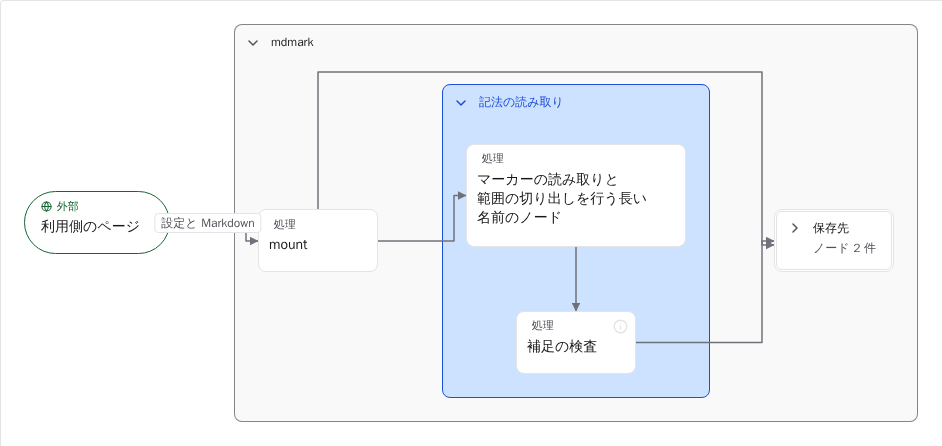
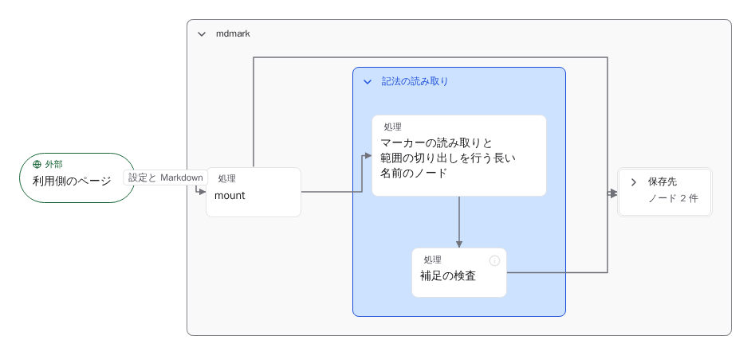
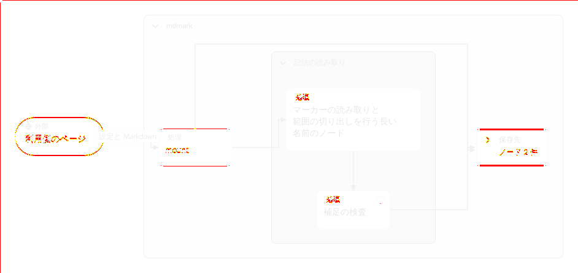
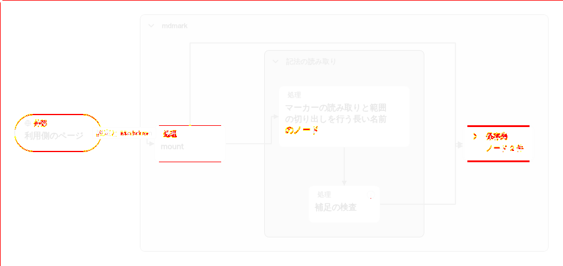

# ライブラリ本体

## 現状

| 分類 | ページ / ファイル | 概要 | 補足 |
| --- | --- | --- | --- |
| ドキュメント | [docs/scenario/SC-472-8.yaml](https://github.com/shuhei1101/mdmark/blob/develop/docs/scenario/SC-472-8.yaml) | Mermaid と補足で図を描く | 計画した変更の流れを追加 |
| ドキュメント | [docs/scenario/SC-472-42.yaml](https://github.com/shuhei1101/mdmark/blob/develop/docs/scenario/SC-472-42.yaml) | 図を拡大・縮小・移動する | 書き出し・一覧の表示を図の枠のパネルに配置する場合に更新 |
| ドキュメント | [docs/scenario/SC-472-87.yaml](https://github.com/shuhei1101/mdmark/blob/develop/docs/scenario/SC-472-87.yaml) | Mermaid と補足で書いた図を辿って読む | 追加する項目に追随 |
| ドキュメント | ER-472-2（map の補足）・DATA-472-2〜DATA-472-5 | 補足のキー（`notes`・`walkthroughs`・`layout`・`plays_over`・`groups`） | 計画した変更のキーを追加する場合に更新 |
| ドキュメント | IF-472-34（文書を HTML 文字列にする）・IF-472-39（設定と索引を点検する） | map の描画と点検の入出力 | 補足のキーの値の点検を追加する場合に更新 |
| ドキュメント | CMP-472-5（map の構成図）ほか map の部品（CMP-472-4・CMP-531-1・CMP-531-2・CMP-596-1〜3・CMP-649-1・CMP-653-1） | 図の種類ごとの部品 | 計画した変更の描き方、一覧の表示を追加する場合に更新 |
| ドキュメント | MOD-472-24〜MOD-472-28 と配下のモジュール（data.ts・check.ts・flow-view.ts・map.part.ts ほか） | map の読み取り・点検・配置・描画と操作 | 追加する項目に応じて更新 |
| ドキュメント | [docs/guide/図を描く-Mermaidと補足で図を描く.md](https://github.com/shuhei1101/mdmark/blob/develop/docs/guide/%E5%9B%B3%E3%82%92%E6%8F%8F%E3%81%8F-Mermaid%E3%81%A8%E8%A3%9C%E8%B6%B3%E3%81%A7%E5%9B%B3%E3%82%92%E6%8F%8F%E3%81%8F.md)・[docs/guide/記法.mark.md](https://github.com/shuhei1101/mdmark/blob/develop/docs/guide/%E8%A8%98%E6%B3%95.mark.md)・[docs/guide/用語集.mark.md](https://github.com/shuhei1101/mdmark/blob/develop/docs/guide/%E7%94%A8%E8%AA%9E%E9%9B%86.mark.md) | map の使い方集・補足のキー・用語 | 追加する項目の記載方法と用語を追加 |
| 実装 | [src/map/](https://github.com/shuhei1101/mdmark/tree/develop/src/map) | map の読み取り・点検・配置・描画と操作 | No 13〜17 に該当する処理は無い |

## 変更方針

| 対象 | 方針 | 補足 |
| --- | --- | --- |
| 追加する項目 | No 16・17 と、No 14 の計画した変更を追加する。No 13・15 は追加しない | ユーザーが推奨案 A を承認した後、No 13 は再確認で追加しないと決めた（[確認ログ](./確認ログ.yaml)） |
| No 16 の書き出し | 設計の前に PoC 検証で、HTML のノードと SVG の線を重ねた図をブラウザだけで外部の資源を持たない SVG と 2 倍の PNG にできるかを確認する | - |
| 補足のキー | 計画した変更は `changes` を、補足の `version` を変えずに新規のトップレベルのキーで追加する。キーは `notes` と同じ ID で、値は後から引数を追加できるオブジェクト（`{"type": …}` の `added`・`changed`・`removed`） | 知らないキーの扱いは今のとおり |
| 計画した変更を描く種類 | 構成図の部品の上に描く種類（flowchart・ER 図・状態遷移図・クラス図・アーキテクチャ図・C4 図）だけ。シーケンス図・マインドマップ・軸と格子の配置の図に記載したときは `map_invalid_value` | - |
| 計画した変更の色 | `added` は `--mdmark-color-diff-add-sign`、`removed` は `--mdmark-color-diff-del-sign`、`changed` は色の名前 `orange` | 差分の色に変更の色は無いため、既存の色の名前を使用する |
| 図の枠の操作 | 書き出しは map の図のパネルに配置し、一覧の表示は構成図の部品の上に描く種類とシーケンス図のパネルに配置する | - |
| PNG の倍率 | 端末の `devicePixelRatio` に依らず 2 倍に固定する | 書き出したファイルの大きさが端末で変わらず、高精細の画面と印刷でも文字がぼやけない |

## 設計書の確定コミット

| 工程 | 範囲 | 補足 |
| --- | --- | --- |
| 単一ユースケース設計 | `b477e1df..1db6cde1` | 推奨の案 A で記載した |
| 単一ユースケース設計 | `27b8c5d6..152923ea` | レビューの指摘の修正（SC-472-8） |
| 複合ユースケース設計 | `27b8c5d6..152923ea` | SC-472-87 に確信度と計画した変更を一覧で辿る正常シナリオを追加した |
| データ設計 | `152923ea..6d7a161c` | 補足の `trust`（DATA-472-33）・`changes`（DATA-472-34）を追加し、ER-472-2 に表と関連を追加した |
| データ設計 | `6d7a161c..c1fdd6cf` | 計画した変更の色の優先を記載し、再確認の回答で `trust`（DATA-472-33）と SC-472-8・SC-472-87 の確信度のシナリオを削除した |
| インターフェース定義設計 | `2855e4af..0aad594e` | IF-472-35 に制約『map の計画した変更』『map の図の書き出し』『map の一覧の表示』と 3 つのフロー、IF-472-39 に `changes` のずれと 1 つのフローを追加した |
| インターフェース定義設計 | `0bb7ec4b..2f43f988` | レビューの指摘の修正（書き出すボタンを Popover API と `aria-haspopup` を使用しない開閉するボタンにした） |
| 部品設計 | `2f43f988..866294ba` | CMP-472-5 に `changes`、CMP-472-39 に書き出すボタンと一覧の表示のボタン、部品『mapの一覧』（CMP-740-1）を追加した |
| 部品設計 | `6726cdc4..f599948c` | レビューの指摘の修正（一覧の項目を ID で指す。PNG にできないときの振る舞いを追加した） |
| モジュール構成設計 | `36a79bd7..cc520361` | data.ts・check.ts・map.part.ts・flow-view.ts・sequence-view.ts・diagram.part.ts・index.ts・index.css を更新し、export.ts（MOD-740-1）・list.part.ts（MOD-740-2）・list.ts（MOD-740-3）を追加した |

## PoC 結果

| 検証構成 | 成功条件 | 結果 | PoC PR | 補足 |
| --- | --- | --- | --- | --- |
| foreignObject の方式（計算したスタイルを書き写した DOM を foreignObject に入れる） | 外部の資源 0 件・中身・閉じたグループ・2 倍の PNG・画素 N・文字の位置 M | ✅ 画素 N 以外を 3 エンジンで満たす。画素は 1 px の位置の丸めによる差だけ | [#745](https://github.com/shuhei1101/mdmark/pull/745)（closed） | 採用 |
| SVG の要素へ置き換える方式（面と枠線を rect、文字を行ごとの text） | 同上 | ❌ 文字の位置が Firefox で 79.6 px、WebKit で 338.9 px ずれる | [#745](https://github.com/shuhei1101/mdmark/pull/745)（closed） | 不採用 |

結論: 成立。foreignObject の方式で、ブラウザだけで外部の資源を持たない SVG と 2 倍の PNG にできる。

測った値（Playwright 1.64.0 の公式イメージ。Chromium・Firefox・WebKit、倍率 1、`devicePixelRatio` 1）:

| 観点 | Chromium | Firefox | WebKit |
| --- | --- | --- | --- |
| 外部の資源（`href`・`url()`・`var()`） | 0 件 | 0 件 | 0 件 |
| ノードの名前・アイコン（3 つ）・枠線の色 | 全てある | 全てある | 全てある |
| 閉じたグループ（名前がある・中のノードが無い） | ✓ | ✓ | ✓ |
| PNG（汚染されない・幅と高さが 2 倍） | ✓（1884×892） | ✓（1888×892） | ✓（1884×892） |
| 揺れ（同じページを 2 回、画素・文字の中心） | 0 %・0 px | 0 %・0 px | 0 %・0 px |
| 閾値 N・M | 0 %・1 px | 0 %・1 px | 0 %・1 px |
| 文字の位置の差の最大（行ごとの中心） | 0.03 px | 0.00 px | 0.16 px |
| 違う画素（pixelmatch `includeAA: false`） | 0.78 % | 0.33 % | 0.79 % |
| 縁の 1 px を除いた違う画素 | 0.45 % | 0 % | 0.46 % |
| 縁を除き、1 px のずれを許した違う画素 | 0.0005 % | 0.0002 % | 0.034 % |
| 書き出しにかかった時間・SVG の大きさ | 71 ms・1.16 MB | 50 ms・0.93 MB | 42 ms・1.06 MB |

所感:
- 揺れが 0 のため N は 0 % になり、画素の条件は Chromium・WebKit で外れた。M（1 px）は 3 エンジンとも満たしている。差分画像のとおり、違う画素は撮った範囲の縁の線（ページの図を切り抜いたときに図の枠線が入る）と、いくつかのノードが 1 px 縦にずれた輪郭だけで、1 px のずれを許すとほぼ 0 になる。描き方の違いではなく位置の丸めと判断した
- WebKit で 1 px のずれを許しても残る 0.034 % は、文字の輪郭の濃さの違い。実機の Safari は未確認
- SVG が 1 MB 前後になるのは、全ての計算したスタイルを要素ごとに書き写したため。設計で、既定値と同じプロパティを省いて小さくする
- `::before`・`::after` で描いた要素は複製に含まれない。今の図では差が出ていないが、設計で疑似要素を使用する部品を確認する
- 選択の強調は PoC で扱っていない。書き出す前に強調を外すか、強調の class を外した状態で書き写すかは設計で決める

最小再現コードの要点（[poc/export-image/export.js](https://github.com/shuhei1101/mdmark/blob/36c66496/poc/export-image/export.js) の `exportForeign` と `toPng`）:

```js
const clone = stage.cloneNode(true);
const originals = [...stage.querySelectorAll("*")];
const copies = [...clone.querySelectorAll("*")];
inlineAll(stage, clone);            // getComputedStyle の全てのプロパティを style 属性へ書き写し、class を消す
originals.forEach((el, i) => {      // 当たり判定・データの印・ツールチップ・非表示の要素を外す
  if (el.matches(SKIP) || isHidden(el)) copies[i].remove();
});
dropVarAttributes(clone);           // 矢じりの fill="var(...)" など、var() を値に持つ属性を外す
clone.setAttribute("xmlns", XHTML_NS);
const svg = `<svg xmlns="${SVG_NS}" width="${width}" height="${height}">`
  + `<rect width="100%" height="100%" fill="${bg}"/>`
  + `<foreignObject width="${width}" height="${height}">${new XMLSerializer().serializeToString(clone)}</foreignObject></svg>`;

// PNG: data URL の img を 2 倍の canvas に描く。3 エンジンとも toDataURL は SecurityError にならない
img.src = `data:image/svg+xml;charset=utf-8,${encodeURIComponent(svg)}`;
canvas.width = width * 2; canvas.height = height * 2;
ctx.scale(2, 2); ctx.drawImage(img, 0, 0, width, height);
canvas.toDataURL("image/png");
```

PR の diff の見どころ: `export.js` の 2 方式と、`run.mjs` の成功条件の突き合わせ（`checkSvg`・`diffRatio`・`maxCenterDiff`）と、`edge-check.mjs` の縁を除いた再計測。

| ページの図（Chromium） | 書き出した SVG を単独で開いた図（Chromium） |
| --- | --- |
|  |  |

| 差分画像（Chromium） | 差分画像（WebKit） |
| --- | --- |
|  |  |

## 実装

| 項目 | 内容 |
| --- | --- |
| 足した・直したストーリー | `parts-mapflow--planned-changes` / `parts-diagramframe--map-export-open` / `parts-diagramframe--map-list-view` / `parts-diagramframe--map-list-view-narrow` / `parts-diagramframe--map-no-list` / `parts-diagramframe--map-export-failed` / `parts-maplist--flow` / `parts-maplist--with-changes` / `parts-maplist--sequence` / `parts-maplist--group-collapsed` / `parts-maplist--narrow` |

## テスト結果

### 単体

<!-- table: {"kind": "data"} -->

| ファイル | メソッド | 変更種別 | 結果 | 補足 |
| --- | --- | --- | --- | --- |
| `tests/unit/` | 全実行 | 実行のみ | ✅ | 328 ファイル・2707 テスト pass（ランナー）<br>`テスト結果/20261120210029_e1b09e9e_単体テスト.log`<br>Red は `テスト結果/20261120210026_cec86814_単体テスト.log`（テストコードの末尾 `cec86814`） |
| [tests/unit/src/map/data.test.ts](https://github.com/shuhei1101/mdmark/blob/develop/tests/unit/src/map/data.test.ts) | 全実行 | 変更 | ✅ | changes の読み取り |
| [tests/unit/src/map/check.test.ts](https://github.com/shuhei1101/mdmark/blob/develop/tests/unit/src/map/check.test.ts) | 全実行 | 変更 | ✅ | changes の点検 |
| [tests/unit/src/map/map.part.test.ts](https://github.com/shuhei1101/mdmark/blob/develop/tests/unit/src/map/map.part.test.ts) | 全実行 | 変更 | ✅ | 計画した変更の描画 |
| [tests/unit/src/diagram/diagram.part.test.ts](https://github.com/shuhei1101/mdmark/blob/develop/tests/unit/src/diagram/diagram.part.test.ts) | 全実行 | 変更 | ✅ | 書き出すボタン・一覧の表示のボタン |
| [tests/unit/src/map/flow-view.browser.test.ts](https://github.com/shuhei1101/mdmark/blob/develop/tests/unit/src/map/flow-view.browser.test.ts) | 全実行 | 変更 | ✅ | 計画した変更・一覧の表示 |
| [tests/unit/src/map/sequence-view.browser.test.ts](https://github.com/shuhei1101/mdmark/blob/develop/tests/unit/src/map/sequence-view.browser.test.ts) | 全実行 | 変更 | ✅ | シーケンス図の一覧の表示 |
| [tests/unit/src/map/index.browser.test.ts](https://github.com/shuhei1101/mdmark/blob/develop/tests/unit/src/map/index.browser.test.ts) | 全実行 | 変更 | ✅ | 全ての種類の書き出すボタン |
| `tests/unit/src/map/export.browser.test.ts` | 全実行 | 新規 | ✅ | 書き出し |
| `tests/unit/src/map/list.part.test.ts` | 全実行 | 新規 | ✅ | 一覧の部品 |
| `tests/unit/src/map/list.browser.test.ts` | 全実行 | 新規 | ✅ | 一覧の項目と操作 |

<!-- /table -->

lint は `テスト結果/20261120205821_e1b09e9e_lint.log`（Biome・ESLint・tsc・actionlint の全てが終了コード 0）。

実装の工程で直したテスト（設計書との食い違いではなく、テストの書き方の誤り）:

| テスト | 直したこと | 理由 | テストを直した commit | 実装と同じ commit になった理由 |
| --- | --- | --- | --- | --- |
| `test_export_map_svg` | 外を指す `url(` だけを誤りにする | 矢じりの `marker-end` は図の中の `#` を指す `url(` で、外部の資源ではない。設計書 [MOD-740-1](../../module/MOD-740-1.ts.yaml) の `expected`・`process` も同じく直した | `70b50ae3`・`45c548d8`・`9758d485` | 書き出しの `url()` の書き写し方（`export.ts`）と、それを確かめる正規表現を、ランナーの fail を見ながら 1 つの修正として直した |
| `test_attach_map_export_when_escape` | 書き出すボタンを押す前にパネルを開く | 畳んだパネルでは書き出すボタンが隠れ、フォーカスを戻せない。設計書の `condition` も直した | `45c548d8` | 同じ fail の調査の中で、`export.ts` の修正と一緒に commit した |
| `test_attach_map_flow_when_changes` | `attachMap` で付け、警告を補足のパス `changes.data` で探す | 記載の警告は `attachMap` が出し、文は誤りの値ではなくパスを持つ | `45c548d8`・`9758d485` | 同じ fail の調査の中で、`export.ts`・`index.css` の修正と一緒に commit した |

### 結合テストの実行範囲

<!-- table: {"kind": "data"} -->

| 変更したファイル | 結果 | 実行する結合テスト | 結合テストが無いエントリーポイント |
| --- | --- | --- | --- |
| `docs/component/`・`docs/data/`・`docs/er/`・`docs/interface/`・`docs/module/`・`docs/scenario/` の設計書（20 ファイル） | R7 | - | - |
| `docs/mock/` のモック（8 ファイル） | R7 | - | - |
| `docs/pr/740/` の PR ドキュメント | R7 | - | - |
| `docs/guide/図を描く-Mermaidと補足で図を描く.md`・`docs/guide/記法.mark.md`・`docs/guide/用語集.mark.md`・`docs/guide/用語集.yaml` | R7 | - | - |
| `src/files.yaml` | R7 | - | - |
| `tests/unit/` の単体テスト（10 ファイル） | R7 | - | - |
| `src/diagram/diagram.part.ts`・`src/diagram/diagram-frame.part.stories.ts`・`scripts/storybook-render.ts` | R7 | `tests/integration/lib/diagram-frame.story.test.ts` | - |
| `src/map/map.part.ts`・`src/map/map-flow.part.stories.ts` | R7 | `tests/integration/lib/map-flow.story.test.ts` | - |
| `src/map/list.part.ts`・`src/map/list.ts`・`src/map/map-list.part.stories.ts` | R7 | `tests/integration/lib/map-list.story.test.ts`（新規作成） | - |
| `src/map/data.ts`・`src/map/check.ts` | R7 | `tests/integration/lib/check-config.test.ts` | - |
| `src/map/export.ts`・`src/map/flow-view.ts`・`src/map/sequence-view.ts`・`src/map/index.ts`・`src/map/axis-grid-view.ts`・`src/map/mindmap-view.ts`・`src/index.css`・`src/shared/icons.part.ts` | R7 | `tests/integration/lib/mount.browser.test.ts` | - |

<!-- /table -->

結合テストの層（TL-3）は `excluded_paths`・`full_run_paths`・`folder_map` を持たないため、全ての行が R7。
実行する結合テストは、変更した部品と関数の設計書の `test_file`（[CMP-472-39](../../component/CMP-472-39.ts.yaml)・[CMP-472-5](../../component/CMP-472-5.ts.yaml)・[CMP-740-1](../../component/CMP-740-1.ts.yaml)・[IF-472-39](../../interface/IF-472-39.ts.yaml)・[IF-472-35](../../interface/IF-472-35.ts.yaml)）の 5 ファイルだけにした。
設計書・モック・PR ドキュメント・公開ドキュメント・`src/files.yaml` は、結合テストが読み込まない（公開ドキュメントはプラグインのビルドの入力に入るが、内容を確かめる結合テストは無い）。
ほかの map の種類のストーリー（ER 図・状態遷移図・クラス図など）は `renderMapFlow` を通るが、`changes` を指定しない描画は変わらないため含めない。
