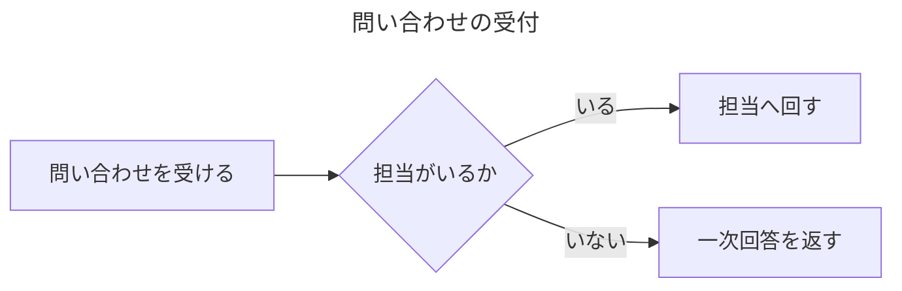

# mermaidの図を描く

mermaid のコードブロックを書いて mdmark の見た目の図にし、テーマを変える手順

ほかのツールで書いた mermaid を、VS Code のプレビューと書き出した HTML で図にして読ませるときに実行する。

## 前提

- [文書を描く](../導入/文書を描く.md)
- 設定の `features.mermaid` がオン（既定）。オフにする手順は [機能をオン・オフする](../カスタマイズ/機能をオン・オフする.md)

## 手順

### mermaid のコードブロックを書く

````markdown

````

言語を `mermaid` にしたコードブロックが、図の枠に入った図になる。
front matter の `title` が図の枠のタイトルになり、図の中には重ねて描かない。
`title` が無ければ `accTitle`、どちらも無ければ図の種類の名前（`フローチャート`・`シーケンス図` など）がタイトルになる。
シーケンス図の `actor` は、mdmark のほかの図と同じ人のアイコンで描く。
書き方の一覧は [mermaid のコードブロック](../../リファレンス/記法.md#mermaid-のコードブロック)。

### テーマを変える

```yaml
mermaid:
  theme: neutral
  themeVariables:
    primaryColor: "#e0f2f1"
```

既定のテーマ `mdmark` は、描いた文書の配色（`--mdmark-color-*` の CSS 変数）から図の色を作り、明暗を切り替えると図も描き直す。
`theme` に mermaid のテーマの名前（`default`・`neutral`・`dark`・`forest`・`base`）を書くと、そのテーマで描く。
`themeVariables` は、選んだテーマの変数に重ねる。
どのテーマでも、グラデーションと影は付けない。
キーの一覧は [mermaid の設定](../../リファレンス/設定.md#mermaid-の設定)。

### 読み込み先を差し替える

```yaml
mermaid:
  url: /vendor/mermaid/mermaid.esm.min.mjs
```

既定では、版を固定した jsDelivr の URL から、mermaid のコードブロックがある文書でだけ読む。
外へ要求できない環境では、mermaid の `dist/` をそのまま置いた場所を指す。
`mdmark export`・`mdmark build` は、mermaid のコードブロックがある文書のときだけ mermaid を 1 枚の HTML に埋めるため、開いたときに外へ要求しない（[1枚にまとめる仕組み](../../はじめに/コアコンセプト/1枚にまとめる仕組み.md)）。

### 読む人ができること

図の枠の右上のボタンとキーの `+`・`-`・`0` で拡大・縮小し、ドラッグと矢印キーで動かし、全画面で開き、右下のリサイズハンドルで高さを変える。
操作は [図を描く](./図を描く.md#読む人ができること)。

## 反映

即時。`mount` と `update` で描くたびに、mermaid のコードブロックから描き直す。
`render` が返す HTML 文字列は図にせず、コードブロックのまま返す。

## 確認

#### 図が描かれている

```js
[...document.querySelectorAll(".mdmark figure.mdmark-diagram")].map((f) => f.dataset.diagram)
```

書いた順に `mermaid` が出る。
図の枠のタイトルが front matter の `title` の文字になっている。

#### 読めないとき・書き方を誤ったとき

`mermaid.url` を無いファイルにすると、コードブロックの上にタイトル `この図を表示できません` の枠が出て、コードブロックのまま残る。
図の種類の行が無いソースを書くと、コードブロックの上にタイトル `書き方の警告` の枠が出て、`mermaid の図を描けません（` から始まる文が書かれる。

見た目と操作は [描いた図を確かめる](./描いた図を確かめる.md) の手順で通す。

## 元に戻す

コードブロックの言語を `mermaid` 以外にするか、コードブロックを削除する。
mermaid の図を描く機能ごと止めるときは、`features.mermaid` をオフにする。
オフにすると mermaid を読まず、コードブロックのまま描く。
