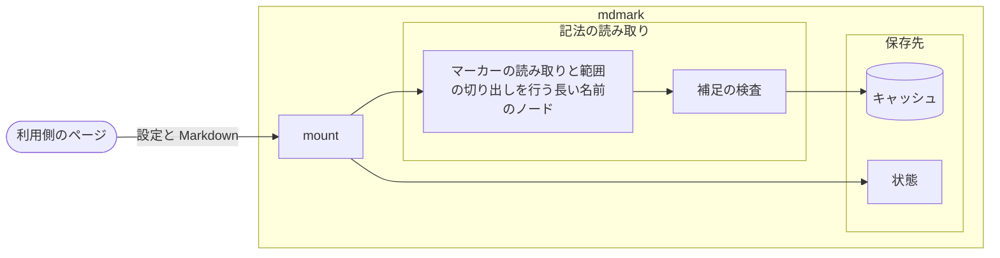

# 書き出しの PoC

<!-- map: {"title": "全体の構成"} -->

<!-- map-data: {"version": 1, "notes": {"data": {"text": "補足を検査する"}}, "layout": {"store": {"collapsed": true}, "read": {"color": "blue"}}} -->

<!-- /map -->
