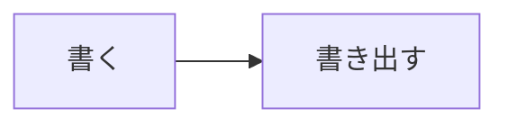

<!-- features: {"html-scripts": true} -->

# mdmark の紹介

<!-- toc -->

mdmark は Markdown を描きます。ワークスペースで使います。[使い方](./guide.md#手順) を参照。

<!-- ただのコメント（マーカーではない） -->

<!-- greet: {"target": "利用者"} -->

## タブ

<!-- tabs: {"group": "os"} -->

### macOS

macOS の手順。

### Windows

Windows の手順。

<!-- /tabs -->

## 表

<!-- table: {"kind": "data"} -->

| 名前 | 件数 |
| --- | --- |
| b | 2 |
| a | 10 |
| c | 1 |

<!-- /table -->

## 図



## HTML

<!-- html -->

```html
<div class="box mdmark-align-center">箱</div>
<mdmark-chart>
{"type": "bar", "title": "件数", "scope": "今週", "updated": "2026-11-14", "x": {"label": "窓口", "ticks": ["メール", "電話"]}, "y": {"label": "件"}, "series": [{"name": "件", "points": [3, 5]}]}
</mdmark-chart>
```

```css
.box { color: var(--mdmark-color-accent); }
```

```js
export default function (root) { root.querySelector(".box").textContent = "箱（スクリプト）"; }
```

<!-- /html -->

<p class="mdmark-align-center">中央</p>

## コードの例

```html
<mdmark-chart>{}</mdmark-chart>
```

脚注の例[^1]。

[^1]: 脚注の本文。
