# classDiagram の mermaid の公式の記法の例

mermaid 12.3.0 の公式ドキュメント（`docs/syntax/`）の `mermaid-example` のコードブロックのうち、図の種類が `classDiagram` のものを、そのまま並べた見本。

<!-- 出典: docs/syntax/classDiagram.md -->

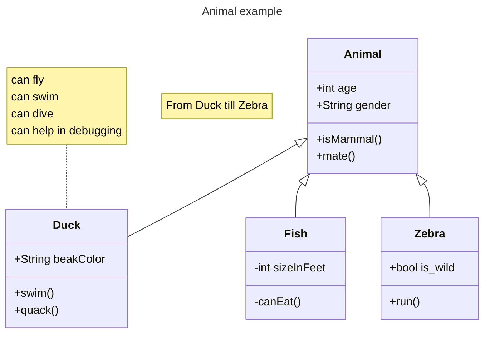

<!-- 出典: docs/syntax/classDiagram.md -->

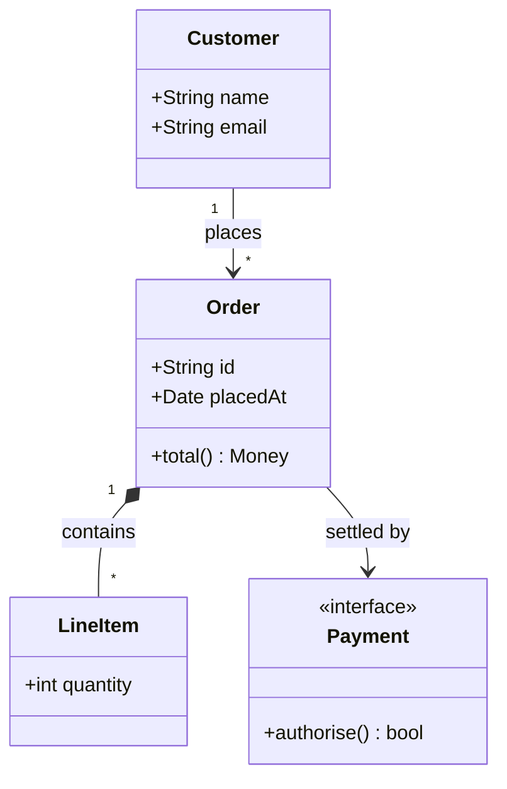

<!-- 出典: docs/syntax/classDiagram.md -->


<!-- 出典: docs/syntax/classDiagram.md -->

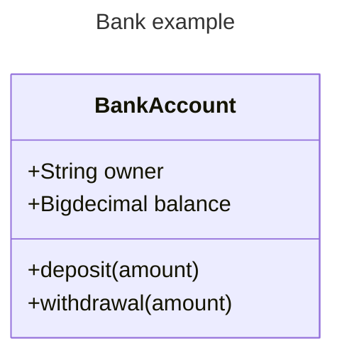

<!-- 出典: docs/syntax/classDiagram.md -->

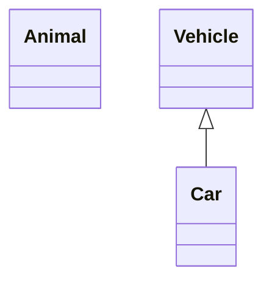

<!-- 出典: docs/syntax/classDiagram.md -->

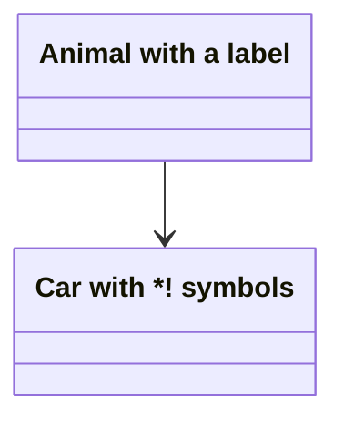

<!-- 出典: docs/syntax/classDiagram.md -->

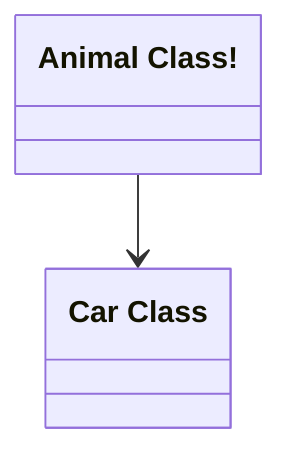

<!-- 出典: docs/syntax/classDiagram.md -->

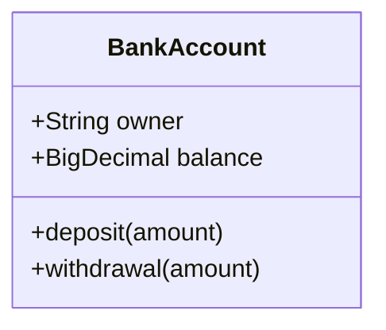

<!-- 出典: docs/syntax/classDiagram.md -->


<!-- 出典: docs/syntax/classDiagram.md -->

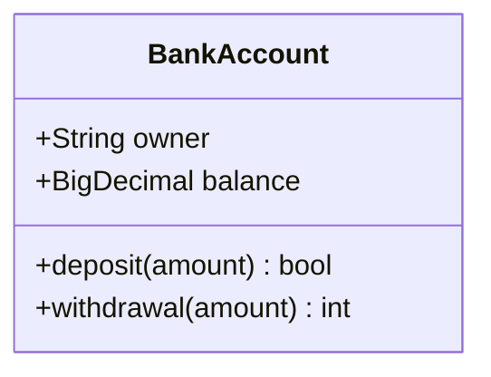

<!-- 出典: docs/syntax/classDiagram.md -->

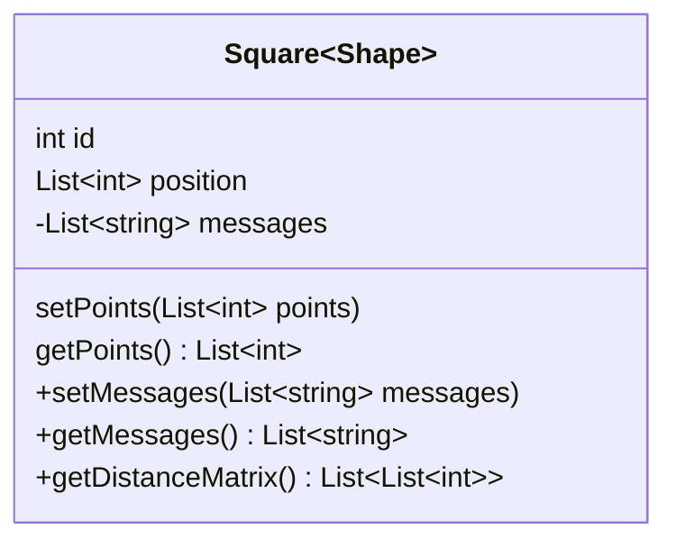

<!-- 出典: docs/syntax/classDiagram.md -->

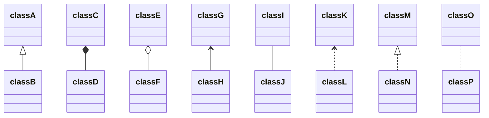

<!-- 出典: docs/syntax/classDiagram.md -->

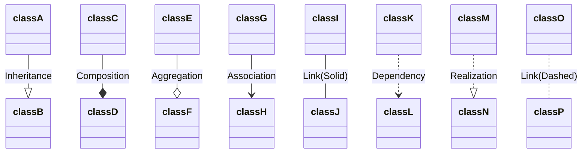

<!-- 出典: docs/syntax/classDiagram.md -->

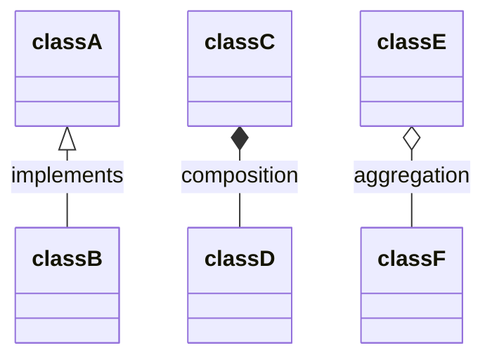

<!-- 出典: docs/syntax/classDiagram.md -->

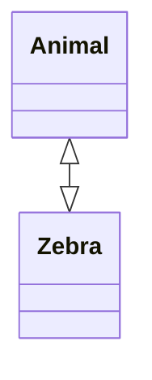

<!-- 出典: docs/syntax/classDiagram.md -->

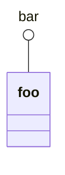

<!-- 出典: docs/syntax/classDiagram.md -->

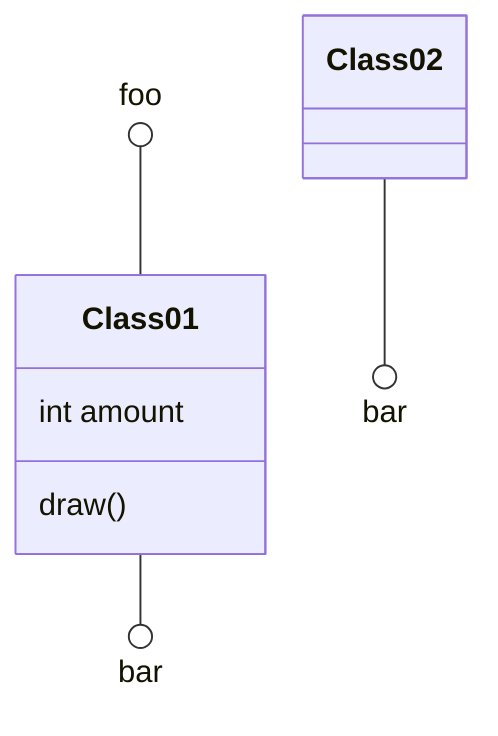

<!-- 出典: docs/syntax/classDiagram.md -->

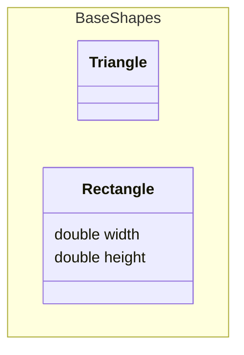

<!-- 出典: docs/syntax/classDiagram.md -->

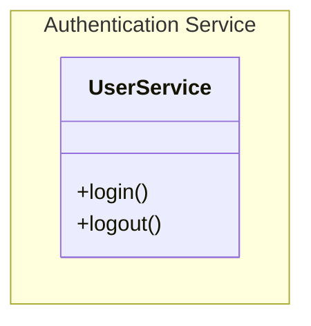

<!-- 出典: docs/syntax/classDiagram.md -->

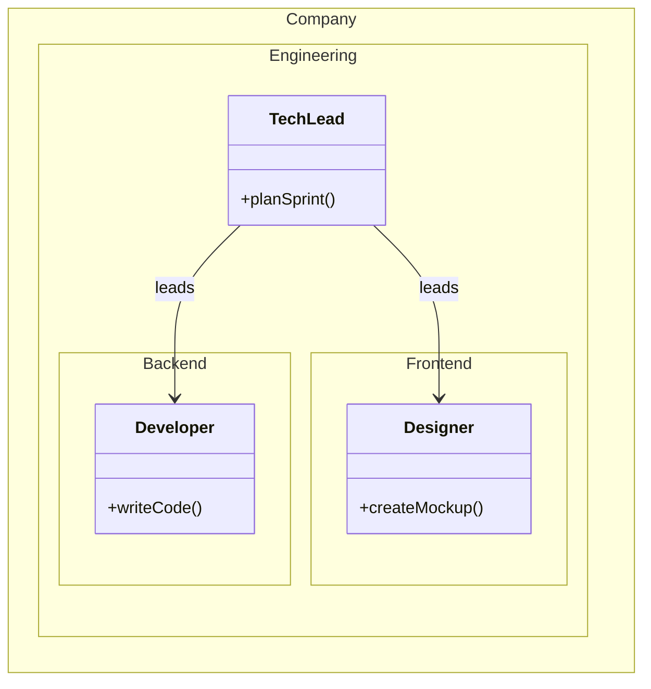

<!-- 出典: docs/syntax/classDiagram.md -->

```mermaid
classDiagram
    namespace Platform {
        namespace Auth {
            class UserService {
                +login()
                +logout()
            }
        }
        namespace Data {
            class Repository {
                +find()
                +save()
            }
        }
        class Gateway {
            +route()
        }
    }
    Gateway --> UserService : delegates
    Gateway --> Repository : delegates
```

<!-- 出典: docs/syntax/classDiagram.md -->

```mermaid
---
config:
  class:
    hierarchicalNamespaces: false
---
classDiagram
    namespace Company.Engineering.Backend {
        class Developer {
            +writeCode()
        }
    }
    namespace Company.Engineering.Frontend {
        class Designer {
            +createMockup()
        }
    }
    namespace Company {
        class CEO {
            +makeDecisions()
        }
    }
    CEO --> Developer : oversees
    CEO --> Designer : oversees
```

<!-- 出典: docs/syntax/classDiagram.md -->

```mermaid
classDiagram
    Customer "1" --> "*" Ticket
    Student "1" --> "1..*" Course
    Galaxy --> "many" Star : Contains
```

<!-- 出典: docs/syntax/classDiagram.md -->

```mermaid
classDiagram
  class Shape <<interface>>
```

<!-- 出典: docs/syntax/classDiagram.md -->

```mermaid
classDiagram
class Shape
<<interface>> Shape
Shape : noOfVertices
Shape : draw()
```

<!-- 出典: docs/syntax/classDiagram.md -->

```mermaid
classDiagram
class Shape{
    <<interface>>
    noOfVertices
    draw()
}
class Color{
    <<enumeration>>
    RED
    BLUE
    GREEN
    WHITE
    BLACK
}
```

<!-- 出典: docs/syntax/classDiagram.md -->

```mermaid
classDiagram
%% This whole line is a comment classDiagram class Shape <<interface>>
class Shape{
    <<interface>>
    noOfVertices
    draw()
}
```

<!-- 出典: docs/syntax/classDiagram.md -->

```mermaid
classDiagram
  direction RL
  class Student {
    -idCard : IdCard
  }
  class IdCard{
    -id : int
    -name : string
  }
  class Bike{
    -id : int
    -name : string
  }
  Student "1" --o "1" IdCard : carries
  Student "1" --o "1" Bike : rides
```

<!-- 出典: docs/syntax/classDiagram.md -->

```mermaid
classDiagram
    note "This is a general note"
    note for MyClass "This is a note for a class"
    class MyClass{
    }
```

<!-- 出典: docs/syntax/classDiagram.md -->

```mermaid
classDiagram
class Shape
link Shape "https://www.github.com" "This is a tooltip for a link"
class Shape2
click Shape2 href "https://www.github.com" "This is a tooltip for a link"
```

<!-- 出典: docs/syntax/classDiagram.md -->

```mermaid
classDiagram
class Shape
callback Shape "callbackFunction" "This is a tooltip for a callback"
class Shape2
click Shape2 call callbackFunction() "This is a tooltip for a callback"
```

<!-- 出典: docs/syntax/classDiagram.md -->

```mermaid
classDiagram
    class Class01
    class Class02
    callback Class01 "callbackFunction" "Callback tooltip"
    link Class02 "https://www.github.com" "This is a link"
    class Class03
    class Class04
    click Class03 call callbackFunction() "Callback tooltip"
    click Class04 href "https://www.github.com" "This is a link"
```

<!-- 出典: docs/syntax/classDiagram.md -->

```mermaid
classDiagram
  class Animal
  class Mineral
  style Animal fill:#f9f,stroke:#333,stroke-width:4px
  style Mineral fill:#bbf,stroke:#f66,stroke-width:2px,color:#fff,stroke-dasharray: 5 5
```

<!-- 出典: docs/syntax/classDiagram.md -->

```mermaid
classDiagram
    class Animal:::someclass
    classDef someclass fill:#f96
```

<!-- 出典: docs/syntax/classDiagram.md -->

```mermaid
classDiagram
    class Animal:::someclass {
        -int sizeInFeet
        -canEat()
    }
    classDef someclass fill:#f96
```

<!-- 出典: docs/syntax/classDiagram.md -->

```mermaid
classDiagram
  class Animal:::pink
  class Mineral

  classDef default fill:#f96,color:red
  classDef pink color:#f9f
```

<!-- 出典: docs/syntax/classDiagram.md -->

```mermaid
classDiagram
    class Animal:::styleClass
```

<!-- 出典: docs/syntax/classDiagram.md -->

```mermaid
---
  config:
    class:
      hideEmptyMembersBox: true
---
classDiagram
  class Duck
```
