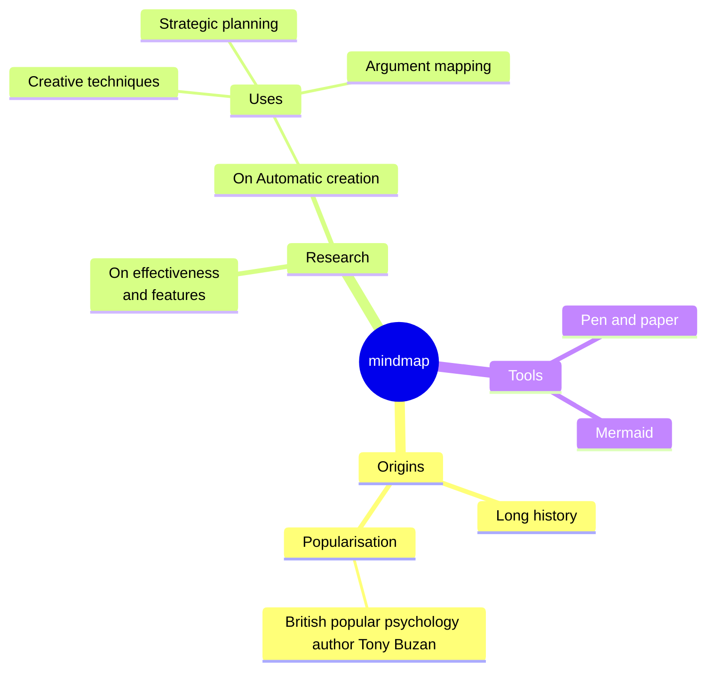
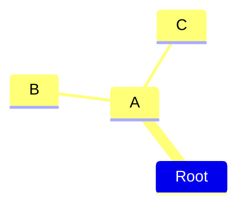
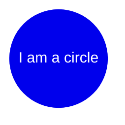
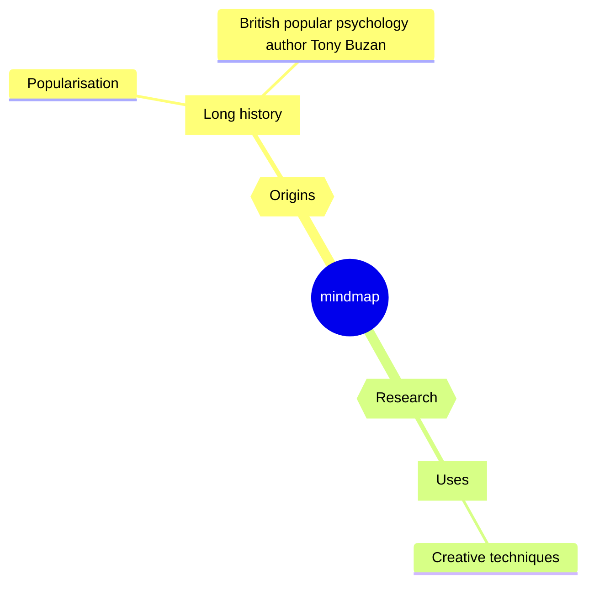
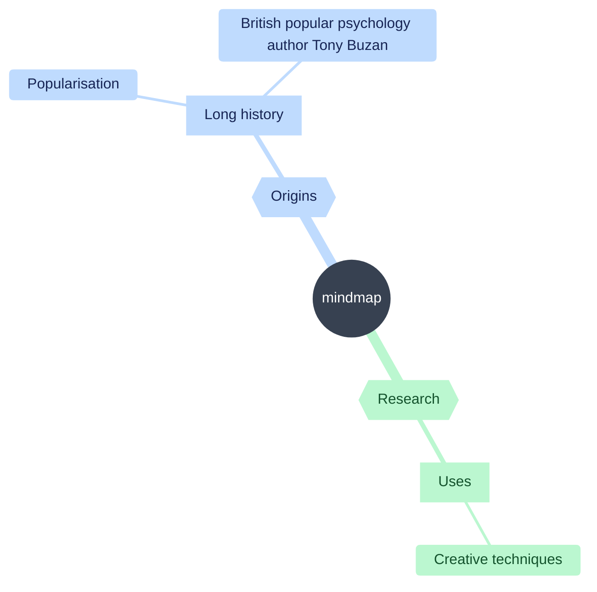
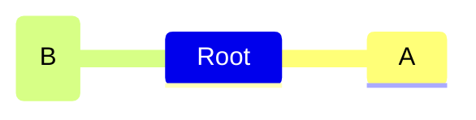
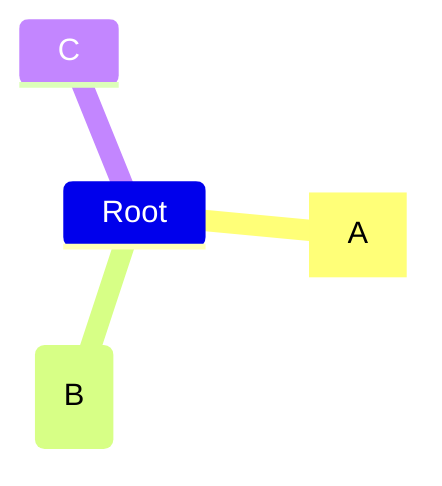
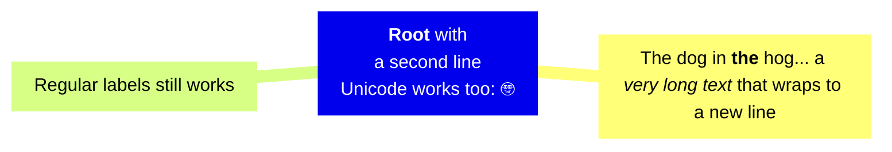

# mindmap の mermaid の公式の記法の例

mermaid 12.3.0 の公式ドキュメント（`docs/syntax/`）の `mermaid-example` のコードブロックのうち、図の種類が `mindmap` のものを、そのまま並べた見本。

<!-- 出典: docs/syntax/mindmap.md -->

<!-- 出典: docs/syntax/mindmap.md -->

<!-- 出典: docs/syntax/mindmap.md -->

<!-- 出典: docs/syntax/mindmap.md -->

<!-- 出典: docs/syntax/mindmap.md -->

<!-- 出典: docs/syntax/mindmap.md -->

<!-- 出典: docs/syntax/mindmap.md -->

<!-- 出典: docs/syntax/mindmap.md -->

<!-- 出典: docs/syntax/mindmap.md -->

<!-- 出典: docs/syntax/mindmap.md -->

<!-- 出典: docs/syntax/mindmap.md -->

<!-- 出典: docs/syntax/mindmap.md -->

<!-- 出典: docs/syntax/mindmap.md -->

<!-- 出典: docs/syntax/mindmap.md -->

<!-- 出典: docs/syntax/mindmap.md -->

