# stateDiagram の mermaid の公式の記法の例

mermaid 12.3.0 の公式ドキュメント（`docs/syntax/`）の `mermaid-example` のコードブロックのうち、図の種類が `stateDiagram` のものを、そのまま並べた見本。

<!-- 出典: docs/syntax/stateDiagram.md -->

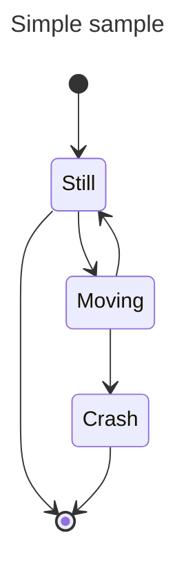

<!-- 出典: docs/syntax/stateDiagram.md -->

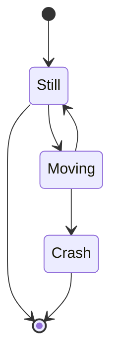

<!-- 出典: docs/syntax/stateDiagram.md -->

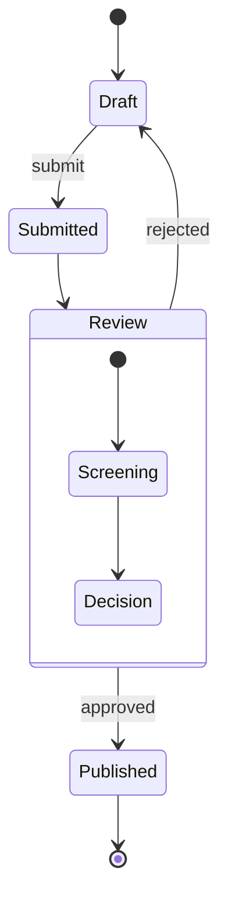

<!-- 出典: docs/syntax/stateDiagram.md -->


<!-- 出典: docs/syntax/stateDiagram.md -->

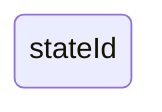

<!-- 出典: docs/syntax/stateDiagram.md -->

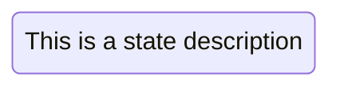

<!-- 出典: docs/syntax/stateDiagram.md -->


<!-- 出典: docs/syntax/stateDiagram.md -->

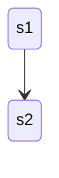

<!-- 出典: docs/syntax/stateDiagram.md -->

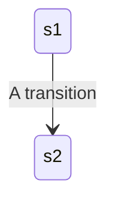

<!-- 出典: docs/syntax/stateDiagram.md -->

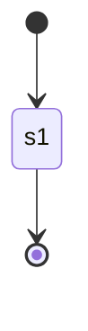

<!-- 出典: docs/syntax/stateDiagram.md -->

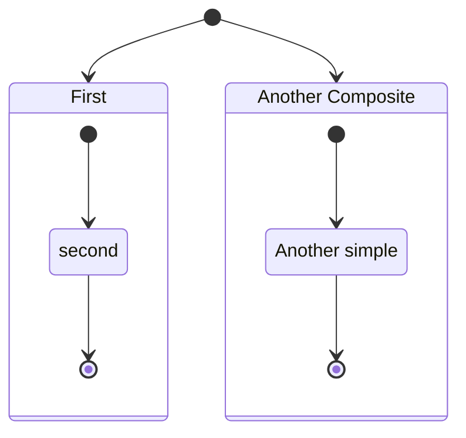

<!-- 出典: docs/syntax/stateDiagram.md -->

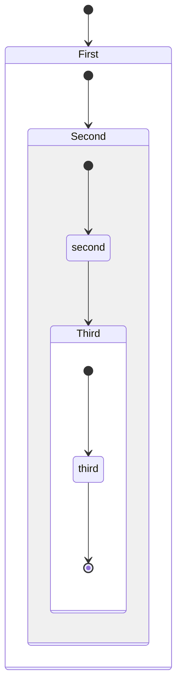

<!-- 出典: docs/syntax/stateDiagram.md -->

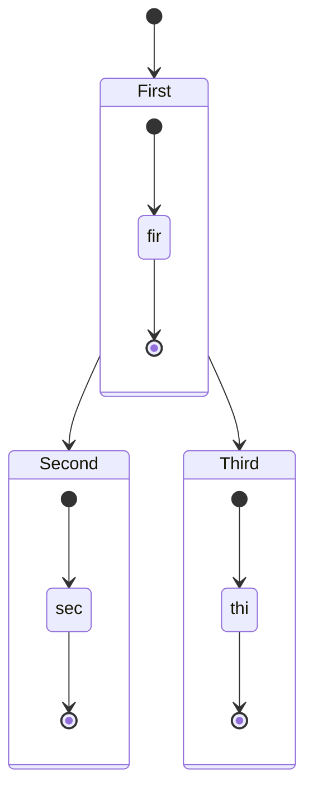

<!-- 出典: docs/syntax/stateDiagram.md -->

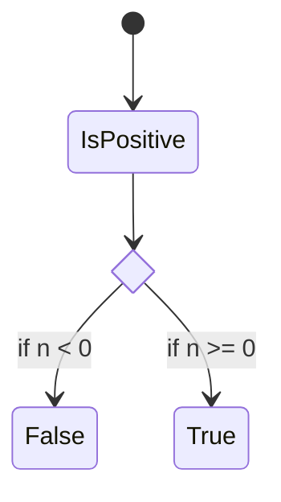

<!-- 出典: docs/syntax/stateDiagram.md -->

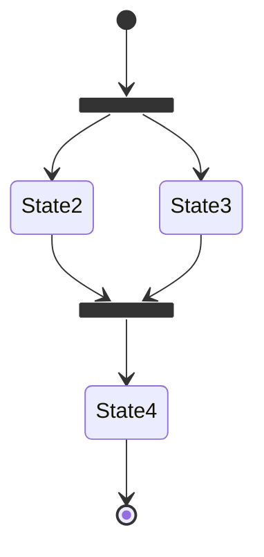

<!-- 出典: docs/syntax/stateDiagram.md -->

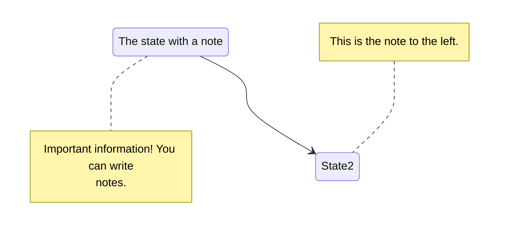

<!-- 出典: docs/syntax/stateDiagram.md -->

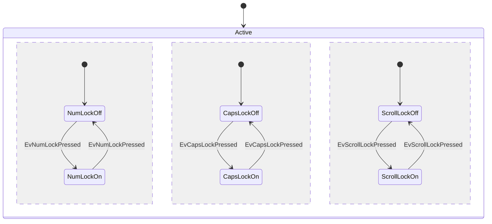

<!-- 出典: docs/syntax/stateDiagram.md -->

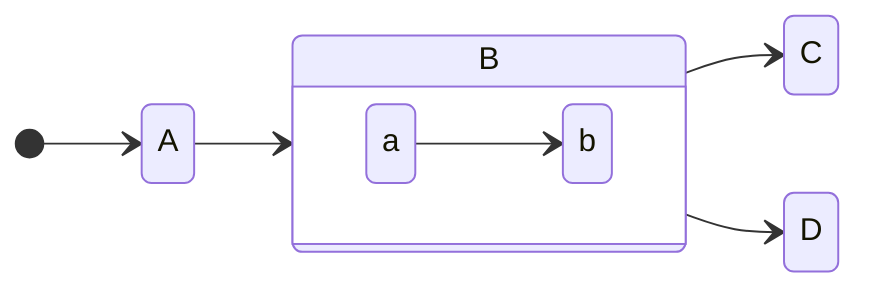

<!-- 出典: docs/syntax/stateDiagram.md -->


<!-- 出典: docs/syntax/stateDiagram.md -->

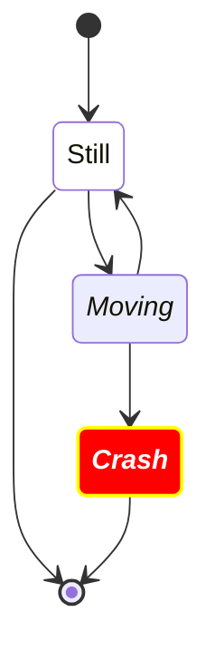

<!-- 出典: docs/syntax/stateDiagram.md -->

```mermaid
stateDiagram
   direction TB

   accTitle: This is the accessible title
   accDescr: This is an accessible description

   classDef notMoving fill:white
   classDef movement font-style:italic;
   classDef badBadEvent fill:#f00,color:white,font-weight:bold,stroke-width:2px,stroke:yellow

   [*] --> Still:::notMoving
   Still --> [*]
   Still --> Moving:::movement
   Moving --> Still
   Moving --> Crash:::movement
   Crash:::badBadEvent --> [*]
```

<!-- 出典: docs/syntax/stateDiagram.md -->

```mermaid
stateDiagram
    classDef yourState font-style:italic,font-weight:bold,fill:white

    yswsii: Your state with spaces in it
    [*] --> yswsii:::yourState
    [*] --> SomeOtherState
    SomeOtherState --> YetAnotherState
    yswsii --> YetAnotherState
    YetAnotherState --> [*]
```
